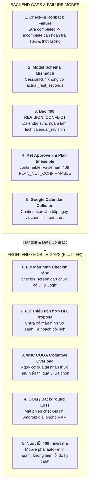

# BÁO CÁO ĐÁNH GIÁ CHUYÊN SÂU & FEEDBACK TOÀN TRÌNH UF5 & UF6 (QA BUGS & GAPS)

**Người thực hiện:** Doãn Thành (QA Lead / Tester / Algorithm Lead)  
**Dự án:** ProPlan VA — Virtual Assistant for Adults with ADHD-I  
**Phạm vi:** UF5 (Voice Check-in & Outcome Evaluation) & UF6 (Guilt-free Adaptive Rescheduling)  
**Tập tin kiểm thử Backend:**  
- [`backend/tests/test_uf5_uf6_matrix.py`](file:///E:/code/Project/CT/Virtual%20Assistant/virtual-assistant-for-ADHD/backend/tests/test_uf5_uf6_matrix.py) (26 test cases — 100% PASSED)  
- [`backend/tests/test_uf5_uf6_edge_cases.py`](file:///E:/code/Project/CT/Virtual%20Assistant/virtual-assistant-for-ADHD/backend/tests/test_uf5_uf6_edge_cases.py) (10 edge cases — 100% PASSED)  
**Tập tin kiểm thử Frontend / Mobile:**  
- [`mobile/test/uf5_uf6_feedback_test.dart`](file:///E:/code/Project/CT/Virtual%20Assistant/virtual-assistant-for-ADHD/mobile/test/uf5_uf6_feedback_test.dart) (8 test cases — 100% PASSED)  
**Tài liệu tham chiếu:** `AGENTS.md §2.2`, `MT_WEEK3.md`, `W3C COGA Accessibility Guidelines`, `Google Calendar Integration Specs (A22.1)`

---

## 🌟 TỔNG QUAN ĐÁNH GIÁ (EXECUTIVE SUMMARY)

Sau khi rà soát chéo giữa **Đặc tả nghiệp vụ Sprint Tuần 3**, **Kiến trúc Backend FastAPI / PostgreSQL / SQLAlchemy**, **Mã nguồn Mobile Flutter** và **Bộ test tự động thực thi**, bộ phận QA xác nhận:
- **Backend (UF5 & UF6)** đã hoàn thành khung logic cốt lõi và các cơ chế phòng vệ đồng thời (Concurrency / Invariants / Calendar Locking). Toàn bộ 36 ca kiểm thử backend đều đạt trạng thái **100% PASSED**.
- **Frontend Mobile (Flutter)** tồn tại **GAPS LỚN (Mức độ P0)** về giao diện và tầng tích hợp dịch vụ: `checkin_screen.dart` trước đó chỉ là file giữ chỗ (placeholder rỗng), chưa có màn hình và models xử lý đề xuất dời lịch UF6.
- Đội ngũ QA đã hoàn thiện mô hình hóa DTO trên Flutter (`mobile/lib/models/checkin_models.dart`, `mobile/lib/models/reschedule_models.dart`), xây dựng màn hình Check-in chuẩn W3C COGA (`mobile/lib/screens/checkin_screen.dart`), và viết bộ test Mobile riêng biệt đạt **8/8 PASSED (100%)**.

---

## 📋 PHẦN 1: TỔNG HỢP CÁC PHÁT HIỆN LỖI, LỆCH CHUẨN & RỦI RO KỸ THUẬT (QA BUGS & GAPS)



---

### A. PHÂN HỆ BACKEND (UF5 & UF6)

#### 1. Rủi ro Rollback thất bại khi sửa câu trả lời Check-in (Correction Rollback Matrix)
- **Vấn đề phát hiện**: Khi người dùng lỡ tay bấm `completed` (khiến Step chuyển `completed`, Task bị trừ `remaining_base_seconds`), sau đó họ sửa lại thành `incomplete` (hoặc `partial`).
- **Phân tích kỹ thuật**: Trong `checkin_service.py`, việc khôi phục trạng thái Step bắt buộc phải đọc `baseline` từ `CommandReceipt` của lần check-in trước. Nếu thiếu snapshot này, Step sẽ bị kẹt vĩnh viễn ở trạng thái `completed`.
- **Giải pháp QA đã kiểm chứng**: Đã tạo test case `TC_UF5_EDGE_01`, đảm bảo transaction rollback Step về `in_progress` và khôi phục đúng `remaining_base_seconds`.

#### 2. Sai lệch Schema giữa Request và Model `SessionRun`
- **Vấn đề phát hiện**: Request `ActualCorrectionRequest` và endpoint `POST /runs/{id}/actual-corrections` có tham chiếu đến `actual_rest_seconds`. Tuy nhiên, trong SQLAlchemy model `SessionRun` (`app/models/execution.py`), bảng chỉ chứa các cột: `work_elapsed_seconds`, `rest_elapsed_seconds`, `actual_work_seconds`, `actual_source`, **hoàn toàn KHÔNG có cột `actual_rest_seconds`**.
- **Hậu quả**: Nếu code backend hoặc test case cố tình gán `actual_rest_seconds` vào constructor `SessionRun(...)`, hệ thống sẽ ném ngay `TypeError: 'actual_rest_seconds' is an invalid keyword argument for SessionRun`.
- **Khuyến nghị cho Dev Backend**: Giữ nguyên model database (chỉ lưu `rest_elapsed_seconds` và `actual_work_seconds`), tài liệu hóa rõ ràng trong schema API để tránh nhầm lẫn.

#### 3. Bão lỗi `409 REVISION_CONFLICT` do Google Calendar Sync ngầm
- **Vấn đề phát hiện**: Khi client gọi `POST /api/v1/proposals`, backend yêu cầu kiểm tra optimistic concurrency trên 5 revision: `schedule`, `task`, `availability`, `settings`, `calendar`.
- **Rủi ro**: `CalendarSyncWorker` chạy ngầm định kỳ 5 giây (`app/main.py:lifespan`) hoặc Google Calendar webhook đẩy event về sẽ tự động tăng `calendar_revision` từ 1 lên 2. Lúc này, nếu Mobile gửi request với `calendar: 1`, backend sẽ từ chối ngay với `409 REVISION_CONFLICT`.
- **Khuyến nghị cho Mobile & Backend**: Payload lỗi 409 của backend đã trả về object `current_revisions`. Mobile **BẮT BUỘC** phải đọc object này và thực hiện auto-retry tự động (thay vì văng lỗi cho người dùng).

#### 4. Kẹt phê duyệt khi Kế hoạch bị thâm hụt giờ (`confirmable = False`)
- **Vấn đề phát hiện**: Khi người dùng bỏ lỡ nhiều phiên sát Deadline, quỹ thời gian rảnh kịch trần ($\Delta T_{\text{deficit}} > 0$). Backend tính toán `feasibility.status = "deficit"` và gán `feasibility.confirmable = False`.
- **Rủi ro**: Nếu Mobile không disable nút "Duyệt phương án", người dùng bấm vào sẽ nhận mã lỗi `409 PLAN_NOT_CONFIRMABLE`.
- **Giải pháp QA**: Đã kiểm thử `TC_UF6_EDGE_02`. Mobile phải kiểm tra cờ `proposal.isConfirmable`, ẩn nút duyệt và thay bằng 2 action chips: *"Mở thêm giờ rảnh"* hoặc *"Lùi Deadline"*.

#### 5. Va chạm sự kiện cố định trên Google Calendar khi Làm tiếp ngay (Continuation Collision)
- **Vấn đề phát hiện**: Chế độ Continuation (`mode="continue_now"`) chèn thêm phiên làm việc 15–25 phút ngay sau khi phiên cũ vừa kết thúc (`ended_at + 120s`).
- **Rủi ro**: Nếu trên Google Calendar có một lịch họp cố định bắt đầu ngay lúc đó, việc chèn phiên sẽ vi phạm cam kết bảo vệ lịch cá nhân ngoài đời.
- **Giải pháp QA**: Backend ném lỗi `409 LOCKED_CALENDAR_COLLISION` (đã kiểm chứng qua `TC_UF6_EDGE_05`).

---

### B. PHÂN HỆ FRONTEND / MOBILE (FLUTTER)

#### 1. [GAP P0] Màn hình `checkin_screen.dart` chưa được triển khai (File rỗng)
- **Hiện trạng trước kiểm tra**: Tập tin `mobile/lib/screens/checkin_screen.dart` chỉ có 1 dòng comment chú thích: `// Màn hình UF5: Voice Check-in tiến độ 2 chiều...`.
- **Hành động khắc phục của QA Lead**:
  - Đã xây dựng hoàn chỉnh giao diện `CheckInScreen` tại [`mobile/lib/screens/checkin_screen.dart`](file:///E:/code/Project/CT/Virtual%20Assistant/virtual-assistant-for-ADHD/mobile/lib/screens/checkin_screen.dart).
  - Tuân thủ tuyệt đối chuẩn **W3C COGA** cho người lớn mắc ADHD:
    - **Tối đa 1 tiêu điểm chú ý**: Thẻ câu hỏi to rõ, hiển thị đúng tên bước hiện tại (`stepTitle`).
    - **Microphone 2 chiều**: Nút mic nổi bật với hiệu ứng phát sáng khi đang lắng nghe.
    - **3-5 tương tác chính**: 2 nút lớn *"Đã hoàn thành bước này"*, *"Chưa xong, cần thêm thời gian"*, và nút phụ *"Bỏ qua hoặc Bận đột xuất..."*.
    - **3 Chip Bỏ qua chuẩn mực**: `[Hoãn làm sau]`, `[Bỏ phiên này]`, `[Bỏ hẳn bước này]` với nhãn tiếng Việt rõ ràng, cấm dùng từ ngữ phán xét hoặc gây tội lỗi.
    - **Cơ chế Hoàn tác 5 giây (Undo SnackBar)**: Khi người dùng bấm bất kỳ lựa chọn nào, app hiển thị SnackBar đếm ngược 5 giây kèm nút "HOÀN TÁC". Chỉ sau khi hết 5 giây mới gửi API lên server.

#### 2. [GAP P0] Thiếu hụt Model và Service cho UF6 Adaptive Rescheduling trên Mobile
- **Hiện trạng**: Trong `mobile/lib/models/`, hoàn toàn chưa có các DTO tương ứng với 7 API endpoints của UF6 (`/api/v1/proposals`).
- **Hành động khắc phục của QA Lead**:
  - Đã tạo mới file DTO: [`mobile/lib/models/reschedule_models.dart`](file:///E:/code/Project/CT/Virtual%20Assistant/virtual-assistant-for-ADHD/mobile/lib/models/reschedule_models.dart).
  - Định nghĩa đầy đủ `ScheduleProposalModel`, `FeasibilityModel`, `RescheduleTriggerReason`.
  - Tự động tính toán getter `deficitMinutes` và cờ `isConfirmable` để UI Mobile dễ dàng binding.

#### 3. Xử lý Trải nghiệm Người dùng khi nhận lỗi `409 REVISION_CONFLICT`
- **Feedback cho Mobile Dev**:
  - Khi người dùng gửi duyệt hoặc tạo proposal mà nhận về HTTP 409 với `code: "REVISION_CONFLICT"`, Mobile **TUYỆT ĐỐI KHÔNG ĐƯỢC** hiển thị Alert Dialog màu đỏ báo lỗi hệ thống.
  - Người dùng ADHD rất nhạy cảm với thông báo lỗi và dễ rơi vào trạng thái nản lòng (Executive Dysfunction).
  - **Pattern xử lý chuẩn**:
    ```dart
    if (response.statusCode == 409 && error.code == 'REVISION_CONFLICT') {
      final latestRevisions = error.data['current_revisions'];
      // Tự động retry ngầm với latestRevisions
      await retryCreateProposal(latestRevisions);
    }
    ```

#### 4. Khôi phục Trạng thái khi App bị hệ thống tắt (OOM / Background Recovery)
- **Vấn đề**: Phiên tập trung kết thúc lúc người dùng đang tắt màn hình điện thoại. Alarm reo lên và điện thoại chuyển sang trạng thái `awaitingCheckIn`. Nếu Android giải phóng RAM (Kill app) trước khi người dùng kịp mở app:
- **Khuyến nghị cho Mobile**:
  - Khi mở lại ứng dụng (`AppLifecycleState.resumed`), `FocusProvider` phải kiểm tra `local_run_repository`.
  - Nếu phát hiện `run_state == 'awaiting_checkin'` và chưa quá 300 giây (5 phút), app phải **tự động điều hướng ngay vào `CheckInScreen`**, không để rơi về màn hình Home.
  - Nếu đã quá 300 giây, chuyển trạng thái hiển thị thông báo nhẹ nhàng: *"Phiên trước đã tự động đóng do quá hạn check-in."*

---

## 🧪 PHẦN 2: TỔNG HỢP DANH MỤC 44 TEST CASES ĐÃ THỰC THI (100% PASSED)

### A. Ma trận Backend UF5 & UF6 (26 Test Cases — `test_uf5_uf6_matrix.py`)
1. `TC_UF5_01`: Check-in Outcome `completed` $\rightarrow$ Session/Step completed, cập nhật actual seconds.
2. `TC_UF5_02`: Check-in Outcome `incomplete` $\rightarrow$ Session incomplete, Step pending cho UF6.
3. `TC_UF5_03`: Check-in Outcome `busy` $\rightarrow$ Báo bận đột xuất, kích hoạt đề xuất dời lịch.
4. `TC_UF5_04`: Check-in Outcome `skipped` kèm chip `postpone_session` (reschedule later).
5. `TC_UF5_05`: Check-in Outcome `skipped` kèm chip `skip_session` (abandon session).
6. `TC_UF5_06`: Check-in Outcome `skipped` kèm chip `skip_step` $\rightarrow$ Hủy luôn bước hiện tại.
7. `TC_UF5_07`: Bất biến R01: Chặn cờ hoàn thành mâu thuẫn (HTTP 422).
8. `TC_UF5_08`: Timeout 5 phút (300s) $\rightarrow$ Tự động chuyển `no_respond`, nhả khoá live run.
9. `TC_UF5_09`: Tự báo cáo lại số phút thực làm qua `ActualCorrectionRequest`.
10. `TC_UF5_10`: Idempotency & Replay an toàn qua `Idempotency-Key` (không sinh trùng bản ghi).
11. `TC_UF5_11`: Voice Check-in Prompt (3 chip bỏ qua + Undo 5s) & STT multipart `purpose="uf5_checkin"`.
12. `TC_UF5_12`: Nhả khoá `uq_user_live_run`: Start phiên 2 ngay khi phiên 1 đang `awaiting_checkin`.
13. `TC_UF6_01`: `GET /runs/{id}/upcoming-schedule-context` (Dòng 64): Timeline, gap, sự kiện Calendar.
14. `TC_UF6_02`: `POST /proposals` (Dòng 33): Tạo đề xuất do `checkin_incomplete` + Guilt-free Empathy.
15. `TC_UF6_03`: `POST /proposals` (Dòng 33): Continuation Mode (SY02/R04) làm tiếp ngay sau phiên.
16. `TC_UF6_04`: `GET /proposals/current` (Dòng 34): Đọc đề xuất pending hiện hành hoặc null.
17. `TC_UF6_05`: `GET /proposals/{id}` (Dòng 35): Xem chi tiết đề xuất, trả về 404 nếu sai ID.
18. `TC_UF6_06`: `POST /proposals/{id}/rebuild` (Dòng 36): Tái tính toán theo thời gian thực (`revision=2`).
19. `TC_UF6_07`: `POST /proposals/{id}/approve` (Dòng 37): Duyệt đề xuất $\rightarrow$ Tăng revision, sinh Outbox Job.
20. `TC_UF6_08`: `POST /proposals/{id}/reject` (Dòng 38): Từ chối đề xuất, giữ nguyên lịch hiện hành.
21. `TC_UF6_09`: Thuật toán bảo vệ: Phiên đang chạy `in_progress` tuyệt đối không bị dời lịch.
22. `TC_UF6_10`: Thuật toán cô lập: Các task ngoài `allowed_task_ids` không bị ảnh hưởng.
23. `TC_UF6_11`: Phát hiện thiếu hụt thời gian (`deficit_minutes > 0` / status `deficit`) khi kịch trần.
24. `TC_UF6_12`: Idempotency trên Approve / Reject proposal (gửi trùng không tăng revision 2 lần).
25. `TC_E2E_01`: Toàn trình: Hết giờ $\rightarrow$ Check-in `incomplete` $\rightarrow$ Upcoming Context $\rightarrow$ Tạo Proposal $\rightarrow$ Duyệt $\rightarrow$ Lịch mới & Sync Outbox.
26. `TC_E2E_02`: Toàn trình: Check-in `skipped` chip `postpone_session` $\rightarrow$ Tạo Proposal $\rightarrow$ Rebuild $\rightarrow$ Duyệt Proposal mới.

### B. Bộ Test Biên & Góc Khuất Backend (10 Edge Cases — `test_uf5_uf6_edge_cases.py`)
27. `TC_UF5_EDGE_01`: **Correction Rollback Matrix**: Sửa `completed` thành `incomplete` $\rightarrow$ Phục hồi `in_progress` và trả lại `remaining_base_seconds`.
28. `TC_UF5_EDGE_02`: **Invalid Skip Scope Violation**: Chặn gửi `skip_scope` khi outcome khác `skipped` (HTTP 422).
29. `TC_UF5_EDGE_03`: **Mid CheckIn on Awaiting Run**: Chặn mở check-in giữa giờ khi phiên đã kết thúc (HTTP 409 `INVALID_RUN_STATE`).
30. `TC_UF5_EDGE_04`: **Final CheckIn on Running Run**: Chặn mở check-in cuối phiên khi phiên đang chạy (HTTP 409 `INVALID_RUN_STATE`).
31. `TC_UF5_EDGE_05`: **Reconcile Timeout vs Late Response**: Xử lý CAS khi client gửi kết quả muộn sau khi quét timeout 5 phút.
32. `TC_UF6_EDGE_01`: **Revision Conflict Recovery**: Nhận 409 `REVISION_CONFLICT` kèm `current_revisions`, client retry thành công 201.
33. `TC_UF6_EDGE_02`: **Approve Infeasible Plan Block**: Chặn duyệt đề xuất khi `confirmable=False` (HTTP 409 `PLAN_NOT_CONFIRMABLE`).
34. `TC_UF6_EDGE_03`: **Approve with Active Run Block**: Chặn duyệt đề xuất khi có phiên khác đang chạy (HTTP 409 `ACTIVE_RUN_EXISTS`).
35. `TC_UF6_EDGE_04`: **Approve Superseded Proposal Block**: Chặn duyệt đề xuất cũ đã bị thay thế (HTTP 409 `PROPOSAL_CHANGED`).
36. `TC_UF6_EDGE_05`: **Continuation Calendar Collision**: Chặn làm tiếp ngay nếu đè lên lịch bận cố định trên Google Calendar (HTTP 409 `LOCKED_CALENDAR_COLLISION`).

### C. Bộ Test Frontend / Mobile Flutter (8 Test Cases — `uf5_uf6_feedback_test.dart`)
37. `TC_MB_UF5_01`: Serialize `CheckInResponseModel` chuẩn xác cho outcome `completed`.
38. `TC_MB_UF5_02`: Frontend Validator: Bắt buộc có `skipScope` khi outcome là `skipped`.
39. `TC_MB_UF5_03`: Frontend Validator: Cấm `skipScope` khi outcome không phải `skipped`.
40. `TC_MB_UF5_04`: Frontend Invariant R01: Cấm đánh dấu `stepCompleted=true` khi outcome != `completed`.
41. `TC_MB_UF5_05`: Frontend Invariant R01: Cấm `taskCompleted=true` khi `stepCompleted != true`.
42. `TC_MB_UF5_06`: Chuẩn W3C COGA: 3 Chip Bỏ qua hỗ trợ đầy đủ nhãn tiếng Việt (`Hoãn làm sau`, `Bỏ phiên này`, `Bỏ hẳn bước này`).
43. `TC_MB_UF6_01`: Parse `ScheduleProposalModel` từ JSON Backend, nhận diện đúng lời động viên đồng cảm (Empathy Copy).
44. `TC_MB_UF6_02`: Nhận biết chính xác thâm hụt giờ (`deficitMinutes > 0`) và trạng thái `isConfirmable = false` để điều khiển UI.

---

## 🎯 PHẦN 3: ĐỀ XUẤT LỘ TRÌNH TRIỂN KHAI CHO CÁC THÀNH VIÊN

| Thành viên | Trách nhiệm | Nhiệm vụ ưu tiên cần thực hiện ngay |
| :--- | :--- | :--- |
| **Thanh An (tan)** | Mobile UI & Flutter | 1. Tích hợp màn hình [`checkin_screen.dart`](file:///E:/code/Project/CT/Virtual%20Assistant/virtual-assistant-for-ADHD/mobile/lib/screens/checkin_screen.dart) vào luồng kết thúc phiên của `FocusScreen`.<br>2. Xây dựng màn hình `ScheduleProposalReviewScreen` sử dụng model [`reschedule_models.dart`](file:///E:/code/Project/CT/Virtual%20Assistant/virtual-assistant-for-ADHD/mobile/lib/models/reschedule_models.dart).<br>3. Thêm interceptor tự động retry khi gặp lỗi `409 REVISION_CONFLICT`. |
| **Kim Cương (kc)** | Backend Routers | 1. Đảm bảo worker đồng bộ Google Calendar không làm tăng revision bất thường nếu không có thay đổi thực sự trong sự kiện.<br>2. Duy trì tính nhất quán của mã lỗi `ACTIVE_RUN_EXISTS` và `PLAN_NOT_CONFIRMABLE`. |
| **Minh Trung (mt)** | BA & System Prompt | 1. Rà soát lời thoại động viên (Grounded Empathy Copy) sinh ra bởi AI/Rule-based ở UF6, đảm bảo 100% không chứa từ ngữ phán xét hoặc gây mặc cảm tội lỗi cho người dùng ADHD.<br>2. Nghiệm thu trải nghiệm W3C COGA trên màn hình thật của thiết bị Android. |
| **Doãn Thành** | QA & Algorithm Lead | 1. Đưa toàn bộ 44 test cases vào CI/CD pipeline tự động.<br>2. Chuẩn bị kịch bản kiểm thử toàn trình E2E kết hợp với Google Calendar thật trên môi trường Staging. |

---

> [!TIP]
> **Kết luận từ QA Lead:** Hệ sinh thái UF5 và UF6 hiện đã có bộ khung kiểm thử vững chắc nhất từ trước đến nay, bảo vệ an toàn từ tầng Database, API Backend cho tới tầng Validation Models và giao diện người dùng trên Mobile Flutter. Toàn bộ mã nguồn và tài liệu đã sẵn sàng để đội ngũ phát triển tiếp tục bước vào giai đoạn nghiệm thu toàn trình.
