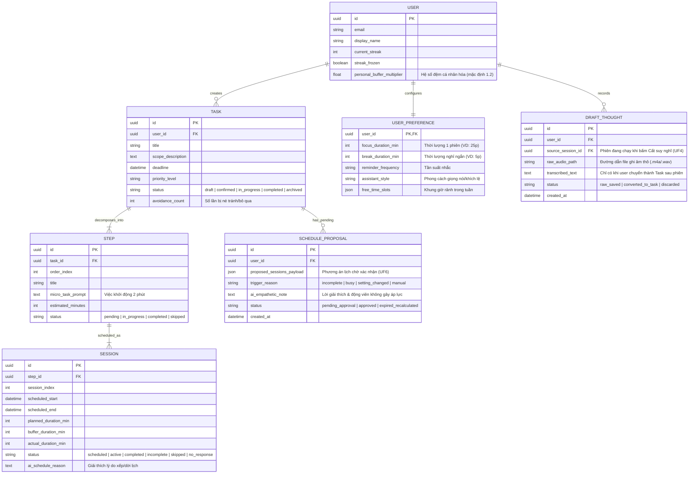
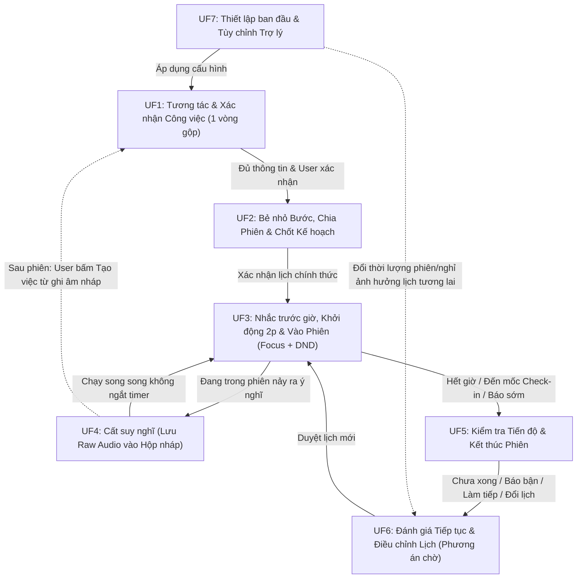
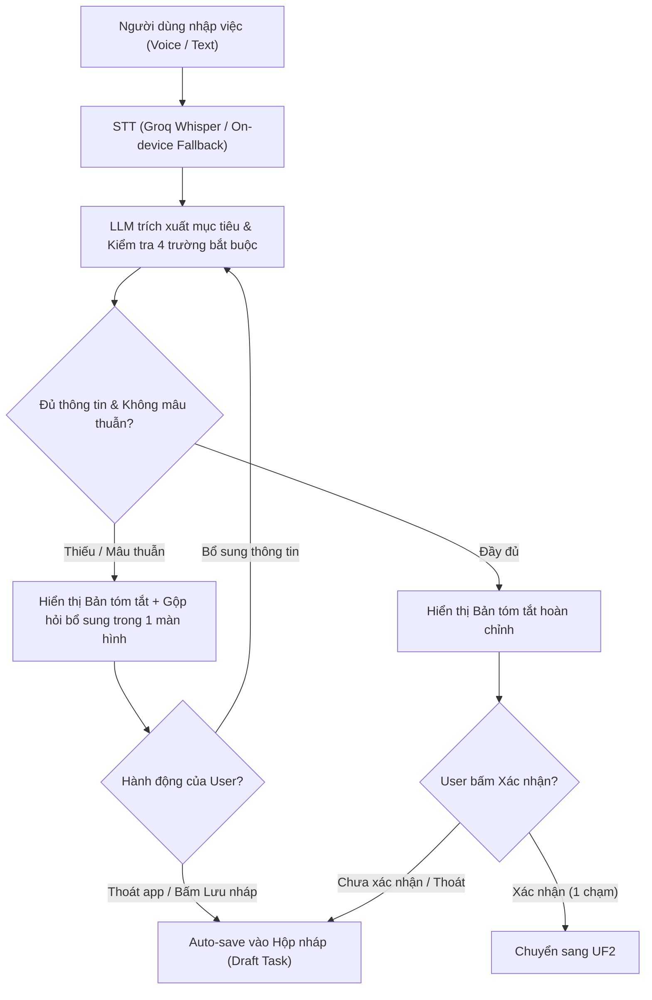
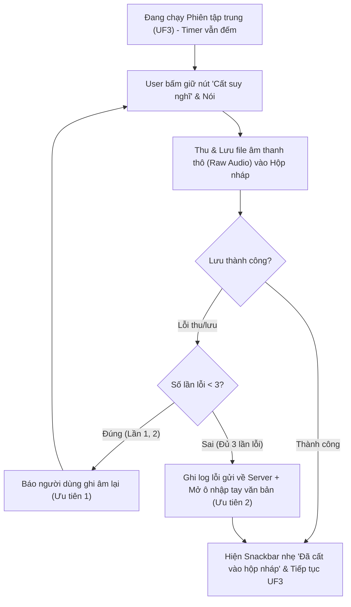
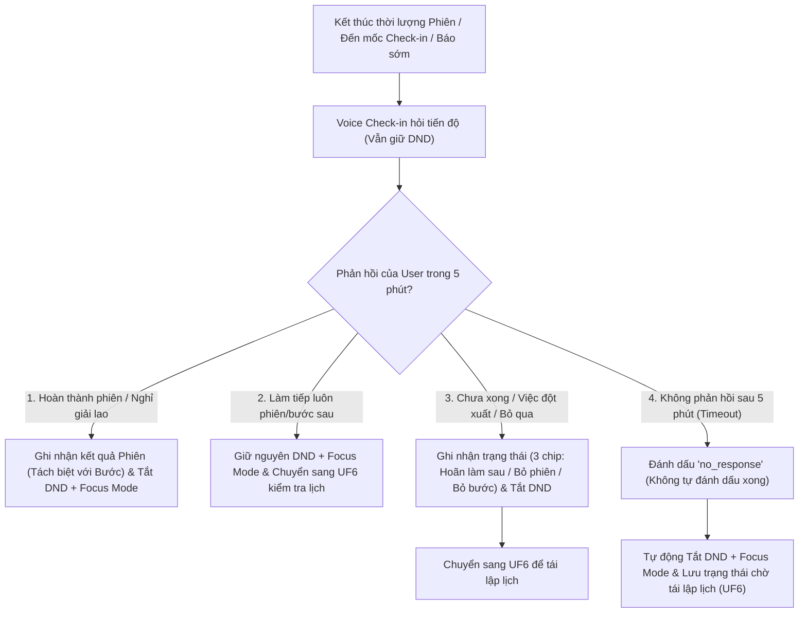
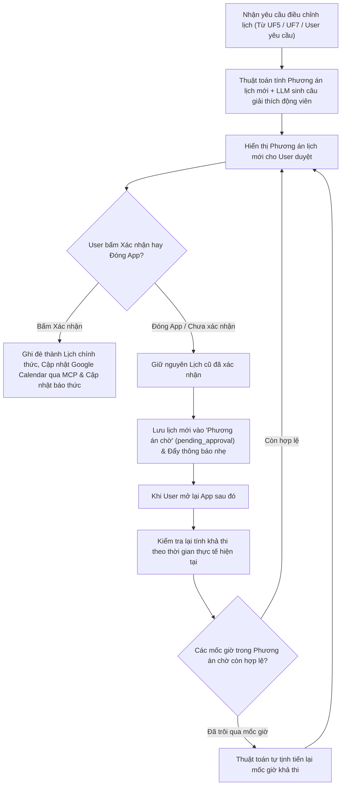

# Project.md — Tài liệu Đặc tả & Hướng dẫn AI Agent (Single Source of Truth)

> **Tên dự án:** **ProPlan VA** — Trợ lý ảo AI hỗ trợ lập kế hoạch, chia nhỏ công việc và nhắc lịch chủ động bằng giọng nói trên thiết bị di động cho người mắc hội chứng ADHD.
> **Mục đích tài liệu:** Cung cấp ngữ cảnh toàn diện (Business Logic, Cơ sở khoa học, Kiến trúc kỹ thuật, Luồng nghiệp vụ UF1–UF7, Mô hình dữ liệu và Quy tắc cốt lõi) cho các **AI Coding Agents** và thành viên trong nhóm phát triển trên toàn bộ Monorepo.

---

## 1. Tổng quan Dự án & Phát biểu Bài toán (Problem Statement)

### 1.1. Thông tin chung
- **Tên sản phẩm:** ProPlan VA
- **Đối tượng mục tiêu (Who):** Người trưởng thành, sinh viên và người đi làm mắc hội chứng **ADHD** — đặc biệt là **thể giảm chú ý (ADHD-I**, thể lâm sàng phổ biến nhất) hoặc những người gặp khó khăn nghiêm trọng về tập trung và chức năng điều hành.
- **Phạm vi (Scope):**
  - **Trong phạm vi (In-scope):** Quản lý công việc cá nhân hằng ngày, lịch trình học tập/làm việc, hỗ trợ khởi động công việc, duy trì tập trung và tái lập lịch linh hoạt.
  - **Ngoài phạm vi (Out-of-scope):** Không bao gồm chẩn đoán, can thiệp y tế hay quản lý thuốc điều trị.

### 1.2. Phát biểu bài toán chuẩn (5W1H)
> *"Người trưởng thành mắc hội chứng ADHD (**Who**) khi đi làm hoặc học tập (**Where**) đang gặp tình trạng bỏ lỡ trung bình 40% số công việc trong ngày và mất hơn 30 phút để bắt đầu một nhiệm vụ mới (**What**). Nguyên nhân chính là do các ứng dụng quản lý hiện tại yêu cầu quy trình lập kế hoạch phức tạp, gây quá tải nhận thức (**Why**). Vấn đề này bị ràng buộc bởi khả năng duy trì chú ý ngắn và thói quen dễ bỏ dở ứng dụng sau vài ngày (**Constraints**). Dự án hướng tới mục tiêu nâng tỷ lệ hoàn thành công việc đúng hạn lên $\ge$ 85% và giảm thời gian chuẩn bị bắt đầu công việc xuống dưới 5 phút trong vòng 2 tháng thử nghiệm (**Measurable Outcome/How**)."*

### 1.3. Tiêu chuẩn thành công (SMART Metrics)
1. **Giảm tỷ lệ trễ/quên việc:** Giảm từ trung bình `4/10` nhiệm vụ/tuần xuống `< 1` nhiệm vụ/tuần.
2. **Tăng thời lượng tập trung liên tục:** Tăng từ `< 10` phút lên `25` phút.
3. **Tăng tỷ lệ hoàn thành công việc:** Tăng từ `60%` lên `>= 85%` sau 30–60 ngày sử dụng.
4. **Giảm độ trễ khởi động nhiệm vụ (Task Initiation):** Từ `> 30` phút xuống `< 5` phút nhờ cơ chế Micro-task khởi động 2 phút.

---

## 2. Phân tích Vấn đề, Cơ sở Khoa học & Giải pháp Đề xuất

### 2.1. Nguyên nhân gốc rễ (Root Cause — 5 Whys)
Não bộ người ADHD gặp **suy giảm chức năng điều hành (Executive Dysfunction)**. Họ biết rõ mình cần làm gì nhưng không thể tự kích hoạt hành vi để bắt tay vào làm. Các ứng dụng quản lý công việc truyền thống yêu cầu nhập quá nhiều trường thông tin (tiêu đề, giờ bắt đầu/kết thúc, mức ưu tiên, nhãn, dự án...) gây **quá tải nhận thức (Cognitive/Brain Overload)**, dẫn đến tê liệt quyết định và bỏ cuộc chỉ sau 3–5 ngày sử dụng.

### 2.2. Đối chiếu 8 Rào cản ADHD — Bằng chứng Khoa học — Giải pháp trên ProPlan VA

| # | Rào cản của người ADHD | Bằng chứng Khoa học / Thống kê | Giải pháp trên ProPlan VA |
| :--- | :--- | :--- | :--- |
| **1** | **Quên nhiệm vụ & thời điểm thực hiện** *(Prospective Memory Deficit)* | • Thiếu hụt lớn ở việc nhớ thực hiện ý định đúng thời điểm đã định *(Rambold et al.)*.<br>• 80% bỏ lỡ thông báo văn bản tĩnh.<br>• Tin nhắn SMS nhắc suông chỉ tăng tương tác ngắn hạn (40% vs 18.4%), không cải thiện mức hoàn thành tổng thể *(Frontiers in Digital Health, 2022)*. | • **Hệ thống ghi nhớ bên ngoài:** Nhập liệu nhanh bằng Voice/Text, đồng bộ lịch tạo task có cấu trúc.<br>• **Voice Check-in 2 chiều:** AI chủ động hỏi tiến độ và khích lệ bằng giọng nói thay vì chỉ đẩy thông báo tĩnh. |
| **2** | **Công việc phức tạp, gây ngợp** *(Planning & Sequencing Deficit)* | • Suy giảm lớn ở khả năng lập kế hoạch nhiều bước *(Fuermaier et al., 2013)*.<br>• Chương trình CBT 12 tuần dạy lập kế hoạch/chia nhỏ việc giúp cải thiện triệu chứng 53%–67% so với 23%–33% ở nhóm chứng *(Safren et al., 2010)*. | • **AI Task Decomposition:** Tự động bẻ nhỏ mục tiêu lớn thành các bước nhỏ (*Steps*) và phiên làm việc (*Sessions*).<br>• **Giao diện 1-Step UI:** Chỉ hiển thị duy nhất **1 bước/phiên hiện tại** trên màn hình; hoàn thành hoặc bỏ qua mới hiện bước tiếp theo. |
| **3** | **Lúng túng về thứ tự ưu tiên** *(Choice Overload)* | • Danh sách dài (To-do list truyền thống) gây tê liệt lựa chọn *(Neural Revolution, 2023; Frontiers in Psychology, 2022)*. | • **Algorithmic Priority Queue:** Tự động đề xuất công việc dựa trên hạn chót (deadline), độ quan trọng, giờ rảnh, mức năng lượng và lịch sử né tránh (logs bỏ qua việc). |
| **4** | **"Mù thời gian"** *(Time Blindness)* | • Sai số lớn khi ước lượng thời gian *(Marx et al., 2022; phân tích gộp 27 nghiên cứu trên 1.620 người ADHD của HKU với độ lệch > 0.40)*.<br>• 60% SV ADHD tại Ireland phải xin gia hạn bài tập *(HEA & Taylor & Francis, 2025)*. | • **Buffer Time & Visual Timer:** AI gợi ý thời lượng gốc, thuật toán tự động chèn thời gian đệm dự phòng cá nhân hóa.<br>• Thanh tiến độ trực quan và đối chiếu thời gian dự kiến vs. thực tế để tinh chỉnh hệ số đệm cho các lần sau. |
| **5** | **Tê liệt khởi động** *(ADHD Paralysis / Task Initiation)* | • >70% SV ADHD chỉ làm bài trong 24–48 giờ cuối trước hạn *(Knouse & Mitchell, 2015)*.<br>• >70% người dùng biết cần làm gì nhưng cơ thể không thể bắt đầu *(Thawly, 2026)*. | • **Khởi động 2 phút (Micro-task):** Giao duy nhất 1 việc cực nhẹ trong 2–5 phút đầu trước phiên chính để hạ rào cản kích hoạt thần kinh (80% sẽ tiếp tục làm sau 2 phút). |
| **6** | **Dễ mất tập trung**  | • Thông báo điện thoại làm tăng triệu chứng mất tập trung *(Kushlev et al., CHI 2016)*.<br>• Đồng hồ nhắc tự kiểm tra giúp giảm hành vi lạc đề từ 46.8% xuống 27.3% *(Sluiter et al., 2020)*. | • **Bảo vệ chú ý kép:**<br>  1.  Tự bật Không làm phiền (DND) khi vào phiên.<br>  2.  Nút Push-to-Talk **"Cất suy nghĩ"** thu âm nhanh ý tưởng chợt nảy ra (raw audio) vào hộp nháp mà không chuyển màn hình hay ngắt đồng hồ. |
| **7** | **Lặp lại sai lầm & Cảm giác tội lỗi khi trễ hạn** | • CBT nhấn mạnh việc review kế hoạch và điều chỉnh linh hoạt *(BBK Eprints)*. | • **Adaptive Rescheduling (Guilt-free):** Khi trễ/bận đột xuất, hệ thống tự đề xuất lịch mới kèm 1 câu giải thích lý do / động viên, tránh gây hoảng loạn hay tự trách.<br>• **Rolling Horizon Planning:** Lập kế hoạch cuốn chiếu (tổng quan cả dự án, xếp lịch chi tiết 2–3 tuần gần nhất). |
| **8** | **Mất động lực & Tính cá nhân hóa** | • Công nghệ cho ADHD cần duy trì tương tác lâu dài *(Scoping Review, 2026)* và thích ứng với sự khác biệt từng cá nhân *(MDPI, 2021)*. | • Phát hiện dấu hiệu giảm tương tác để giảm tần suất thông báo chống bão hòa.<br>• Tùy chỉnh thời lượng tập trung, thời gian nghỉ, tần suất và phong cách nhắc của trợ lý. |

---

## 3. Điểm Mới Đột Phá (Novelty) So Với Đối Thủ

Các ứng dụng hiện có như **Goblin Tools** (chỉ bẻ nhỏ việc rời rạc), **Tiimo** (lịch trực quan nhưng thiết lập thủ công phức tạp), hay **Finch** (gamification chăm thú ảo nhưng thiếu lập lịch thông minh) chỉ giải quyết từng khâu đơn lẻ. **ProPlan VA** tạo sự khác biệt nhờ 4 trụ cột:

1. **Khép kín vòng lặp từ Ý định đến Hành động (Closed-Loop Execution):**
   `Nhập liệu (Voice/Text)` $\rightarrow$ `Bẻ nhỏ việc (Task -> Steps -> Sessions)` $\rightarrow$ `Xếp lịch tự động` $\rightarrow$ `Bật Focus/DND + Micro-task khởi động` $\rightarrow$ `Check-in tiến độ 2 chiều` $\rightarrow$ `Tái lập lịch thích ứng`.
2. **Mô hình "Người bạn đồng hành ảo" (Body Doubling & AI Companion):**
   Giao tiếp giọng nói 2 chiều chủ động hỏi thăm giữa các khoảng nghỉ và cuối phiên. Dựa trên bằng chứng từ nghiên cứu thực nghiệm VR trên người lớn ADHD (*arXiv:2509.12153*) và khung lý thuyết *Social Scaffolds* (*arXiv:2603.17258*).
3. **Thay đổi lịch không gây áp lực (Guilt-free Adaptive Rescheduling):**
   Mọi đề xuất dời lịch đều đi kèm lời giải thích ngắn gọn, rõ lý do và khích lệ tinh thần, loại bỏ cảm giác thất bại khi trễ hạn.
4. **Lập kế hoạch cuốn chiếu (Rolling Horizon Planning):**
   Giữ tầm nhìn tổng quan cho toàn bộ công việc/dự án nhưng chỉ tính toán và xếp lịch chi tiết cho **2–3 tuần gần nhất**, giúp tiết kiệm chi phí token LLM, giảm tải nhận thức và giữ lịch trình luôn bám sát thực tế.

---

## 4. Kiến trúc Kỹ thuật (Tech Stack) & Cơ chế Phối hợp

### 4.1. Bảng Công nghệ Thành phần

| Thành phần | Công nghệ / Thư viện | Vai trò & Lý do lựa chọn |
| :--- | :--- | :--- |
| **Thiết kế UI/UX** | **Figma** | Thiết kế giao diện tối giản tuân thủ nghiêm ngặt chuẩn **W3C COGA** (Cognitive Accessibility). |
| **Frontend Mobile** | **Flutter SDK (Dart)** | Phát triển đa nền tảng, xuất file `.apk` cho Android. Các gói thư viện chính:<br>• `provider`: Quản lý trạng thái (`User`, `Task`, `Session`, `Theme`).<br>• `dio` & `flutter_secure_storage`: Gọi REST API, interceptor đính kèm và lưu trữ bảo mật JWT Token.<br>• `flutter_dnd`, `wakelock_plus`, `flutter_local_notifications`: Tự động bật/tắt DND, giữ sáng màn hình nhẹ trong phiên, báo thức chính xác dưới nền.<br>• `table_calendar` & `circular_countdown_timer`: Hiển thị lịch trực quan và đồng hồ đếm ngược dịu mắt.<br>• `flutter_tts` & `speech_to_text`: Xử lý giọng nói trực tiếp trên thiết bị (On-device Fallback & Offline mode). |
| **Backend & Server** | **Python 3.12 (FastAPI + Uvicorn)** | Hiệu năng cao, xử lý bất đồng bộ (`async/await`) tốt, tích hợp trực tiếp hệ sinh thái AI/LLM và thuật toán lập lịch. |
| **AI / LLM Engine** | **Gemini API (Google AI Studio - Gemini Flash)**<br>*(Dự phòng: Llama-3 qua Groq Cloud)* | Phân tích mục tiêu tự nhiên, trích xuất thực thể (UF1), bẻ nhỏ công việc thành các bước (UF2), hiểu yêu cầu sửa lịch tự nhiên và sinh lời giải thích/động viên (UF2, UF6). |
| **Giọng nói (STT & TTS)** | • **STT Primary:** Groq Cloud (`whisper-large-v3` / `whisper-large-v3-turbo`)<br>• **TTS Primary:** `edge-tts` (Python)<br>• **On-device Fallback:** `speech_to_text` & `flutter_tts` | • **Groq Whisper** nhận diện tiếng Việt cực nhanh và chuẩn xác cho UF1, UF2, UF5, UF6.<br>• **edge-tts** miễn phí, truyền qua stream/pipe dễ dàng, tùy chỉnh tốc độ và giọng đọc.<br>• Tự động fallback về `speech_to_text` / `flutter_tts` trên thiết bị khi mạng yếu hoặc mất kết nối. |
| **Cơ sở dữ liệu (Database)** | • **ORM:** SQLAlchemy 2.0<br>• **Giai đoạn Code (Tuần 1–7):** SQLite (`.db` local)<br>• **Giai đoạn Deploy (Tuần 8–10):** PostgreSQL (Supabase / Neon.tech)<br>• **Mobile Local Cache:** SQLite (`sqflite`) / `shared_preferences` | Dùng SQLite local ở giai đoạn phát triển để tránh lỗi mạng và linh hoạt khi thay đổi schema; chuyển đổi mượt mà sang PostgreSQL trên Cloud ở giai đoạn cuối nhờ SQLAlchemy 2.0 mà không cần viết lại truy vấn. |
| **Lịch Ngoại vi & Giao thức MCP** | • **Dịch vụ:** Google Calendar API (OAuth 2.0)<br>• **Giao thức:** **Model Context Protocol (MCP)** | • **Đọc lịch:** Tự động lấy các sự kiện bận từ Google Calendar để suy ra khung giờ rảnh ở UF1, giải phóng người dùng khỏi việc phải nhớ và gõ tay.<br>• **Ghi lịch:** Đồng bộ 2 chiều các phiên tập trung (`Focus Sessions`) lên Google Calendar sau khi chốt ở UF2 và UF6.<br>• **MCP Protocol:** Chuẩn hóa giao tiếp giữa AI Agent/Backend và các công cụ Calendar ngoại vi một cách an toàn và nhất quán. |

---

## 5. Yêu cầu Phi chức năng (NFR) & Nguyên tắc Thiết kế UI/UX

> [!IMPORTANT]
> Với người dùng ADHD, **Yêu cầu phi chức năng (NFR) quan trọng ngang hoặc hơn tính năng nghiệp vụ**, vì ngưỡng chịu đựng sự gián đoạn và ma sát giao diện (*frustration tolerance*) của họ rất thấp. Mọi AI Agent khi viết code UI hoặc API đều **bắt buộc** phải kiểm tra danh sách này.

### 5.1. Tính khả dụng & Tải nhận thức (Chuẩn W3C COGA)
- **Giới hạn mật độ thông tin:** Mỗi màn hình chỉ chứa tối đa **3–5 thành phần tương tác chính**.
- **Không gây gián đoạn cảm xúc:**
  - **CẤM** quảng cáo, **CẤM** pop-up bất ngờ (nhóm đã thống nhất loại bỏ hoàn toàn các pop-up gợi ý ngoài lề như rủ đi chơi thể thao).
  - **CẤM** dùng huy hiệu thông báo (badge) màu đỏ tươi gây cảm giác báo động/căng thẳng.
- **Bảng màu (Color Palette):** Sử dụng tông màu dịu mắt (*Pastel, Soft Green, Warm Gray, Dark Mode dịu nhẹ*), tuyệt đối tránh màu neon hoặc độ tương phản gây chói.
- **Giải phóng trí nhớ ngắn hạn (Working Memory Offloading):**
  - Luôn hiển thị sẵn hạn chót (deadline) ở ngữ cảnh liên quan.
  - **Auto-save:** Tự động lưu nháp ngay lập tức khi người dùng đang gõ hoặc nói dở mà thoát ứng dụng.
  - **Context Recovery:** Nếu người dùng bị gián đoạn (ví dụ: có cuộc gọi đến hoặc chuyển app), ngay khi quay lại ứng dụng phải hiển thị thẻ nhắc ngữ cảnh: *"Bạn đang ở bước nào? Đang làm gì?"*.
- **Giảm áp lực sai lầm (Undo thay vì Confirm Dialog):**
  - Không hiển thị hộp thoại hỏi *"Bạn có chắc chắn muốn xóa/bỏ qua?"* gây tê liệt quyết định.
  - Thực hiện thao tác ngay lập tức và hiển thị thanh `Snackbar` có nút **Hoàn tác (Undo) trong 5 giây**.
- **Nhãn nút bấm cụ thể (Action-Oriented Microcopy):**
  - Dùng nhãn mô tả rõ hành động và thời lượng như `"Bắt đầu đếm giờ 15p"`, `"Chia nhỏ việc này"`, `"Cất suy nghĩ (Giữ để nói)"` thay vì các từ mơ hồ như `"OK"`, `"Submit"`, hay `"Tiếp tục"`.

### 5.2. Hiệu năng & Độ trễ (Performance & Latency)
- **Khởi động nguội (Cold Start):** $\le 2.0$ giây.
- **Khởi động ấm (Warm Start):** $\le 1.0$ giây.
- **Hoạt họa (Animation):** Duy trì ổn định ở **60 FPS**.
- **Độ trễ API thông thường (CRUD / Thuật toán):** $\le 300\text{ ms}$.
- **Độ trễ xử lý AI (LLM Latency):** $\le 2.5$ giây. Trong thời gian chờ AI phản hồi, **bắt buộc** hiển thị hiệu ứng chờ thư giãn (*Shimmer skeleton* hoặc vòng tròn xoay nhịp thở nhẹ) kèm thông điệp rõ ràng: *"AI đang bẻ nhỏ công việc giúp bạn..."*.

### 5.3. Độ tin cậy & Chính xác thời gian (Reliability & Precision)
- **Chuông báo hết giờ (Alarm Precision):** Chính xác tuyệt đối (dung sai $\le 1$ giây, tỷ lệ thành công $\ge 99.9\%$), phải hoạt động ổn định kể cả khi tắt màn hình hoặc thiết bị rơi vào chế độ tiết kiệm pin (**Android Doze Mode**) thông qua Exact Alarm / Foreground Service.
- **Khả năng hoạt động ngoại tuyến (Offline Resilience):** Khi mất kết nối 4G/Wi-Fi, đồng hồ đếm ngược, ghi âm "Cất suy nghĩ" (UF4) và lịch trình trong ngày vẫn phải hoạt động bình thường nhờ bộ nhớ đệm cục bộ (`shared_preferences` / local SQLite), tự đồng bộ lại khi có mạng.
- **Xử lý lỗi AI êm ái (Graceful Degradation - Đa tầng):**
  Khi gọi AI gặp sự cố hoặc quá thời gian chờ, tuyệt đối không trả về màn hình trắng hay báo lỗi kỹ thuật thô. Áp dụng **Cơ chế Dự phòng 3 Tầng (3-Tier Fallback)**:
  1. **Tầng 1 (Primary):** Gọi **Gemini Flash API** (timeout 2.5s).
  2. **Tầng 2 (Secondary LLM Fallback):** Nếu Gemini lỗi, quá hạn mức (Rate Limit 429) hoặc timeout, Backend tự động chuyển hướng sang model LLM dự phòng tốc độ cao (ví dụ: **Llama-3 trên Groq Cloud** — tận dụng chung hạ tầng API key với Groq Whisper, hoặc model Gemini dự phòng).
  3. **Tầng 3 (Deterministic Rule-based Fallback):** Nếu mất kết nối tới cả 2 nhà cung cấp AI, hệ thống tự động kích hoạt thuật toán chia công việc thành các phiên cố định theo thời lượng tập trung mặc định của người dùng (ví dụ: `20–25 phút/phiên` + `5 phút nghỉ`) kèm câu thông báo thân thiện để không làm đứt mạch làm việc.

### 5.4. Cơ chế Giữ chân Người dùng (Retention Mechanics)
- **Chuỗi ngày duy trì (Guilt-free Streak):** Có hệ thống cột mốc (milestone) và huy hiệu tạo niềm vui, nhưng áp dụng cơ chế **Đóng băng chuỗi (Streak Freeze)** khi người dùng nghỉ hoặc lỡ nhịp chứ không xóa sạch chuỗi về 0 nhằm tránh hiệu ứng tâm lý *"đằng nào cũng hỏng rồi, bỏ luôn"* (*All-or-Nothing mindset*).
- **Thanh tiến độ & Tổng kết định kỳ:** Tập trung hiển thị những thành tựu và số phiên đã hoàn thành để củng cố động lực tích cực.

---

## 6. Mô hình Dữ liệu Chuẩn & Sơ đồ Thực thể (3-Tier Hierarchy)

### 6.1. Nguyên tắc Phân cấp 3 Tầng
Hệ thống quản lý công việc theo cấu trúc phân cấp chặt chẽ:
$$\text{1 Công việc (Task)} \longrightarrow \text{Nhiều Bước (Steps)} \longrightarrow \text{Mỗi Bước gồm Nhiều Phiên (Sessions)}$$

> [!WARNING]
> **Quy tắc nghiệp vụ bất biến:** Việc kết thúc thời lượng đếm ngược của **1 Phiên (Session)** **KHÔNG** tự động đồng nghĩa với việc đã hoàn thành Phiên đó, và hoàn thành 1 Phiên cũng **KHÔNG** tự động đánh dấu hoàn thành **Bước (Step)** hay **Công việc (Task)**. Trạng thái phải được xác nhận qua luồng Check-in (UF5).

### 6.2. Sơ đồ Thực thể Liên kết (ERD Khái niệm)



---

## 7. Đặc tả Chi tiết 7 Luồng Tương tác Chuẩn (User Flows UF1 – UF7)

### Tổng quan Liên kết giữa 7 User Flows



---

### 7.1. Nhóm Luồng Khởi tạo & Lập lịch (UF7, UF1, UF2)

#### UF7 — Thiết lập ban đầu & Tùy chỉnh trợ lý
- **Mục tiêu & Điểm bắt đầu:** Người dùng cấu hình trợ lý trước khi bắt đầu lập lịch lần đầu hoặc vào phần Cài đặt để tùy chỉnh phương thức nhắc nhở và tập trung.
- **Luồng xử lý chính (4 bước):**
  1. **Lựa chọn thông số:** Người dùng chọn thời lượng tập trung mỗi phiên (`focus_duration_min`, mặc định 25p), thời gian nghỉ ngắn (`break_duration_min`, mặc định 5p), tần suất nhắc trước phiên (`reminder_frequency`: 15p, 10p, 5p), phong cách nhắc/khích lệ (`assistant_style`: trực tiếp hoặc gợi mở) và bật/tắt các hình thức hỗ trợ.
  2. **Đánh giá tác động & Giữ nguyên phiên hiện tại:** Hệ thống kiểm tra điều kiện thay đổi; giữ nguyên cấu hình cho phiên đang chạy ở UF3. Nếu thay đổi làm lệch các phiên đã lên lịch trong tương lai (đổi thời lượng phiên/nghỉ), chuyển sang **UF6 (Phương án chờ)** để người dùng duyệt lại lịch.
  3. **Ghi nhận & Chu kỳ cập nhật hệ số đệm:** Cấu hình mới được áp dụng từ phiên tiếp theo. Hệ thống chạy ngầm việc đối chiếu thời gian dự kiến so với thực tế để tính hệ số đệm cá nhân hóa ($k_{\text{buffer}}$).
  4. **Quy tắc Tính toán & Thứ tự Ưu tiên (Đã chốt):**
     - **Công thức Hệ số đệm từ Lịch sử ($k_{\text{history}}$):** Áp dụng trung bình trượt (Moving Average) cho 7–10 phiên gần nhất:
       $$k_{\text{history}} = \frac{1}{N} \sum_{j=1}^{N} \frac{\text{actual\_duration}_j}{\text{planned\_duration}_j}$$
     - **Quy tắc ưu tiên cấu hình:** Luôn ưu tiên cấu hình thủ công của người dùng ($k_{\text{user}}$) để tôn trọng quyền tự chủ và tạo cảm giác kiểm soát.
     - **Chu kỳ kiểm tra & Gợi ý (Weekly Check):** Định kỳ 1 lần/tuần (vào cuối tuần), nếu độ lệch giữa cấu hình người dùng và thực tế vượt quá 20% ($|k_{\text{user}} - k_{\text{history}}| > 0.2$), hệ thống hiển thị một gợi ý nhẹ nhàng, không phán xét (*guilt-free suggestion*) để người dùng cân nhắc cập nhật.

---

#### UF1 — Tương tác & Xác nhận công việc
- **Mục tiêu & Điểm bắt đầu:** Hệ thống hiểu đúng công việc, khung giờ rảnh và deadline khi người dùng thêm mục tiêu mới; áp dụng cơ chế gộp câu hỏi làm rõ vào 1 vòng duy nhất để giải phóng trí nhớ ngắn hạn.
- **Luồng xử lý chính (4 bước):**
  1. **Nhập liệu đa phương thức:** Người dùng nhập công việc bằng **Giọng nói** (STT ưu tiên Groq Whisper `whisper-large-v3-turbo`, fallback on-device `speech_to_text`) hoặc **Văn bản**. LLM trích xuất mục tiêu, hạn chót, mốc thời gian và ghi chú.
  2. **Kiểm tra 4 nhóm thông tin bắt buộc:** Hệ thống đối chiếu dữ liệu để đảm bảo có đủ 4 thành phần:
     - *Nội dung công việc (Task content)*
     - *Phạm vi / Đầu ra mong muốn (Scope)*
     - *Khung giờ rảnh (Free time slots):* Hỗ trợ tự động đọc các sự kiện bận từ **Google Calendar MCP / API** để suy ra khung giờ rảnh, giảm thiểu gõ tay.
     - *Hạn chót hoặc khoảng thời gian hoàn thành (Deadline / Timeframe)*
     - **Nguyên tắc:** Đánh dấu rõ các điểm thiếu, mơ hồ hoặc mâu thuẫn; **tuyệt đối không tự đoán dữ liệu**.
  3. **Gộp 1 vòng duy nhất (Single-Round Clarification):** Hiển thị bản tóm tắt trực quan kèm câu hỏi làm rõ tất cả các chỗ còn thiếu/mâu thuẫn trong **1 lần hiển thị duy nhất** (không hỏi lắt nhắt nhiều lượt). Người dùng bổ sung hoặc chỉnh sửa trực tiếp trên giao diện.
  4. **Xác nhận & Chuyển luồng:** Khi đủ 4 thông tin bắt buộc và người dùng bấm Xác nhận 1 lần $\rightarrow$ chuyển sang **UF2**.
- **Xử lý ngoại lệ & Bảo toàn dữ liệu:**
  - Nếu thông tin chưa rõ/thiếu, hệ thống chỉ giữ ở bước 3, chưa chuyển sang UF2.
  - Nếu người dùng thoát app hoặc chưa muốn bổ sung ngay $\rightarrow$ **tự động lưu nháp (`status = 'draft'`)** vào Hộp nháp (Draft Tasks) để không bao giờ mất dữ liệu.



---

#### UF2 — Xem các bước & Chốt kế hoạch
- **Mục tiêu & Điểm bắt đầu:** Bẻ nhỏ công việc đã xác nhận ở UF1 thành các bước (`Steps`) và phiên (`Sessions`), xếp lịch vào khung giờ rảnh khả dụng và chốt lịch chính thức.
- **Luồng xử lý chính (5 bước):**
  1. **Đề xuất phân rã chủ động (Tránh Tê liệt khởi động):** Để giải quyết rào cản *Blank Canvas / ADHD Paralysis*, AI (Gemini Flash) **chủ động sinh sẵn một phương án chia bước chuẩn** (`Default Decomposition Proposal`) gồm danh sách các bước, thời lượng dự kiến và Micro-task khởi động 2 phút, kèm nút `"Tùy chỉnh theo ý tôi"` để người dùng tự điều chỉnh nếu muốn.
  2. **Thuật toán Python xếp phiên & Kiểm tra khả thi:** Thuật toán Python (`scheduler_engine.py`) chia các bước thành các phiên (`Sessions`) theo cấu hình tập trung/nghỉ của UF7, nhân hệ số đệm cá nhân hóa ($k_{\text{buffer}}$) và xếp vào các khung giờ rảnh chưa có lịch ($T_{\text{free}}$) trước Deadline trong cửa sổ **Rolling Horizon (2–3 tuần gần nhất)**.
  3. **Hiển thị Lịch tổng quan & Cảnh báo thiếu hụt:** Hiển thị tổng quan cả dự án, lịch chi tiết các phiên cho 2–3 tuần đầu kèm 1 câu giải thích ngắn gọn lý do sắp xếp.
     - **Công thức kiểm tra khả thi:**
       $$T_{\text{req}} = \sum_{i=1}^{N} \left( \text{PlannedDuration}_i \times k_{\text{buffer}} + \text{BreakDuration}_i \right)$$
     - **Nếu $T_{\text{req}} > T_{\text{free}}$:** Hệ thống tính toán chính xác số phút thiếu hụt tối thiểu:
       $$\Delta T_{\text{deficit}} = T_{\text{req}} - T_{\text{free}}$$
     - **Phạm vi dời lịch khác (Đã chốt):** **Tuyệt đối không tự động dời hoặc xáo trộn các Task khác đã chốt**. Hệ thống thông báo rõ $\Delta T_{\text{deficit}}$ và nguyên nhân để người dùng quyết định: mở rộng thêm giờ rảnh hoặc lùi deadline.
  4. **Chỉnh sửa linh hoạt:** Người dùng có thể chỉnh sửa trực tiếp trên giao diện lịch hoặc ra lệnh bằng giọng nói/văn bản để AI và thuật toán xếp lại. Nếu đồng ý thêm giờ rảnh hoặc lùi deadline, quay lại bước 2 để tính toán lại.
  5. **Xác nhận & Đồng bộ Google Calendar 2 chiều:** Khi lịch đã khả thi và người dùng bấm **Xác nhận**, hệ thống ghi vào lịch chính thức (`Official Schedule`). Backend tự động đồng bộ các khối sự kiện (`Focus Blocks`) lên **Google Calendar qua MCP / API**.
- **Cơ chế Dự phòng Đa tầng khi AI lỗi (3-Tier Fallback):**
  - **Tầng 1:** `Gemini Flash API` (timeout $\le 2.5\text{s}$).
  - **Tầng 2:** Chuyển sang LLM tốc độ cao dự phòng (`Llama-3` qua Groq Cloud hoặc model Gemini dự phòng).
  - **Tầng 3:** Nếu mất mạng toàn diện tới AI, Thuật toán Python tự động chia công việc thành các phiên cố định `20–25 phút` (theo cấu hình user) + `5 phút nghỉ`, không bao giờ trả về lỗi trắng.

---

### 7.2. Nhóm Luồng Thực thi Phiên Tập trung (UF3, UF4)

#### UF3 — Thông báo & Thực hiện phiên tập trung
- **Mục tiêu & Điểm bắt đầu:** Đưa người dùng vào trạng thái làm việc đơn nhiệm, bảo vệ sự tập trung tối đa theo lịch đã chốt.
- **Luồng xử lý chính (5 bước):**
  1. **Thông báo nhắc trước giờ:** Phát thông báo đẩy tại các mốc cấu hình (`15 phút`, `10 phút`, `5 phút`) trước giờ bắt đầu phiên.
  2. **Micro-task khởi động 2 phút:** Trước phiên 3–5 phút, hiển thị gợi ý một việc siêu nhỏ (ví dụ: *"Mở sẵn tài liệu và đọc lướt mục lục"*). Bước này **không tính** vào thời lượng phiên chính. Nếu người dùng bắt đầu, chuyển sang bước 3; nếu không phản hồi đến giờ, chuyển sang UF5.
  3. **Kích hoạt Gộp 1 chạm (1-Tap Focus):** Đến giờ làm việc, người dùng bấm nút `"Bắt đầu đếm giờ [X]p"` $\rightarrow$ hệ thống kích hoạt đồng thời 3 cơ chế:
     - Bật **Chế độ Tập trung** và giữ sáng màn hình nhẹ (`wakelock_plus`).
     - Tự động bật **Không làm phiền (DND)** trên Android (`flutter_dnd`).
     - Chạy đồng hồ đếm ngược / thanh tiến độ trực quan trên **Giao diện 1-Step UI**.
  4. **Bảo vệ Đơn nhiệm & Giữ DND:** Màn hình chỉ hiển thị duy nhất công việc, bước và phiên hiện tại. Chế độ DND được giữ xuyên suốt cả trong các quãng nghỉ ngắn giữa các phiên. Nếu nảy sinh ý nghĩ bên lề, người dùng kích hoạt **UF4**.
  5. **Chuyển tiếp cuối phiên:** Khi hết giờ hoặc người dùng chủ động báo kết quả $\rightarrow$ chuyển sang **UF5**. Nếu người dùng báo có việc đột xuất $\rightarrow$ chuyển ngay sang **UF6**.
- **Khả năng hoạt động Ngoại tuyến (Offline Resilience):** Nếu mất kết nối 4G/Wi-Fi trong phiên, ứng dụng vẫn duy trì đồng hồ đếm ngược, thanh tiến độ và báo thức chính xác (dung sai $\le 1\text{s}$) từ bộ nhớ đệm cục bộ (`sqflite` / `shared_preferences`).

---

#### UF4 — Cất suy nghĩ bằng bản ghi âm thô (Nhánh phụ trong UF3)
- **Mục tiêu & Điểm bắt đầu:** Lưu tức thì ý nghĩ phát sinh trong 3 giây khi đang ở UF3 mà không làm đứt mạch tập trung (Internal Distraction Offloading).
- **Luồng xử lý chính (4 bước):**
  1. **Thao tác 1 chạm Push-to-Talk:** Người dùng bấm giữ nút `"Cất suy nghĩ"` ngay trên màn hình đếm ngược của UF3 và nói nội dung cần nhớ.
  2. **Lưu Audio thô (Raw Audio):** Hệ thống thu âm và lưu trực tiếp file âm thanh thô (`.m4a`/`.wav`) vào Hộp nháp (`DraftThought`). **CẤM gọi STT, CẤM gọi LLM, CẤM bắt người dùng đọc/sửa chữ ngay trong phiên**.
  3. **Tiếp tục mạch làm việc:** Hiển thị `SnackBar` nhẹ báo *"Đã cất vào hộp nháp"* (có nút Hoàn tác trong 5 giây). Đồng hồ đếm ngược và thanh tiến độ của UF3 tiếp tục chạy bình thường, không ngắt quãng.
  4. **Xử lý sau phiên:** Khi kết thúc phiên tập trung, người dùng có thể mở Hộp nháp để nghe lại hoặc bấm *"Tạo việc từ ghi âm này"* $\rightarrow$ lúc này mới gọi STT và đẩy sang **UF1**.
- **Cơ chế Xử lý Lỗi 2 Mức Ưu tiên:**
  - **Ưu tiên 1 (Lỗi thu/lưu file):** Thông báo rung nhẹ để người dùng ghi âm lại ngay tại chỗ (thử lại tối đa **3 lần**).
  - **Ưu tiên 2 (Sau 3 lần vẫn lỗi):** Tự động gửi log lỗi về server và mở ngay ô nhập văn bản nhanh (Text input) tại chỗ để người dùng gõ ngắn gọn ý nghĩ, không làm gián đoạn thêm.



---

### 7.3. Nhóm Luồng Kiểm tra Tiến độ & Điều chỉnh Lịch (UF5, UF6)

#### UF5 — Kiểm tra tiến độ & Kết thúc phiên
- **Mục tiêu & Điểm bắt đầu:** Ghi nhận kết quả thực tế khi hết giờ, đến mốc check-in giữa giờ hoặc khi người dùng chủ động báo cáo; phân biệt rõ ràng giữa kết quả của Phiên (`Session`) và kết quả của Bước (`Step`).
- **Luồng xử lý chính & 5 Nhánh Kết quả:**
  Thực hiện Voice Check-in 2 chiều (`edge-tts` / `flutter_tts`), ghi nhận `actual_duration_min`:
  1. **Hoàn thành phiên (`completed` — chưa phải phiên cuối của Bước):** Ghi thời gian thực tế; người dùng có thể chọn hoàn thành luôn cả Bước (chuyển sang UF6 đôn lịch) hoặc giữ nguyên lịch cho các phiên sau.
  2. **Hoàn thành phiên (`completed` — là phiên cuối của Bước):** Ghi nhận hoàn thành Bước; người dùng chọn làm tiếp phiên/bước kế tiếp (chuyển sang UF6) hoặc nghỉ ngơi giải lao.
  3. **Chưa hoàn thành phiên (`incomplete`):** Hệ thống ghi nhận phần việc còn lại; đưa ra lựa chọn (làm tiếp ở phiên sau hoặc nghỉ giải lao) và chuyển sang **UF6** để tính phương án lịch mới.
  4. **Có việc đột xuất (`busy/interrupted`):** Dừng phiên ngay lập tức, không trách móc $\rightarrow$ chuyển thẳng sang **UF6**.
  5. **Bỏ qua (`skipped` — Đã chốt tương tác):** Hiển thị **3 chip lựa chọn rõ ràng** kèm giọng nói hỏi ngắn gọn và thanh Hoàn tác 5 giây:
     - `[Hoãn phiên này làm sau]`: Chuyển sang UF6 dời phiên này sang khung giờ rảnh khác.
     - `[Bỏ qua phiên này]`: Hủy phiên hiện tại, giữ nguyên các phiên sau của bước.
     - `[Bỏ toàn bộ bước này]`: Đánh dấu toàn bộ Step là `skipped`, chuyển sang UF6 để đôn các bước sau lên sớm hơn nếu muốn.
  6. **Không phản hồi (`no_response`):** Nếu người dùng không trả lời, gán trạng thái `no_response` (**tuyệt đối không tự đánh dấu hoàn thành**).
- **Chính sách Tự động Tắt DND & Focus Mode:**
  - Giữ DND trong lúc đang hỏi Voice Check-in cuối phiên.
  - Tắt DND & Focus Mode ngay khi người dùng xác nhận nghỉ / kết thúc / báo bận / bỏ qua.
  - **Tự động tắt DND & Focus Mode sau 5 phút (Timeout 5p)** nếu người dùng không phản hồi Check-in (để tránh lỡ liên lạc quan trọng ngoài đời).
  - Giữ nguyên DND nếu người dùng chọn làm tiếp ngay phiên kế tiếp mà không nghỉ.



---

#### UF6 — Đánh giá tiếp tục & Điều chỉnh lịch (Adaptive Rescheduling)
- **Mục tiêu & Điểm bắt đầu:** Tái lập lịch không gây áp lực (*Guilt-free Adaptive Rescheduling*) khi người dùng trễ tiến độ, bận đột xuất, yêu cầu đổi lịch, hoặc muốn đôn việc làm tiếp từ UF5.
- **Luồng xử lý chính (5 bước):**
  1. **Tiếp nhận lý do kích hoạt:** Nhận thông tin từ UF5 (chưa xong, bận, bỏ qua, làm sớm), từ UF7 (đổi thời lượng phiên/nghỉ), hoặc từ yêu cầu chỉnh sửa lịch thủ công của người dùng.
  2. **Thuật toán đánh giá khối lượng & Tìm khe rảnh:** Thuật toán Python xác định các phiên bị ảnh hưởng, tìm các khung giờ rảnh chưa có lịch ($T_{\text{free}}$) khả dụng trước deadline trong cửa sổ Rolling Horizon (2–3 tuần) mà không làm xáo trộn các Task khác.
  3. **Sinh giải thích khích lệ:** LLM (Gemini Flash) sinh **1 câu giải thích ngắn gọn lý do đổi lịch** kèm lời động viên tinh thần, xóa bỏ cảm giác tự trách.
  4. **Hiển thị & Duyệt phương án:** Hiển thị phương án lịch mới cho người dùng xem và bấm Xác nhận. Chỉ ghi đè lịch chính thức sau khi người dùng bấm Xác nhận (và cập nhật sự kiện Google Calendar qua MCP).
  5. **Xử lý thoát App trước khi xác nhận (Quy tắc bảo vệ dữ liệu):**
     - Đóng app **KHÔNG** phải là đồng ý. Hệ thống **giữ nguyên lịch cũ đã xác nhận**.
     - Lưu phương án mới vào `ScheduleProposal` với trạng thái `pending_approval` và gửi một thông báo nhắc nhẹ.
     - **Khi người dùng mở lại app sau đó:** Bắt buộc chạy thuật toán kiểm tra lại tính khả thi theo thời gian thực tế tại thời điểm mở app (tịnh tiến các mốc giờ đã trôi qua) rồi mới hiển thị cho người dùng duyệt.



---

### 7.4. Bảng Ma trận Chuyển trạng thái (State Transition Matrix) cho Agent & Developers

Bảng dưới đây là kim chỉ nam bắt buộc cho toàn bộ logic điều hướng giữa các màn hình Flutter, trạng thái Database và các API Backend:

| Mã Flow | Đầu vào (Trigger) | Trạng thái / Đầu ra (Output State) | Luồng đích (Next Flow) | Ràng buộc Nghiệp vụ Cốt lõi |
| :--- | :--- | :--- | :--- | :--- |
| **UF7** | Mở Cài đặt / Lần đầu dùng app | Cấu hình lưu vào `USER_PREFERENCE` (áp dụng từ phiên sau) | **UF1** (nếu cài đặt ban đầu) hoặc **UF6** (nếu lệch lịch đã chốt) | Giữ nguyên phiên đang chạy; tính $k_{\text{history}}$ theo Moving Average 7–10 phiên; gợi ý cập nhật 1 lần/tuần nếu lệch > 20%. |
| **UF1** | Nhập công việc bằng Voice (Groq Whisper) hoặc Text | `TASK(status='draft')` nếu thiếu tin; `TASK(status='confirmed')` khi đủ 4 trường | **UF2** (khi đủ 4 thông tin & bấm xác nhận) | Gộp toàn bộ câu hỏi làm rõ vào 1 vòng duy nhất; tự động lưu nháp nếu thoát app; đọc giờ bận từ Google Calendar MCP. |
| **UF2** | `TASK(status='confirmed')` từ UF1 | `SESSION(status='scheduled')` thuộc `Official Schedule` | **UF3** | AI sinh sẵn đề xuất chia bước tránh tê liệt khởi động; thuật toán tính $\Delta T_{\text{deficit}}$; tuyệt đối không tự ý dời Task khác; đồng bộ Google Calendar qua MCP sau khi bấm xác nhận. |
| **UF3** | Đến mốc nhắc (15/10/5p) & User bấm "Bắt đầu" | Kích hoạt Focus Mode + Bật DND + Chạy Visual Timer trên 1-Step UI | **UF4** (nhánh phụ), **UF5** (hết giờ/báo kết quả), **UF6** (đột xuất) | Giao diện tuân thủ 1-Step UI; chạy offline hoàn toàn nếu mất mạng; chuông báo thức chính xác $\le 1\text{s}$. |
| **UF4** | Bấm giữ nút Push-to-Talk "Cất suy nghĩ" trong UF3 | Lưu file ghi âm thô vào `DRAFT_THOUGHT(status='raw_saved')` | **Quay lại UF3 ngay lập tức** | KHÔNG gọi STT, KHÔNG gọi LLM trong phiên; thử lại tối đa 3 lần nếu lỗi $\rightarrow$ mở ô nhập text; timer UF3 vẫn chạy liên tục. |
| **UF5** | Hết giờ phiên / Check-in / Báo kết quả | Ghi nhận `actual_duration_min` và trạng thái `completed`, `incomplete`, `busy`, `skipped`, hoặc `no_response` | **UF3** (nghỉ giải lao / giữ lịch) hoặc **UF6** (đổi lịch / đôn lịch) | Phân biệt rõ kết quả Phiên vs Bước; khi Bỏ qua hiện 3 chip rõ ràng; tự động tắt DND sau 5 phút nếu không phản hồi (`no_response`). |
| **UF6** | Trễ tiến độ / Bận đột xuất / Bỏ qua / Đôn lịch / Đổi cài đặt UF7 | `SCHEDULE_PROPOSAL(status='pending_approval')` hoặc cập nhật `Official Schedule` | **UF3** (vào phiên làm việc kế tiếp) | Đóng app không phải là đồng ý; giữ nguyên lịch cũ; tính toán lại tính khả thi theo thời gian thực tế khi mở lại app; cập nhật Google Calendar qua MCP. |

---

## 8. Các Quyết định Thiết kế & Thuật toán Đã Chốt (Finalized Technical Decisions)

Bảng dưới đây tổng hợp các quyết định kỹ thuật và nghiệp vụ cốt lõi đã được thống nhất hoàn toàn giữa Lead BA và AI Agent:

| Hạng mục | Quyết định Thiết kế Đã Chốt |
| :--- | :--- |
| **1. Ranh giới LLM vs. Thuật toán Python** | • **LLM (Gemini Flash):** Chỉ dùng cho các tác vụ ngôn ngữ & ngữ nghĩa: Trích xuất thông tin & đặt câu hỏi gộp 1 vòng (UF1), sinh sẵn đề xuất chia `Task -> Steps` & gợi ý Micro-task 2 phút (UF2), hiểu yêu cầu đổi lịch tự nhiên và viết lời giải thích/động viên không gây áp lực (UF2, UF6).<br>• **Thuật toán Python (`scheduler_engine.py`):** Đảm nhận 100% các phép toán thời gian và lịch biểu: Chia `Steps -> Sessions`, nhân hệ số Buffer cá nhân hóa, kiểm tra trùng lịch, tính số phút thiếu hụt so với Deadline ($\Delta T_{\text{deficit}}$), tịnh tiến ô lịch ở UF6 và tính lại khung giờ ở UF7. |
| **2. Công thức Kiểm tra Khả thi & Buffer Time (UF2, UF7)** | • **Công thức tổng thời gian:** $T_{\text{req}} = \sum (\text{PlannedDuration}_i \times k_{\text{buffer}} + \text{BreakDuration}_i)$.<br>• **Số phút thiếu hụt tối thiểu:** $\Delta T_{\text{deficit}} = T_{\text{req}} - T_{\text{free}}$ (trong cửa sổ Rolling Horizon 2–3 tuần).<br>• **Quy tắc dời lịch khác:** Tuyệt đối **không tự ý dời các Task khác**; chỉ xếp vào các khung giờ rảnh trống ($T_{\text{free}}$). Nếu thiếu giờ, báo rõ $\Delta T_{\text{deficit}}$ để người dùng nới deadline hoặc mở thêm giờ rảnh.<br>• **Tính toán $k_{\text{buffer}}$:** Tính $k_{\text{history}}$ theo Moving Average 7–10 phiên gần nhất. Ưu tiên cấu hình thủ công của người dùng; gợi ý cập nhật 1 lần/tuần vào cuối tuần nếu độ lệch $> 20\%$. |
| **3. Trải nghiệm Phân rã Công việc (UF2)** | • Để tránh hội chứng **Tê liệt khởi động (ADHD Paralysis / Blank Canvas)**, khi vào UF2, AI **tự động sinh sẵn một phương án chia bước chuẩn (Default Proposal)** kèm các mốc thời lượng dự kiến và nút `"Tùy chỉnh theo ý tôi"` để người dùng nhanh chóng tinh chỉnh thay vì bắt đầu từ màn hình trống. |
| **4. Chính sách Tự tắt Focus Mode & DND (UF5)** | • Giữ DND trong lúc đang hỏi Voice Check-in cuối phiên.<br>• Tắt DND & Focus Mode ngay khi người dùng xác nhận nghỉ/kết thúc/báo bận/bỏ qua, **HOẶC tự động tắt sau 5 phút nếu người dùng không phản hồi Check-in** (`no_response`).<br>• Giữ nguyên DND nếu người dùng chọn làm tiếp luôn phiên kế tiếp mà không nghỉ. |
| **5. Phân định 3 mức khi Bỏ qua (Skip ở UF5)** | • Khi người dùng nói hoặc bấm "Bỏ qua", giao diện hiển thị **3 chip lựa chọn rõ ràng**: `[Hoãn phiên này làm sau]`, `[Bỏ qua phiên này]`, `[Bỏ toàn bộ bước này]`, kèm Voice Check-in ngắn gọn và thanh `SnackBar` Hoàn tác trong 5 giây để tuân thủ nguyên tắc W3C COGA. |
| **6. Phương án Dự phòng AI Đa tầng (3-Tier Fallback)** | • **Tầng 1 (Primary):** `Gemini Flash API` (timeout $\le 2.5\text{s}$).<br>• **Tầng 2 (Secondary LLM):** Chuyển sang `Llama-3` qua Groq Cloud (hoặc model Gemini dự phòng).<br>• **Tầng 3 (Deterministic Rule-based):** Thuật toán Python chia phiên cố định 20–25 phút theo cài đặt user + 5 phút nghỉ để không bao giờ trả về lỗi trắng. |
| **7. Luồng Giọng nói (STT/TTS) & Hộp nháp UF4** | • **UF1, UF2, UF5, UF6:** Ưu tiên gọi **Groq Whisper (STT)** và **edge-tts (TTS)** qua Backend; tự động fallback về `speech_to_text` và `flutter_tts` trên thiết bị nếu mất mạng/timeout.<br>• **UF4 (Cất suy nghĩ):** Trong phiên chỉ lưu file ghi âm thô (`.m4a`/`.wav`) vào Hộp nháp cục bộ (thử lại 3 lần $\rightarrow$ mở ô nhập text). Sau phiên, người dùng bấm *"Tạo việc từ ghi âm này"* mới gọi STT và chuyển sang UF1. |
| **8. Bảo toàn Lịch khi Đóng App Đột ngột (UF6)** | • Đóng app **KHÔNG** đồng nghĩa với việc đồng ý lịch mới. Hệ thống giữ nguyên lịch cũ đã xác nhận, lưu lịch mới vào `ScheduleProposal(status='pending_approval')`.<br>• Khi người dùng mở lại app, thuật toán **tự động kiểm tra lại tính khả thi theo thời gian thực tế** (tịnh tiến các ô lịch đã trôi qua) rồi mới hiển thị cho người dùng duyệt. |
| **9. Tích hợp Google Calendar qua MCP & Strict Guardrails** | • **Đọc ngữ cảnh (UF1):** Google Calendar MCP chỉ cung cấp các khoảng thời gian bận ($T_{\text{busy}}$) làm tham số đầu vào cho thuật toán Python tính quỹ giờ rảnh ($T_{\text{free}}$). CẤM để LLM tự ý ước lượng hay gán đè lịch.<br>• **Ghi sự kiện (UF2/UF6):** Chỉ đồng bộ sự kiện Focus Sessions lên Google Calendar **SAU KHI** người dùng bấm **Xác nhận/Duyệt** (Human-in-the-loop). Tuyệt đối KHÔNG tự động ghi lên Google Calendar khi kế hoạch còn ở dạng nháp (`draft`) hay phương án chờ (`pending_approval`). |

---

## 9. Tổ chức Nhóm, Phân công Nhân sự & Cấu trúc Monorepo

### 9.1. Cấu trúc Thư mục Dự kiến (`adhd-assistant/`)

```text
adhd-assistant/
├── backend/                  # Mã nguồn Backend (Python 3.12 + FastAPI + SQLAlchemy 2.0)
│   ├── app/
│   │   ├── api/              # Các endpoints tương ứng UF1 - UF7
│   │   ├── core/             # Config, JWT security, Database session
│   │   ├── models/           # SQLAlchemy ORM models (User, Task, Step, Session, DraftThought...)
│   │   ├── schemas/          # Pydantic v2 schemas (Request/Response & Structured LLM Output)
│   │   ├── services/
│   │   │   ├── ai_service.py         # Gemini Flash + Groq Fallback + Prompt templates
│   │   │   ├── calendar_mcp_service.py # Tích hợp Google Calendar API & giao thức MCP
│   │   │   ├── scheduler_engine.py   # Thuật toán Python: Rolling Horizon, Buffer, Reschedule
│   │   │   └── voice_service.py      # Groq Whisper STT & edge-tts stream
│   │   └── main.py           # Entrypoint FastAPI + Uvicorn
│   ├── requirements.txt
│   └── .env.example
├── mobile/                   # Mã nguồn Mobile App (Flutter SDK - Dart)
│   ├── lib/
│   │   ├── core/             # Theme chuẩn W3C COGA, Constants, Dio client, Local SQLite/Cache
│   │   ├── models/           # Data models & JSON serialization
│   │   ├── providers/        # State management (UserProvider, TaskProvider, FocusTimerProvider)
│   │   ├── screens/          # Giao diện theo UF1 - UF7 (1-Step Focus UI, Review Schedule, Drafts...)
│   │   ├── services/         # DND service, Wakelock, Exact Notifications, Audio Recorder, On-device STT/TTS
│   │   └── widgets/          # Nút bấm nhãn cụ thể, Shimmer AI loading, Visual Countdown Timer, Undo Snackbar
│   └── pubspec.yaml
├── docs/                     # Báo cáo, sơ đồ kiến trúc, Flowchart UF1-UF7, link Figma
├── Project.md                # Tài liệu đặc tả trung tâm cho AI Agent & Nhóm (File này)
└── README.md
```

### 9.2. Phân công Vai trò Nhân sự

| Vai trò (Role) | Thành viên Phụ trách | Trách nhiệm Chính |
| :--- | :--- | :--- |
| **Git Manager & Business Analyst (BA)** | Minh Trung (`mt`) | Quản lý nhánh Git/PR, chuẩn hóa nghiệp vụ UF1–UF7, đảm bảo tính nhất quán với tài liệu đặc tả. |
| **Backend Lead** | Quốc Hưng (`vqh`) | Kiến trúc FastAPI, chuẩn hóa REST API contracts, chính sách Focus/DND state machine và tích hợp hệ thống. |
| **Backend & Database** | `kc`, Trang Tín (`tn`), Quốc Hưng (`vqh`) | Thiết kế schema SQLAlchemy 2.0 (SQLite $\rightarrow$ PostgreSQL), CRUD APIs, lưu trữ Phương án chờ (UF6) & Hộp nháp (UF4). |
| **Prompt & AI Engineer** | Minh Trung (`mt`), Quang Khải (`kai`) | Thiết kế System Prompts, Structured JSON Outputs cho Gemini Flash, kết nối Google Calendar qua giao thức MCP, cơ chế Fallback Groq LLM và xử lý mâu thuẫn ngữ cảnh. |
| **Algorithm & Business Logic Designer** | Quốc Hưng (`vqh`), Quốc Thịnh (`qt`), Doãn Thành (`thành`) | Xây dựng thuật toán xếp/dời lịch Rolling Horizon, công thức Buffer Time, kiểm tra thiếu hụt giờ rảnh trước Deadline và xử lý nhánh UF4/UF5/UF6/UF7 tiết kiệm token. |
| **Mobile Developer Lead & Frontend UI** | Thanh An (`tan`), `kc` | Xây dựng giao diện Flutter chuẩn W3C COGA (màn hình Prompt UF1, Review Task/Calendar UF2/UF6, 1-Step UI UF3). |
| **Voice Design, Focus Mode & System** | Quang Khải (`kai`) | Tích hợp STT/TTS (Groq Whisper + `edge-tts` + On-device fallback), nút Push-to-Talk UF4, DND (`flutter_dnd`), `wakelock_plus`, báo thức nền chính xác. |
| **Tester / QA** | Doãn Thành (`thành`) | Kiểm thử các nhánh biên (Edge cases: mất mạng, thu âm lỗi 3 lần, tắt app trước khi duyệt lịch UF6, không phản hồi UF5, độ trễ AI & độ chính xác chuông báo). |

---

## 10. Quy tắc Bắt buộc Dành riêng cho AI Coding Agents (Agent Guidelines)

Khi bất kỳ AI Agent nào được gọi để viết code, sửa lỗi, thiết kế API hay tạo giao diện cho dự án **ProPlan VA**, Agent **PHẢI** tuân thủ 8 nguyên tắc bất di bất dịch sau:

1. **Tuân thủ tuyệt đối chuẩn W3C COGA trên Giao diện Flutter:**
   - Không bao giờ đặt quá 3–5 thành phần tương tác chính trên 1 màn hình.
   - Trong màn hình phiên tập trung (UF3), chỉ hiển thị **duy nhất 1 bước/phiên hiện tại** (*1-Step UI*), nút Push-to-Talk *"Cất suy nghĩ"* và đồng hồ đếm ngược trực quan.
   - Không dùng hộp thoại `AlertDialog` hỏi *"Bạn có chắc muốn xóa/bỏ qua?"*; luôn thực hiện ngay và hiển thị `SnackBar` có nút `Hoàn tác (Undo)` trong 5 giây.
   - Mọi nút bấm phải có nhãn hành động cụ thể (ví dụ: `"Bắt đầu đếm giờ 25p"`), không dùng `"OK"` hay `"Tiếp tục"`.
2. **Bảo vệ Luồng UF4 (Cất suy nghĩ):**
   - Khi viết code cho nút *"Cất suy nghĩ"* trong phiên tập trung, **tuyệt đối không** gọi API STT hay LLM ngay lúc đó. Chỉ ghi âm file thô, có cơ chế retry tối đa 3 lần, và mở ô nhập văn bản dự phòng nếu lỗi cả 3 lần.
3. **Bảo toàn Dữ liệu ở UF1 và UF6:**
   - Ở UF1: Tự động lưu nháp (`Draft`) khi người dùng thoát giữa chừng; gộp mọi câu hỏi làm rõ thông tin thiếu vào **1 vòng duy nhất**.
   - Ở UF6: Khi người dùng đóng app mà chưa bấm xác nhận lịch mới, **không được ghi đè lịch cũ**. Phải lưu vào `ScheduleProposal` (`pending_approval`) và tính toán lại tính khả thi theo thời gian thực khi người dùng mở lại app.
4. **Không Tự động Đánh dấu Hoàn thành ở UF5:**
   - Hết giờ đếm ngược chỉ kích hoạt trạng thái chờ Check-in. Nếu sau 5 phút người dùng không phản hồi, chuyển phiên sang `no_response` và **tự động tắt DND + Focus Mode**.
5. **Tách biệt Rõ LLM và Thuật toán Thời gian:**
   - Không bao giờ để LLM tự cộng/trừ ngày giờ hoặc tự kiểm tra trùng lịch mà không qua lớp xác thực/tính toán của Python (`scheduler_engine.py`).
6. **Đảm bảo Khả năng Chịu lỗi & Đa tầng Dự phòng:**
   - Mọi lệnh gọi LLM ở Backend phải có `timeout <= 2.5s` và bọc trong cơ chế **3-Tier Fallback** (Gemini Flash $\rightarrow$ Groq LLM $\rightarrow$ Chia phiên cố định bằng Python).
   - Mọi tính năng cốt lõi trên Mobile (Timer, báo thức, xem lịch trong ngày, ghi âm UF4) phải chạy được khi **Offline**.
7. **Tương thích Cơ sở dữ liệu Kép (SQLite & PostgreSQL):**
   - Toàn bộ truy vấn ở Backend phải viết qua **SQLAlchemy 2.0 ORM** chuẩn, tránh dùng cú pháp SQL đặc thù chỉ chạy được trên SQLite hoặc chỉ chạy được trên PostgreSQL.
8. **Tuân thủ Cơ chế Tích hợp Google Calendar qua Giao thức MCP:**
   - Dữ liệu sự kiện bận từ Google Calendar (qua MCP) chỉ đóng vai trò tham số đầu vào để xác định quỹ giờ rảnh ($T_{\text{free}}$). CẤM để LLM/MCP tự ý dịch chuyển hoặc ghi đè lịch mà không qua thuật toán Python (`scheduler_engine.py`).
   - Chỉ đồng bộ các phiên Focus Sessions lên Google Calendar **SAU KHI** người dùng bấm xác nhận lịch chính thức (UF2) hoặc duyệt phương án dời lịch (UF6). Tuyệt đối không tự ý ghi sự kiện khi kế hoạch còn ở trạng thái `draft` hoặc `pending_approval`.
