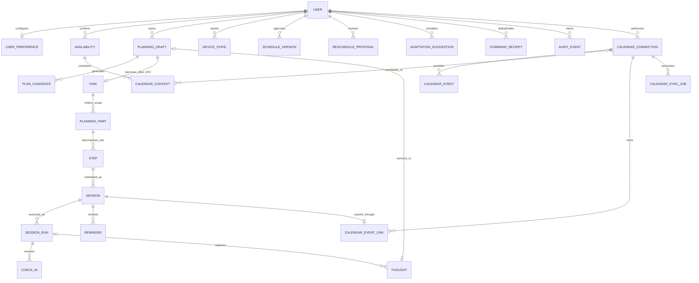
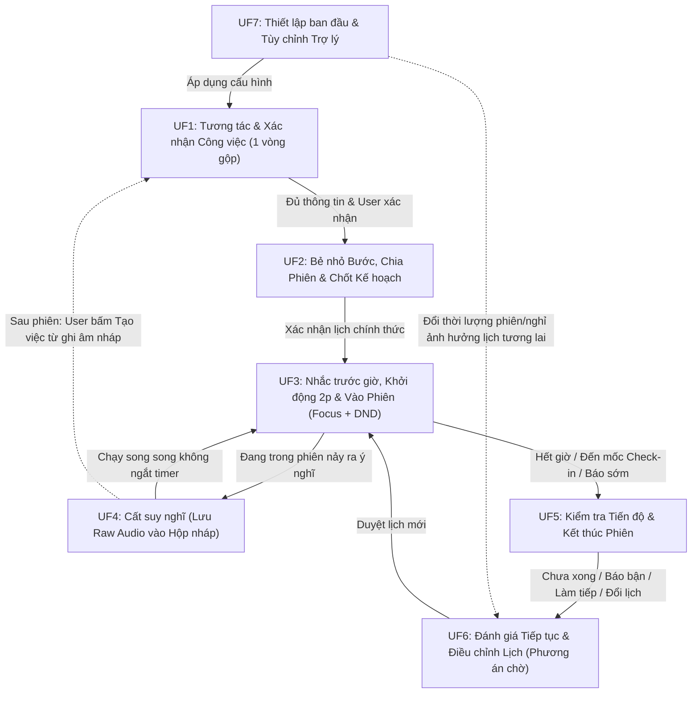
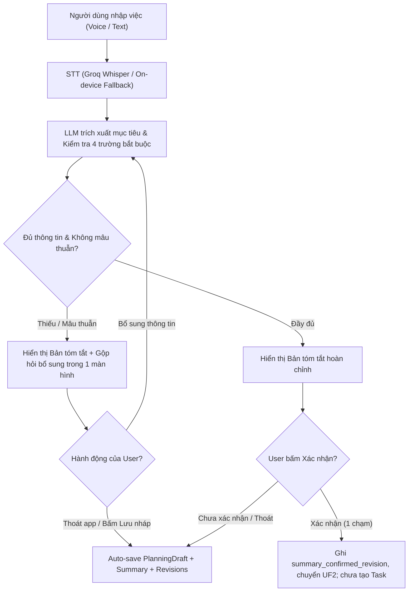
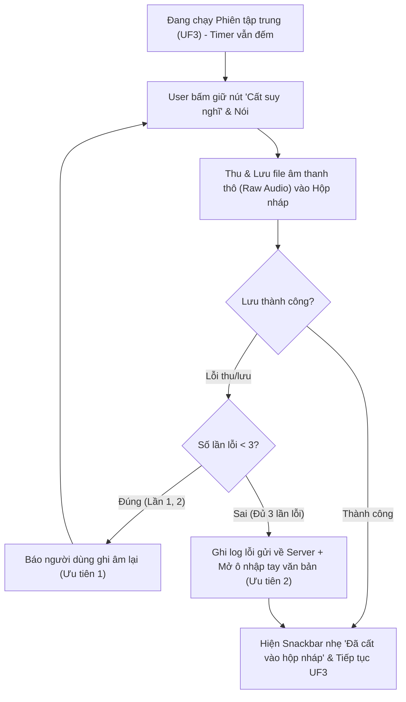
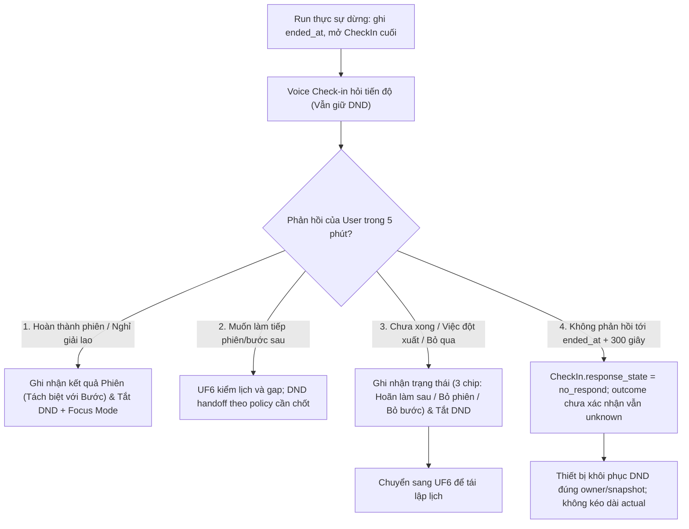
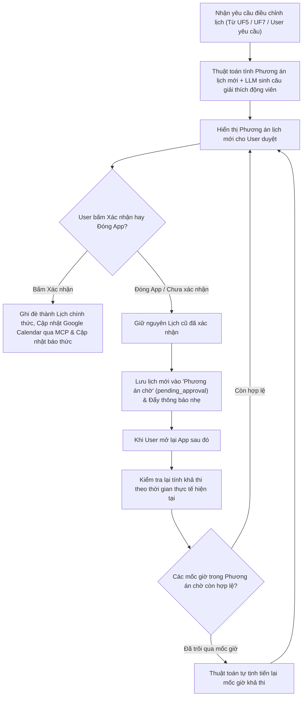

# Project.md — Tài liệu Đặc tả & Hướng dẫn AI Agent (Single Source of Truth)

> **Tên dự án:** **ProPlan VA** — Trợ lý ảo AI hỗ trợ lập kế hoạch, chia nhỏ công việc và nhắc lịch chủ động bằng giọng nói trên thiết bị di động cho người mắc hội chứng ADHD.
> **Mục đích tài liệu:** Cung cấp ngữ cảnh toàn diện (Business Logic, Cơ sở khoa học, Kiến trúc kỹ thuật, Luồng nghiệp vụ UF1–UF7, Mô hình dữ liệu và Quy tắc cốt lõi) cho các **AI Coding Agents** và thành viên trong nhóm phát triển trên toàn bộ Monorepo.
> **Đồng bộ ngày 03/11/2026:** Đối chiếu [schema Backend](docs/backend/schema.md), ORM/migrations và các quyết định tuần 2 đã được người dùng chốt. Mục 6–7 phản ánh cả giờ rảnh riêng UF1 mới; mục 8.2 phân biệt quyết định đã chốt với policy còn chờ. Nhắc 15/10/5 phút, chuông đúng hạn và Undo Thought 5 giây là yêu cầu triển khai tuần 2; chưa được coi là code đã hỗ trợ. Kết quả tích hợp và giới hạn kiểm chứng xem [biên bản nền tuần 2](docs/week2_baseline.md).

---

## 1. Tổng quan Dự án & Phát biểu Bài toán (Problem Statement)

### 1.1. Thông tin chung
- **Tên sản phẩm:** ProPlan VA
- **Đối tượng mục tiêu (Who):** Người trưởng thành, sinh viên và người đi làm mắc hội chứng **ADHD** — đặc biệt là **thể giảm chú ý (ADHD-I**, thể lâm sàng phổ biến nhất) hoặc những người gặp khó khăn nghiêm trọng về tập trung và chức năng điều hành.
- **Phạm vi (Scope):**
  - **Trong phạm vi (In-scope):** Quản lý công việc cá nhân hằng ngày, lịch trình học tập/làm việc, hỗ trợ khởi động công việc, duy trì tập trung và tái lập lịch linh hoạt.
  - **Ngoài phạm vi (Out-of-scope):** Không bao gồm chẩn đoán, can thiệp y tế hay quản lý thuốc điều trị.

### 1.2. Phát biểu bài toán chuẩn (5W1H)
> *"Người trưởng thành mắc hội chứng ADHD (**Who**) khi đi làm hoặc học tập (**Where**) đang gặp tình trạng bỏ lỡ trung bình 40% số công việc trong ngày và mất hơn 30 phút để bắt đầu một nhiệm vụ mới (**What**). Nguyên nhân chính là do các ứng dụng quản lý hiện tại yêu cầu quy trình lập kế hoạch phức tạp, gây quá tải nhận thức (**Why**). Vấn đề này bị ràng buộc bởi khả năng duy trì chú ý ngắn và thói quen dễ bỏ dở ứng dụng sau vài ngày (**Constraints**). Dự án hướng tới mục tiêu nâng tỷ lệ hoàn thành công việc đúng hạn lên $\ge$ 85% và giảm thời gian chuẩn bị bắt đầu công việc xuống dưới 5 phút trong vòng 2 tháng thử nghiệm (**Measurable Outcome/How**)."*

### 1.3. Tiêu chuẩn thành công (SMART Metrics)
1. **Giảm tỷ lệ trễ/quên việc:** Giảm từ trung bình `4/10` nhiệm vụ/tuần xuống `< 1` nhiệm vụ/tuần.
2. **Tăng thời lượng tập trung liên tục:** Tăng từ `< 10` phút lên `25` phút.
3. **Tăng tỷ lệ hoàn thành công việc:** Tăng từ `60%` lên `>= 85%` sau 30–60 ngày sử dụng.
4. **Giảm độ trễ khởi động nhiệm vụ (Task Initiation):** Từ `> 30` phút xuống `< 5` phút nhờ cơ chế Micro-task khởi động 2 phút.

---

## 2. Phân tích Vấn đề, Cơ sở Khoa học & Giải pháp Đề xuất

### 2.1. Nguyên nhân gốc rễ (Root Cause — 5 Whys)
Não bộ người ADHD gặp **suy giảm chức năng điều hành (Executive Dysfunction)**. Họ biết rõ mình cần làm gì nhưng không thể tự kích hoạt hành vi để bắt tay vào làm. Các ứng dụng quản lý công việc truyền thống yêu cầu nhập quá nhiều trường thông tin (tiêu đề, giờ bắt đầu/kết thúc, mức ưu tiên, nhãn, dự án...) gây **quá tải nhận thức (Cognitive/Brain Overload)**, dẫn đến tê liệt quyết định và bỏ cuộc chỉ sau 3–5 ngày sử dụng.

### 2.2. Đối chiếu 8 Rào cản ADHD — Bằng chứng Khoa học — Giải pháp trên ProPlan VA

| # | Rào cản của người ADHD | Bằng chứng Khoa học / Thống kê | Giải pháp trên ProPlan VA |
| :--- | :--- | :--- | :--- |
| **1** | **Quên nhiệm vụ & thời điểm thực hiện** *(Prospective Memory Deficit)* | • Thiếu hụt lớn ở việc nhớ thực hiện ý định đúng thời điểm đã định *(Rambold et al.)*.<br>• 80% bỏ lỡ thông báo văn bản tĩnh.<br>• Tin nhắn SMS nhắc suông chỉ tăng tương tác ngắn hạn (40% vs 18.4%), không cải thiện mức hoàn thành tổng thể *(Frontiers in Digital Health, 2022)*. | • **Hệ thống ghi nhớ bên ngoài:** Nhập liệu nhanh bằng Voice/Text, đồng bộ lịch tạo task có cấu trúc.<br>• **Voice Check-in 2 chiều:** AI chủ động hỏi tiến độ và khích lệ bằng giọng nói thay vì chỉ đẩy thông báo tĩnh. |
| **2** | **Công việc phức tạp, gây ngợp** *(Planning & Sequencing Deficit)* | • Suy giảm lớn ở khả năng lập kế hoạch nhiều bước *(Fuermaier et al., 2013)*.<br>• Chương trình CBT 12 tuần dạy lập kế hoạch/chia nhỏ việc giúp cải thiện triệu chứng 53%–67% so với 23%–33% ở nhóm chứng *(Safren et al., 2010)*. | • **AI Task Decomposition:** Tự động bẻ nhỏ mục tiêu lớn thành các bước nhỏ (*Steps*) và phiên làm việc (*Sessions*).<br>• **Giao diện 1-Step UI:** Chỉ hiển thị duy nhất **1 bước/phiên hiện tại** trên màn hình; hoàn thành hoặc bỏ qua mới hiện bước tiếp theo. |
| **3** | **Lúng túng về thứ tự ưu tiên** *(Choice Overload)* | • Danh sách dài (To-do list truyền thống) gây tê liệt lựa chọn *(Neural Revolution, 2023; Frontiers in Psychology, 2022)*. | • **Algorithmic Priority Queue:** Tự động đề xuất công việc dựa trên hạn chót (deadline), độ quan trọng, giờ rảnh, mức năng lượng và lịch sử né tránh (logs bỏ qua việc). |
| **4** | **"Mù thời gian"** *(Time Blindness)* | • Sai số lớn khi ước lượng thời gian *(Marx et al., 2022; phân tích gộp 27 nghiên cứu trên 1.620 người ADHD của HKU với độ lệch > 0.40)*.<br>• 60% SV ADHD tại Ireland phải xin gia hạn bài tập *(HEA & Taylor & Francis, 2025)*. | • **Buffer Time & Visual Timer:** AI gợi ý thời lượng gốc, thuật toán tự động chèn thời gian đệm dự phòng cá nhân hóa.<br>• Thanh tiến độ trực quan và đối chiếu thời gian dự kiến vs. thực tế để tinh chỉnh hệ số đệm cho các lần sau. |
| **5** | **Tê liệt khởi động** *(ADHD Paralysis / Task Initiation)* | • >70% SV ADHD chỉ làm bài trong 24–48 giờ cuối trước hạn *(Knouse & Mitchell, 2015)*.<br>• >70% người dùng biết cần làm gì nhưng cơ thể không thể bắt đầu *(Thawly, 2026)*. | • **Khởi động 2 phút (Micro-task):** Giao duy nhất 1 việc cực nhẹ trong 2–5 phút đầu trước phiên chính để hạ rào cản kích hoạt thần kinh (80% sẽ tiếp tục làm sau 2 phút). |
| **6** | **Dễ mất tập trung**  | • Thông báo điện thoại làm tăng triệu chứng mất tập trung *(Kushlev et al., CHI 2016)*.<br>• Đồng hồ nhắc tự kiểm tra giúp giảm hành vi lạc đề từ 46.8% xuống 27.3% *(Sluiter et al., 2020)*. | • **Bảo vệ chú ý kép:**<br>  1.  Tự bật Không làm phiền (DND) khi vào phiên.<br>  2.  Nút Push-to-Talk **"Cất suy nghĩ"** thu âm nhanh ý tưởng chợt nảy ra (raw audio) vào hộp nháp mà không chuyển màn hình hay ngắt đồng hồ. |
| **7** | **Lặp lại sai lầm & Cảm giác tội lỗi khi trễ hạn** | • CBT nhấn mạnh việc review kế hoạch và điều chỉnh linh hoạt *(BBK Eprints)*. | • **Adaptive Rescheduling (Guilt-free):** Khi trễ/bận đột xuất, hệ thống tự đề xuất lịch mới kèm 1 câu giải thích lý do / động viên, tránh gây hoảng loạn hay tự trách.<br>• **Rolling Horizon Planning:** Lập kế hoạch cuốn chiếu (tổng quan cả dự án, xếp lịch chi tiết 2–3 tuần gần nhất). |
| **8** | **Mất động lực & Tính cá nhân hóa** | • Công nghệ cho ADHD cần duy trì tương tác lâu dài *(Scoping Review, 2026)* và thích ứng với sự khác biệt từng cá nhân *(MDPI, 2021)*. | • Phát hiện dấu hiệu giảm tương tác để giảm tần suất thông báo chống bão hòa.<br>• Tùy chỉnh thời lượng tập trung, thời gian nghỉ, tần suất và phong cách nhắc của trợ lý. |

---

## 3. Điểm Mới Đột Phá (Novelty) So Với Đối Thủ

Các ứng dụng hiện có như **Goblin Tools** (chỉ bẻ nhỏ việc rời rạc), **Tiimo** (lịch trực quan nhưng thiết lập thủ công phức tạp), hay **Finch** (gamification chăm thú ảo nhưng thiếu lập lịch thông minh) chỉ giải quyết từng khâu đơn lẻ. **ProPlan VA** tạo sự khác biệt nhờ 4 trụ cột:

1. **Khép kín vòng lặp từ Ý định đến Hành động (Closed-Loop Execution):**
   `Nhập liệu (Voice/Text)` $\rightarrow$ `Bẻ nhỏ việc (Task -> Steps -> Sessions)` $\rightarrow$ `Xếp lịch tự động` $\rightarrow$ `Bật Focus/DND + Micro-task khởi động` $\rightarrow$ `Check-in tiến độ 2 chiều` $\rightarrow$ `Tái lập lịch thích ứng`.
2. **Mô hình "Người bạn đồng hành ảo" (Body Doubling & AI Companion):**
   Giao tiếp giọng nói 2 chiều chủ động hỏi thăm giữa các khoảng nghỉ và cuối phiên. Dựa trên bằng chứng từ nghiên cứu thực nghiệm VR trên người lớn ADHD (*arXiv:2509.12153*) và khung lý thuyết *Social Scaffolds* (*arXiv:2603.17258*).
3. **Thay đổi lịch không gây áp lực (Guilt-free Adaptive Rescheduling):**
   Mọi đề xuất dời lịch đều đi kèm lời giải thích ngắn gọn, rõ lý do và khích lệ tinh thần, loại bỏ cảm giác thất bại khi trễ hạn.
4. **Lập kế hoạch cuốn chiếu (Rolling Horizon Planning):**
   Giữ tầm nhìn tổng quan cho toàn bộ công việc/dự án nhưng chỉ tính toán và xếp lịch chi tiết cho **2–3 tuần gần nhất**, giúp tiết kiệm chi phí token LLM, giảm tải nhận thức và giữ lịch trình luôn bám sát thực tế.

---

## 4. Kiến trúc Kỹ thuật (Tech Stack) & Cơ chế Phối hợp

### 4.1. Bảng Công nghệ Thành phần

| Thành phần | Công nghệ / Thư viện | Vai trò & Lý do lựa chọn |
| :--- | :--- | :--- |
| **Thiết kế UI/UX** | **Figma** | Thiết kế giao diện tối giản tuân thủ nghiêm ngặt chuẩn **W3C COGA** (Cognitive Accessibility). |
| **Frontend Mobile** | **Flutter SDK (Dart)** | Phát triển đa nền tảng, xuất file `.apk` cho Android. Các gói thư viện chính:<br>• `provider`: Quản lý trạng thái (`User`, `Task`, `Session`, `Theme`).<br>• `dio` & `flutter_secure_storage`: Gọi REST API, interceptor đính kèm và lưu trữ bảo mật JWT Token.<br>• `flutter_dnd`, `wakelock_plus`, `flutter_local_notifications`: Tự động bật/tắt DND, giữ sáng màn hình nhẹ trong phiên, báo thức chính xác dưới nền.<br>• `table_calendar` & `circular_countdown_timer`: Hiển thị lịch trực quan và đồng hồ đếm ngược dịu mắt.<br>• `flutter_tts` & `speech_to_text`: Xử lý giọng nói trực tiếp trên thiết bị (On-device Fallback & Offline mode). |
| **Backend & Server** | **Python 3.12 (FastAPI + Uvicorn)** | Hiệu năng cao, xử lý bất đồng bộ (`async/await`) tốt, tích hợp trực tiếp hệ sinh thái AI/LLM và thuật toán lập lịch. |
| **AI / LLM Engine** | **Gemini 3.8 Flash (`gemini-3.8-flash`)** + **Warm Backup (`gemini-3.5-flash-lite`)**<br>*(Dự phòng Tầng 2: `qwen/qwen3.8-27b` & `openai/gpt-oss-20b` qua Groq Cloud)* | Điều phối **Quality-First Hedged Execution** (hỗ trợ chứng thực GCP Service Account / Google AI Studio API Key): Phân tích mục tiêu & hợp nhất nháp (UF1), bẻ nhỏ công việc thành các bước (UF2), hiểu yêu cầu sửa kế hoạch tự nhiên và sinh lời giải thích/động viên (UF2, UF6). |
| **Giọng nói (STT & TTS)** | • **STT Primary:** Groq Cloud (`whisper-large-v3` / `whisper-large-v3-turbo`)<br>• **TTS Primary:** `edge-tts` (Python)<br>• **On-device Fallback:** `speech_to_text` & `flutter_tts` | • **Groq Whisper** nhận diện tiếng Việt cực nhanh và chuẩn xác cho UF1, UF2, UF5, UF6.<br>• **edge-tts** miễn phí, truyền qua stream/pipe dễ dàng, tùy chỉnh tốc độ và giọng đọc.<br>• Tự động fallback về `speech_to_text` / `flutter_tts` trên thiết bị khi mạng yếu hoặc mất kết nối. |
| **Cơ sở dữ liệu (Database)** | • **ORM:** SQLAlchemy 2.0<br>• **Giai đoạn Code (Tuần 1–7):** SQLite (`.db` local)<br>• **Giai đoạn Deploy (Tuần 8–10):** PostgreSQL (Supabase / Neon.tech)<br>• **Mobile Local Cache:** SQLite (`sqflite`) / `shared_preferences` | Dùng SQLite local ở giai đoạn phát triển để tránh lỗi mạng và linh hoạt khi thay đổi schema; chuyển đổi mượt mà sang PostgreSQL trên Cloud ở giai đoạn cuối nhờ SQLAlchemy 2.0 mà không cần viết lại truy vấn. |
| **Lịch Ngoại vi & Giao thức MCP** | • **Dịch vụ:** Google Calendar API (OAuth 2.0)<br>• **Giao thức:** **Model Context Protocol (MCP)** | • **Đọc lịch:** Tự động lấy các sự kiện bận từ Google Calendar để suy ra khung giờ rảnh ở UF1, giải phóng người dùng khỏi việc phải nhớ và gõ tay.<br>• **Ghi lịch:** Đồng bộ 2 chiều các phiên tập trung (`Focus Sessions`) lên Google Calendar sau khi chốt ở UF2 và UF6.<br>• **MCP Protocol:** Chuẩn hóa giao tiếp giữa AI Agent/Backend và các công cụ Calendar ngoại vi một cách an toàn và nhất quán. |

---

## 5. Yêu cầu Phi chức năng (NFR) & Nguyên tắc Thiết kế UI/UX

> [!IMPORTANT]
> Với người dùng ADHD, **Yêu cầu phi chức năng (NFR) quan trọng ngang hoặc hơn tính năng nghiệp vụ**, vì ngưỡng chịu đựng sự gián đoạn và ma sát giao diện (*frustration tolerance*) của họ rất thấp. Mọi AI Agent khi viết code UI hoặc API đều **bắt buộc** phải kiểm tra danh sách này.

### 5.1. Tính khả dụng & Tải nhận thức (Chuẩn W3C COGA)
- **Giới hạn mật độ thông tin:** Mỗi màn hình chỉ chứa tối đa **3–5 thành phần tương tác chính**.
- **Không gây gián đoạn cảm xúc:**
  - **CẤM** quảng cáo, **CẤM** pop-up bất ngờ (nhóm đã thống nhất loại bỏ hoàn toàn các pop-up gợi ý ngoài lề như rủ đi chơi thể thao).
  - **CẤM** dùng huy hiệu thông báo (badge) màu đỏ tươi gây cảm giác báo động/căng thẳng.
- **Bảng màu (Color Palette):** Sử dụng tông màu dịu mắt (*Pastel, Soft Green, Warm Gray, Dark Mode dịu nhẹ*), tuyệt đối tránh màu neon hoặc độ tương phản gây chói.
- **Giải phóng trí nhớ ngắn hạn (Working Memory Offloading):**
  - Luôn hiển thị sẵn hạn chót (deadline) ở ngữ cảnh liên quan.
  - **Auto-save:** Tự động lưu nháp ngay lập tức khi người dùng đang gõ hoặc nói dở mà thoát ứng dụng.
  - **Context Recovery:** Nếu người dùng bị gián đoạn (ví dụ: có cuộc gọi đến hoặc chuyển app), ngay khi quay lại ứng dụng phải hiển thị thẻ nhắc ngữ cảnh: *"Bạn đang ở bước nào? Đang làm gì?"*.
- **Giảm áp lực sai lầm (Undo thay vì Confirm Dialog):**
  - Không hiển thị hộp thoại hỏi *"Bạn có chắc chắn muốn xóa/bỏ qua?"* gây tê liệt quyết định.
  - Thực hiện thao tác ngay lập tức và hiển thị thanh `Snackbar` có nút **Hoàn tác (Undo) trong 5 giây**.
- **Nhãn nút bấm cụ thể (Action-Oriented Microcopy):**
  - Dùng nhãn mô tả rõ hành động và thời lượng như `"Bắt đầu đếm giờ 15p"`, `"Chia nhỏ việc này"`, `"Cất suy nghĩ (Giữ để nói)"` thay vì các từ mơ hồ như `"OK"`, `"Submit"`, hay `"Tiếp tục"`.

### 5.2. Hiệu năng & Độ trễ (Performance & Latency)
- **Khởi động nguội (Cold Start):** $\le 2.0$ giây.
- **Khởi động ấm (Warm Start):** $\le 1.0$ giây.
- **Hoạt họa (Animation):** Duy trì ổn định ở **60 FPS**.
- **Độ trễ API thông thường (CRUD / Thuật toán):** $\le 300\text{ ms}$.
- **Độ trễ xử lý AI (LLM Latency & Hedged Timing Profiles):** Phản hồi thông thường đạt $\le 2.5$ giây; áp dụng 2 khung điều phối **Quality-First Hedged Execution**: **Khung A** cho luồng tương tác trực tiếp UF1/UF2-Adjust/UF6 (Warm Backup tại `2.6s`, Groq Hedge tại `3.5s`, ưu tiên Primary tới `4.0s`, **ngắt cứng `4.5s`**) và **Khung B** cho luồng bẻ nhỏ công việc UF2 (Warm Backup tại `3.1s`, Groq Hedge tại `4.4s`, ưu tiên Primary tới `5.4s`, **ngắt cứng `6.0s`**). Trong thời gian chờ AI phản hồi, **bắt buộc** hiển thị hiệu ứng chờ thư giãn (*Shimmer skeleton* hoặc vòng tròn xoay nhịp thở nhẹ *Breathing Circle*) kèm thông điệp rõ ràng: *"AI đang bẻ nhỏ công việc giúp bạn..."*.

### 5.3. Độ tin cậy & Chính xác thời gian (Reliability & Precision)
- **Chuông báo hết giờ (Alarm Precision):** Chính xác tuyệt đối (dung sai $\le 1$ giây, tỷ lệ thành công $\ge 99.9\%$), phải hoạt động ổn định kể cả khi tắt màn hình hoặc thiết bị rơi vào chế độ tiết kiệm pin (**Android Doze Mode**) thông qua Exact Alarm / Foreground Service.
- **Khả năng hoạt động ngoại tuyến (Offline Resilience):** Khi mất kết nối 4G/Wi-Fi, đồng hồ đếm ngược, ghi âm "Cất suy nghĩ" (UF4) và lịch trình trong ngày vẫn phải hoạt động bình thường nhờ bộ nhớ đệm cục bộ (`shared_preferences` / local SQLite), tự đồng bộ lại khi có mạng.
- **Xử lý lỗi AI êm ái (Graceful Degradation - Đa tầng):**
  Khi gọi AI gặp sự cố hoặc quá thời gian chờ, tuyệt đối không trả về màn hình trắng hay báo lỗi kỹ thuật thô. Áp dụng **Cơ chế Dự phòng 3 Tầng (3-Tier Fallback)**:
  1. **Tầng 1 (Primary + Warm Backup Gemini):** Gọi **`gemini-3.8-flash`** kết hợp khởi chạy ngầm **`gemini-3.5-flash-lite`** (Warm Backup giữ sẵn trong RAM nếu model chính xử lý chậm).
  2. **Tầng 2 (Cross-Provider Groq Fallback):** Nếu nhánh Google lỗi nhanh, quá hạn mức (Rate Limit 429) hoặc chạm mốc Hedge, Backend tự động chuyển sang **`qwen/qwen3.8-27b`** trên Groq Cloud (và model phụ **`openai/gpt-oss-20b`** nếu chạm trần TPM — dùng chung `GROQ_API_KEY` với Groq Whisper).
  3. **Tầng 3 (Deterministic Rule-based Fallback):** Nếu mất kết nối tới cả 2 nhà cung cấp AI, hệ thống tự động kích hoạt thuật toán chia công việc thành các phiên cố định theo thời lượng tập trung mặc định của người dùng (ví dụ: `20–25 phút/phiên` + `5 phút nghỉ`) kèm câu thông báo thân thiện để không làm đứt mạch làm việc.

### 5.4. Cơ chế Giữ chân Người dùng (Retention Mechanics)
- **Chuỗi ngày duy trì (Guilt-free Streak):** Có hệ thống cột mốc (milestone) và huy hiệu tạo niềm vui, nhưng áp dụng cơ chế **Đóng băng chuỗi (Streak Freeze)** khi người dùng nghỉ hoặc lỡ nhịp chứ không xóa sạch chuỗi về 0 nhằm tránh hiệu ứng tâm lý *"đằng nào cũng hỏng rồi, bỏ luôn"* (*All-or-Nothing mindset*).
- **Thanh tiến độ & Tổng kết định kỳ:** Tập trung hiển thị những thành tựu và số phiên đã hoàn thành để củng cố động lực tích cực.

---

## 6. Mô hình Dữ liệu Chuẩn & Sơ đồ Thực thể

### 6.1. Phân cấp công việc & Vòng đời lập kế hoạch

Ba đối tượng nghiệp vụ cốt lõi vẫn là **Task → Step → Session**. Schema bổ sung **PlanningPart** để giữ từng phần phạm vi, kể cả phần chưa chia chi tiết trong Rolling Horizon:

$$\text{Task} \longrightarrow \text{PlanningPart} \longrightarrow \text{Step} \longrightarrow \text{Session}$$

- **UF1:** Lưu `PlanningDraft` và `TaskSummary`; xác nhận Summary chưa tạo Task chính thức.
- **UF2:** Sinh `PlanCandidate` để review. Chỉ khi xác nhận Candidate mới lưu `Task`, `PlanningPart`, `Step`, `Session` và `ScheduleVersion` trong một transaction.
- **UF3–UF5:** `Session` là lịch dự kiến; `SessionRun` là lần thực hiện được chấp nhận start; `CheckIn` lưu phản hồi. Phiên chưa bắt đầu không có Run giả.
- **UF6:** `RescheduleProposal` giữ thay đổi chờ duyệt; chỉ approve thành công mới tạo bản lịch chính thức mới.

> [!WARNING]
> **Quy tắc nghiệp vụ bất biến:** Timer hết **KHÔNG** tự hoàn thành Session, Step hay Task. Kết quả Run, xác nhận đầu ra Step và xác nhận toàn bộ phạm vi Task là các dữ liệu riêng ở UF5. Xong phần đã xếp lịch trong horizon không đồng nghĩa xong toàn Task.

### 6.2. Sơ đồ Thực thể Liên kết (ERD Khái niệm)

Sơ đồ thể hiện quan hệ nghiệp vụ, không phải DDL hoặc cam kết mỗi object có một bảng SQL. Các snapshot/value object có thể được nhúng; FK, indexes và constraints theo models/migrations được review cho SQLite và PostgreSQL.



### 6.3. Danh mục Đối tượng O01–O26

Tên object và trường dưới đây theo [schema Backend](docs/backend/schema.md). Đây là chỉ mục các thay đổi chính; required/nullable, enum và biến thể request/response phải đọc theo từng endpoint trong schema, không suy từ tên object hoặc ví dụ.

| Mã | Đối tượng | Dữ liệu & Vai trò chính |
| :--- | :--- | :--- |
| O01 | `UserPreference` | `work_interval_seconds`, `rest_interval_seconds`, `micro_task_seconds`, `reminder_offsets`, `buffer_multiplier`, `reminder_style`; tách `requested_revision` và `effective_revision`, giữ `requested_changes`/`pending_proposal_id`. |
| O02 | `Availability` | `weekly_rules`, `date_overrides`, `task_limits`, `timezone`, `confirmed_at`; `effective_intervals` dẫn xuất theo from/to và `calendar_context` có revision. |
| O03 | `TimeConstraint` | `kind=deadline` dùng `start_at` + `deadline_at`, `finish_by_at=null`; `kind=window` dùng `start_at` + `finish_by_at`, `deadline_at=null`; giữ `input_timezone`. |
| O04 | `TaskSummary` | `title`, `description`, `goal`, `scope`, `extra_requirements`, `time_constraint`, `availability_ref`, `importance`, `clarification_issues`, `can_plan`, `field_sources`. |
| O05 | `PlanningDraft` | `client_draft_id`, `raw_input`, `input_source`, `stage`, `summary`, `summary_revision`, `planning_input_revision`, `summary_confirmed_revision`, `user_step_proposal`; liên kết Thought/Candidate/Task khi có. |
| O06 | `PlanCandidate` | Parts/Steps/Sessions dùng client keys; `planning_horizon`, `feasibility`, `review_revision`, hai revision đầu vào Draft, `source_revisions`, `stale` do server tính. Chưa có lịch vận hành. |
| O07 | `Task` | Giữ nội dung/phạm vi, `time_constraint`, `importance`, `source_draft_id`, `availability_ref`; tách `status`, `decomposition_state` và `scheduling_state`. `source_summary` giữ cả goal/nguồn giá trị. |
| O08 | `Step` | Thuộc Task và `planning_part_id`; `expected_output`, `order_index`, `estimated_base_seconds`, `remaining_base_seconds`, `buffer_multiplier`, `estimate_source`, `status`. |
| O09 | `Session` | `scheduled_start/end`, `work_seconds`, `rest_seconds`, `segments`, `duration_seconds`, gợi ý micro-task; `schedule_revision`, `status`, `start_state`, `start_decision_due_at`, `calendar_event_link_id`. |
| O10 | `FeasibilityReport` | `verification_scope`, `status`, `fully_scheduled`, `required_seconds`, `available_seconds`, `unscheduled_seconds`, `deficit_seconds`, `blocking_reasons`; chỉ rõ phần chưa ước lượng/chưa lập kế hoạch. |
| O11 | `ScheduleVersion` | `version_number`, `base_version`, `approved_at`, `affected_task_ids`, `min_inter_session_gap_seconds`; tách `alarm_sync_state` với `calendar_sync_summary`. |
| O12 | `SessionRun` | `session_id`, `device_id`, `started_at`, `ended_at`, `run_state`, `active_phase`, `segment_index`, `settings_snapshot`, thời gian work/rest, `actual_source`, `outcome`, mốc check-in/DND. |
| O13 | `CheckIn` | `run_id`, `kind`, `response_state`, `session_outcome`, `step_completed`, `task_completed`, `skip_scope`, `remaining_note`, `asked_at`, `responded_at`, `response_revision`. |
| O14 | `Thought` | `client_thought_id`, `source_run_id`, `input_type`, `capture_state`, `attempt_count`, `text_content`; `linked_draft_id` khác `converted_task_id`; audio path thuộc local. |
| O15 | `RescheduleProposal` | `target_task_id`, `allowed_task_ids`, `affected_task_ids`, `proposed_changes`, `feasibility`, `explanation`; revision nguồn/lịch nền, supersession và trạng thái thông báo phương án chờ. |
| O16 | `Reminder` | `session_id`, `schedule_revision`, `device_id`, `kind`, `fire_at`, `dedupe_key`, `delivery_state`, `user_action`; không phát nhắc vận hành từ Candidate. |
| O17 | `DeviceState` | Quyền notification/microphone/DND/alarm, `active_run_id`, `last_schedule_revision`, `dnd_owner_run_id`, kết quả apply/restore, `reported_at`, `app_visibility`, `device_report_revision`. |
| O18 | `CommandReceipt` | `command_id`, `command_type`, `state`, `result_reference`, `applied_at`; `payload_hash` nội bộ, `queue_state` là dữ liệu hàng chờ local. |
| O19 | `AdaptationSuggestion` | `kind`, `current_value`, `suggested_value`, `sample_count`, `sample_refs`, `reason`, `policy_revision`, `model_revision`, revision và liên kết gợi ý bị thay thế. |
| O20 | `AuditEvent` | `event_id`, `event_type`, `resource_ref`, `resource_revision`, `command_id`, `occurred_at`, `received_at`, `duration_source`; truy vết retry và nguồn actual. |
| O21 | `CalendarContext` | Snapshot theo `context_id/revision`; cặp nguồn `connection_id/google_calendar_id`, phạm vi truy vấn, busy intervals, coverage/errors, nguồn loại trừ và giờ bận thủ công. ORM hiện dùng tên `PlanningContext`. |
| O22 | `PlanningPart` | `client_part_key`, `scope_description`, `order_index`, trạng thái chia/xếp, `unexpanded_scope`, `rough_estimate_seconds`, `estimate_source`; chưa biết estimate giữ null. |
| O23 | `CalendarConnection` | `account_ref`, các lịch được phép đọc, một lịch đích ghi, `granted_scopes`, `connection_state`, `revision`; `credential_ref` chỉ dùng nội bộ. |
| O24 | `CalendarEventLink` | Ánh xạ Session với bộ ba connection/calendar/event của Google, `google_etag`, revision lịch mong muốn/đã sync, `sync_state`, `last_synced_at`. |
| O25 | `CalendarSyncJob` | `target_kind`, `target_ref`, `operation`, revision lịch/etag nguồn, trạng thái job/retry; payload snapshot và idempotency key nội bộ, không trả toàn bộ ra API. |
| O26 | `CalendarEvent` | Dữ liệu sự kiện ngoài app hoặc gắn Session: start/end, timezone hoặc ngày all-day, `transparency`, provider status, `etag`, `session_link_id`, reminders và phạm vi recurrence. |

### 6.4. Quy ước Dữ liệu, Revision & Transaction

- **Kiểu dữ liệu:** ID trên API là string; DB có thể dùng UUID nhưng không ép mọi client phải UUIDv4. Thời lượng trao đổi là **integer giây**. Timestamp tuyệt đối có offset, lưu UTC; lịch tuần dùng giờ `HH:mm` kèm timezone IANA. Revision theo tài nguyên; `CheckIn.response_revision` mới có thể bằng 0.
- **Null khác rỗng:** Chưa biết/không áp dụng giữ null; `[]` chỉ dùng khi đã biết danh sách rỗng. PATCH omitted giữ nguyên; null chỉ xóa trường được phép. Không có query from/to thì `Availability.effective_intervals=null`; đã tính và thật sự không rảnh mới là `[]`.
- **Giờ rảnh có xác nhận:** Yêu cầu UF1 mới dùng `TaskSummary.availability` (`DraftAvailability`), review/xác nhận cùng `summary_confirmed_revision`, không bắt buộc cấu hình Settings trước. Nháp cũ vẫn dùng `AvailabilityRef={availability_id,revision}` khi user đã chọn nguồn chung. Sửa/xóa giờ riêng không tự quay lại ref chung. Calendar chỉ bổ sung bận; lỗi/thiếu coverage không được giả thành lịch trống. UF2/Context hiện chưa nối nguồn Draft mới và trả `409 PLAN_NOT_CONFIRMABLE` / `wait_for_configuration` cho nguồn này; đây là việc giai đoạn 1 cần hoàn thiện.
- **Revision Draft:** `raw_input`, Summary hoặc `user_step_proposal` thực sự đổi thì tăng `planning_input_revision` một lần trong lần ghi. Summary đổi tăng `summary_revision` và mất xác nhận UF1; raw input đổi cũng vô hiệu xác nhận. Chỉ sửa ý tưởng chia bước giữ xác nhận Summary nhưng làm Candidate cũ stale. No-op/metadata/confirm không tự tăng đầu vào.
- **Revision Candidate:** Sinh từ `source_summary_revision` và `source_planning_input_revision`; PATCH kiểm `expected_review_revision`. Confirm kiểm `expected_review_revision`, `expected_summary_revision`, `expected_planning_input_revision`, `expected_source_revisions` trong transaction áp dụng. `SourceRevisions` gồm `availability`, `preferences`, `schedule`, `calendar_context={context_id,revision}`.
- **Khóa tạm → ID thật:** Candidate dùng `client_part_key/client_step_key/client_session_key`, quan hệ cha cũng dùng khóa tạm tương ứng. UF2 confirm trả `key_mapping`; không dùng client key để start Session thật. `source_draft_id` ngăn một nháp sinh nhiều Task đầu tiên.
- **Chống retry trùng:** `user_id` lấy từ app token. Giữ `Idempotency-Key` cho cùng ý định/payload; cùng khóa khác nội dung bị từ chối. Client draft ID và command ID unique trong phạm vi user; Part/Step/Session keys unique trong phạm vi nguồn tương ứng.
- **Lưu nguyên tử:** Confirm/approve kiểm quyền, nguồn và revision bằng CAS/khóa phù hợp; lưu lịch, receipt và outbox trong cùng transaction. Không giữ transaction chờ AI/Google. Google worker chỉ chạy sau commit, không ghi đè revision mới hoặc khôi phục Session đã hủy.
- **Ranh giới API/DB/local:** Summary/Feasibility/ref không bắt buộc có bảng riêng. Audio path, DND restore snapshot và queue local không tự trở thành DTO Backend. Không ghi token, transcript hoặc audio vào log.

### 6.5. Session, Run & Kết quả Thực hiện

- Một Session có thể gồm nhiều segment `work/rest`: `duration_seconds = work_seconds + rest_seconds = tổng segments[].duration_seconds`. Buffer chỉ nhân **một lần** lên làm chính; không nhân lại work đã buffer khi tạo timer.
- Micro-task là gợi ý chuẩn bị trước Session, không có timer/Run riêng, không có `active_phase=micro`, không nằm trong segments và không cộng vào duration/actual/Google event. Số giây micro-task có thể null trong hợp đồng; mục tiêu UX 2 phút và policy cần chốt được ghi ở mục 8.2.
- Phân biệt các mốc: reminder đích tuần 2 mặc định `[900, 600, 300]`, code nền hiện vẫn `[900]`; start grace 900 giây; gap tối thiểu giữa hai Session liên tiếp 900 giây, cùng hoặc khác Task. Reminder là cấu hình, grace và gap là ràng buộc khác nhau; mở rộng reminder không đổi grace/gap. Một Session đứng riêng không tự cộng gap trước/sau.
- `Session.start_state=not_started` khi đến `scheduled_start + 900` mà chưa có Run; hiển thị **Bắt đầu** hoặc **Hoãn lại**, không tạo `ended_at`/actual giả. Bắt đầu sớm/muộn phải kiểm giờ rảnh, thứ tự, collision và gap; nếu cần đổi lịch thì qua UF6.
- `ended_at` là lúc Run thật sự dừng; `checkin_timeout_at=ended_at+300`. Thời gian chờ phản hồi không kéo dài actual. Tách `work_elapsed_seconds`, `rest_elapsed_seconds` và `actual_work_seconds` với `actual_source=timer_proxy/self_report`; thiếu nguồn actual thì null, không lấy planned thay actual.
- Không phản hồi cuối Run là `CheckIn.response_state=no_respond`, `outcome` chưa xác nhận vẫn `unknown`. Phản hồi muộn sửa cùng CheckIn và revision, không tạo Run/mẫu học mới, không dời `ended_at`.
- DND có owner Run và snapshot local: chỉ khôi phục phần app đã áp, không tắt DND vốn do user bật; timeout cũ không được tác động Run mới. Backend chỉ ghi nhận trạng thái thiết bị báo, không suy đã khôi phục thành công. Giữ DND qua rest **nội bộ Run**; chính sách chuyển sang Run tiếp theo cần đối chiếu mục 8.2.

### 6.6. Ánh xạ Tên cũ → Schema hiện hành

| Tên trong đặc tả cũ | Cách đọc theo schema hiện hành |
| :--- | :--- |
| `TASK(status='draft'/'confirmed')` ở UF1 | `PlanningDraft` và `summary_confirmed_revision`; Task chính thức chỉ có sau confirm UF2. |
| `DraftThought`, `DRAFT_THOUGHT(status='raw_saved')` | `Thought` (O14), `capture_state` mô tả bằng chứng thu/lưu; không tạo thêm model trùng và không tự coi `raw_saved` là enum wire. |
| `ScheduleProposal`, `SCHEDULE_PROPOSAL` | `RescheduleProposal` (O15); phương án đang chờ duyệt giữ ý nghĩa nghiệp vụ `pending_approval`. |
| `no_response` của nghiệp vụ UF5 | Wire hiện hành là `CheckIn.response_state='no_respond'`; không gán nhãn này vào Session.status hoặc tự complete Run. |
| `actual_duration_min` trên Session | Thời gian thực hiện ở `SessionRun`, đơn vị giây và có nguồn; UI có thể quy đổi phút để hiển thị. |
| `focus_duration_min`, `break_duration_min` | `work_interval_seconds`, `rest_interval_seconds`; một quãng work không nhất thiết là toàn Session. |
| `free_time_slots`, `reminder_frequency`, `assistant_style` | `Availability` riêng; cấu hình nhắc dùng `reminder_offsets` và `reminder_style`. |

### 6.7. Tài khoản, Calendar & Phạm vi triển khai

- **O00 User:** Thiết kế bổ sung chọn Google Sign-In → Backend xác minh Google ID token → cấp app access token. Định danh Google theo `sub`/AuthIdentity, không dùng email thay subject. Auth endpoint, TTL, refresh/logout và thu hồi token chưa được công bố đầy đủ trong nguồn schema.
- **Calendar OAuth tách Auth:** Đăng nhập không tự cấp quyền Calendar. `CalendarConnection` quản lý read/write scopes và lựa chọn lịch; `CalendarContext` là snapshot bận để Python tính lịch. Session ID nội bộ khác Google event ID.
- **Ghi Calendar:** Tạo/sửa/xóa sự kiện ngoài qua preview/confirm; đổi giờ/xóa event gắn Session phải qua UF6. Worker kiểm etag/revision, phân biệt lưu lịch app thành công với sync Google. Đổi lịch đích xử lý keep/move tường minh; sửa sự kiện lặp phải rõ phạm vi.
- **Khả năng hiện hành:** `offline_start_supported=false` theo schema; timer của Run đã được chấp nhận, xem lịch cache và thu âm UF4 vẫn phải hoạt động khi mất mạng. Không suy cache đồng nghĩa có thể tự start Run mới offline.
- **Streak Freeze:** Giữ mục tiêu UX ở mục 5.4; các trường streak và số freeze tokens chưa thuộc schema tối thiểu, không tự thêm vào User/API hoặc gán quota mặc định.
- **Trạng thái triển khai:** ORM đã có nhiều model nêu trên, nhưng không có nghĩa mọi API/worker/mobile đã triển khai. Hợp đồng schema, models/migrations và OpenAPI/kiểm thử phải đối chiếu riêng trước bàn giao. Các mục chưa khóa trong schema mục 9 vẫn cần nhóm chốt.
- **Migration đã bổ sung:** `0ece3b500cfe_align_planning_schema.py` sửa tổng duration không gồm micro-task, khóa `CheckIn.response_state` theo wire, bỏ micro elapsed khỏi Run, đổi importance sang integer và bổ sung audit command/ref. `20261101_01_distinct_planning_part_constraints.py` sửa tên hai unique constraints theo Task + client part key và Task + order; không thay dữ liệu nghiệp vụ. Đây là thay đổi lưu trữ, không phải bằng chứng toàn luồng API đã hoàn tất.

---

## 7. Đặc tả Chi tiết 7 Luồng Tương tác Chuẩn (User Flows UF1 – UF7)

### Tổng quan Liên kết giữa 7 User Flows



---

### 7.1. Nhóm Luồng Khởi tạo & Lập lịch (UF7, UF1, UF2)

#### UF7 — Thiết lập ban đầu & Tùy chỉnh trợ lý
- **Mục tiêu & Điểm bắt đầu:** Người dùng cấu hình trợ lý trước khi bắt đầu lập lịch lần đầu hoặc vào phần Cài đặt để tùy chỉnh phương thức nhắc nhở và tập trung.
- **Luồng xử lý chính (4 bước):**
  1. **Lựa chọn thông số:** Dùng `work_interval_seconds`, `rest_interval_seconds`, `reminder_offsets`, `reminder_style`, `buffer_multiplier`; giờ rảnh lưu riêng trong `Availability`. Các giá trị 25p làm/5p nghỉ là cấu hình minh họa cũ, không phải mặc định API đã được schema khóa. Quyết định tuần 2 nhận 1–3 mốc không trùng, mặc định `[900, 600, 300]`; giữ lựa chọn đã lưu. Code nền vẫn một offset `[900]`, cần cập nhật đồng bộ theo mục 8.2.
  2. **Đánh giá tác động & Giữ nguyên phiên hiện tại:** Hệ thống kiểm tra điều kiện thay đổi; giữ nguyên cấu hình cho phiên đang chạy ở UF3. Nếu thay đổi làm lệch các phiên đã lên lịch trong tương lai (đổi thời lượng phiên/nghỉ), chuyển sang **UF6 (Phương án chờ)** để người dùng duyệt lại lịch.
  3. **Tách yêu cầu và hiệu lực:** `requested_changes/requested_revision` không thay ngay `effective_revision` khi đang chờ duyệt đổi lịch. Run hiện tại giữ `settings_snapshot`; thay đổi giọng/cách nhắc áp dụng cho phiên sau, thay đổi ảnh hưởng lịch đi qua change-request và UF6.
  4. **Gợi ý hệ số đệm:** Luôn ưu tiên cấu hình user; không âm thầm ghi đè. Schema mới chỉ học từ Step đã hoàn tất cùng phạm vi và actual có nguồn; một Step nhiều phiên chỉ là một mẫu. `AdaptationSuggestion` giữ `sample_refs`, `sample_count`, `policy_revision`. Quy tắc cũ Moving Average 7–10 phiên, kiểm hằng tuần và ngưỡng 0.2 đang lệch cơ sở mẫu của schema; ghi tại mục 8.2 để chốt policy trước triển khai.

---

#### UF1 — Tương tác & Xác nhận công việc
- **Mục tiêu & Điểm bắt đầu:** Hệ thống hiểu đúng công việc, khung giờ rảnh và deadline khi người dùng thêm mục tiêu mới; áp dụng cơ chế gộp câu hỏi làm rõ vào 1 vòng duy nhất để giải phóng trí nhớ ngắn hạn.
- **Luồng xử lý chính (4 bước):**
  1. **Nhập liệu đa phương thức:** Người dùng nhập công việc bằng **Giọng nói** (STT ưu tiên Groq Whisper `whisper-large-v3-turbo`, fallback on-device `speech_to_text`) hoặc **Văn bản**. LLM trích xuất mục tiêu, hạn chót, mốc thời gian và ghi chú.
  2. **Kiểm tra 4 nhóm thông tin bắt buộc:** Hệ thống đối chiếu dữ liệu để đảm bảo có đủ 4 thành phần:
     - *Nội dung công việc (Task content)*
     - *Phạm vi / Đầu ra mong muốn (Scope)*
     - *Khung giờ rảnh:* `TaskSummary.availability` cho yêu cầu mới, xác nhận cùng Summary; `AvailabilityRef` chỉ dùng cho nháp cũ/nguồn chung user đã chọn. **Google Calendar MCP / API** bổ sung khoảng bận để Python tính giờ khả dụng, không tự coi khoảng trống Calendar là giờ rảnh đã được xác nhận.
     - *Ràng buộc thời gian:* `TimeConstraint.kind=deadline/window` có `start_at` và mốc cuối theo nhánh; giữ `input_timezone`, không dùng `timeframe` làm nhãn wire.
     - **Nguyên tắc:** Đánh dấu rõ các điểm thiếu, mơ hồ hoặc mâu thuẫn; **tuyệt đối không tự đoán dữ liệu**.
  3. **Gộp 1 vòng duy nhất (Single-Round Clarification):** Hiển thị bản tóm tắt trực quan kèm câu hỏi làm rõ tất cả các chỗ còn thiếu/mâu thuẫn trong **1 lần hiển thị duy nhất** (không hỏi lắt nhắt nhiều lượt). Người dùng bổ sung hoặc chỉnh sửa trực tiếp trên giao diện.
  4. **Xác nhận & Chuyển luồng:** Khi đủ 4 nhóm thông tin, `can_plan=true` và user xác nhận đúng `summary_revision`, lưu `summary_confirmed_revision` rồi chuyển sang **UF2**. Đây là xác nhận đầu vào, **chưa tạo Task**, chưa duyệt lịch hay ghi Google Calendar.
- **Xử lý ngoại lệ & Bảo toàn dữ liệu:**
  - Nếu thông tin chưa rõ/thiếu, hệ thống chỉ giữ ở bước 3, chưa chuyển sang UF2.
  - Nếu người dùng thoát app hoặc chưa muốn bổ sung ngay $\rightarrow$ **tự động lưu `PlanningDraft`** với client ID ổn định, Summary và revisions để phục hồi; không tạo `Task(status='draft')` theo mô hình cũ.



---

#### UF2 — Xem các bước & Chốt kế hoạch
- **Mục tiêu & Điểm bắt đầu:** Từ Summary đã xác nhận, tạo `PlanCandidate` gồm Parts/Steps/Sessions, review và chốt kế hoạch đầu tiên. Không dùng `Task.status=confirmed` làm đầu vào UF2.
- **Luồng xử lý chính (5 bước):**
  1. **Đề xuất phân rã chủ động (Tránh Tê liệt khởi động):** Để giải quyết rào cản *Blank Canvas / ADHD Paralysis*, AI (Gemini Flash) **chủ động sinh sẵn một phương án chia bước chuẩn** (`Default Decomposition Proposal`) gồm danh sách các bước, thời lượng dự kiến và Micro-task khởi động 2 phút, kèm nút `"Tùy chỉnh theo ý tôi"` để người dùng tự điều chỉnh nếu muốn.
  2. **Thuật toán Python xếp phiên & Kiểm tra khả thi:** `scheduler_engine.py` chia Step thành Session/segments, nhân buffer một lần lên làm chính và xếp vào giờ khả dụng. `planning_horizon` mặc định 14 ngày trong giới hạn đã xác nhận, tương ứng đầu khoảng Rolling Horizon 2–3 tuần. Giữ toàn bộ `PlanningPart`, kể cả `unexpanded_scope`; chưa biết estimate giữ null, không tạo Step/Session giả.
  3. **Hiển thị Lịch tổng quan & Cảnh báo thiếu hụt:** Hiển thị phần đã chia/xếp và phần còn lại, kèm `FeasibilityReport.verification_scope` và một câu giải thích.
     - **Tổng thời lượng trong phạm vi đã ước lượng:**
       $$T_{\text{req}} = \sum_i (\text{work\_seconds}_i + \text{rest\_seconds}_i)$$
       `work_seconds` đã gồm buffer; không nhân lại, không cộng micro-task. Kiểm riêng gap 900 giây giữa các Session liên tiếp, không cộng gap vào mọi phiên.
     - **Cận dưới thiếu tổng thời lượng:**
       $$\Delta T_{\text{deficit}} = \max(0, T_{\text{req}} - T_{\text{free}})$$
       `deficit_seconds=0` chưa bảo đảm xếp được: vẫn phải có lịch cụ thể thỏa giờ rảnh, thứ tự, collision, deadline và gap. `search_inconclusive` không có nghĩa đã chứng minh vô nghiệm; phần chưa ước lượng phải được liệt kê riêng.
     - **Phạm vi dời lịch khác (Đã chốt):** **Tuyệt đối không tự động dời hoặc xáo trộn các Task khác đã chốt**. Hệ thống thông báo rõ $\Delta T_{\text{deficit}}$ và nguyên nhân để người dùng quyết định: mở rộng thêm giờ rảnh hoặc lùi deadline.
  4. **Chỉnh sửa linh hoạt:** Người dùng sửa trực tiếp hoặc dùng giọng nói/văn bản. `user_step_proposal` tùy chọn giữ trên Draft và snapshot Candidate; người dùng có thể giao trợ lý đề xuất. Mỗi lần sửa phải kiểm revisions và tính lại khả thi/stale; quy tắc PATCH lồng còn cần khóa allowlist theo schema mục 9.
  5. **Xác nhận & Đồng bộ Google Calendar:** Khi Candidate khả thi và đúng các revision đã xem, confirm nguyên tử tạo Task/Parts/Steps/Sessions, `ScheduleVersion`, receipt và outbox; trả `key_mapping`. Sau commit mới đồng bộ Google, tạo lời nhắc theo lịch chính thức. Lưu app thành công và sync Google thành công là hai trạng thái riêng.
- **Cơ chế Dự phòng Đa tầng khi AI lỗi (3-Tier Fallback):**
  - **Tầng 1:** `gemini-3.8-flash` (Primary) + `gemini-3.5-flash-lite` (Warm Backup chạy ngầm từ `3.1s`, ưu tiên Primary tới `5.4s`, ngắt cứng UF2 tại `6.0s`).
  - **Tầng 2:** Chuyển sang LLM dự phòng chéo hãng trên Groq Cloud (`qwen/qwen3.8-27b` $\rightarrow$ `openai/gpt-oss-20b` tại mốc `4.4s` hoặc ngay khi Google lỗi nhanh).
  - **Tầng 3:** Nếu mất mạng toàn diện tới AI, Thuật toán Python tự động chia công việc thành các phiên cố định `20–25 phút` (theo cấu hình user) + `5 phút nghỉ`, không bao giờ trả về lỗi trắng.

---

### 7.2. Nhóm Luồng Thực thi Phiên Tập trung (UF3, UF4)

#### UF3 — Thông báo & Thực hiện phiên tập trung
- **Mục tiêu & Điểm bắt đầu:** Đưa người dùng vào trạng thái làm việc đơn nhiệm, bảo vệ sự tập trung tối đa theo lịch đã chốt.
- **Luồng xử lý chính (5 bước):**
  1. **Thông báo nhắc trước giờ:** `Reminder` gắn Session, schedule revision và device, chống nhắc trùng qua `dedupe_key`. Quyết định tuần 2 mặc định ba mốc 15/10/5 phút, nhận 1–3 mốc hợp lệ; không phát nhắc thừa sau start hoặc phát dồn các mốc đã qua. Code nền hiện vẫn nhận một offset; việc mở rộng DTO/default/worker/adapter phải được ghép cùng nhau theo mục 8.2.
  2. **Micro-task chuẩn bị:** Hiển thị gợi ý một việc siêu nhỏ (ví dụ: *"Mở sẵn tài liệu và đọc lướt mục lục"*) cùng lời nhắc. Không có timer riêng, không bắt buộc đánh dấu xong và không tự start Run. Đến `scheduled_start+900` chưa start thì `start_state=not_started`, hiển thị **Bắt đầu** hoặc **Hoãn lại**; không tạo Run/actual giả.
  3. **Kích hoạt Gộp 1 chạm (1-Tap Focus):** Người dùng bấm `"Bắt đầu đếm giờ [X]p"`; Backend kiểm quyền, schedule revision, lịch/giờ rảnh/thứ tự/gap và thiết bị trước khi chấp nhận `SessionRun`. Sau đó ứng dụng kích hoạt:
     - Bật **Chế độ Tập trung** và giữ sáng màn hình nhẹ (`wakelock_plus`).
     - Tự động bật **Không làm phiền (DND)** trên Android (`flutter_dnd`).
     - Chạy đồng hồ đếm ngược / thanh tiến độ trực quan trên **Giao diện 1-Step UI**.
  4. **Bảo vệ Đơn nhiệm & Giữ DND:** Chỉ hiển thị công việc/bước/phiên hiện tại, phục hồi đúng `active_phase` và `segment_index`. Giữ DND xuyên các segment rest nội bộ trong cùng Run; không đồng nhất với user chọn nghỉ sau khi kết thúc Run. Thiết bị giữ owner và snapshot; báo kết quả apply/restore thực tế. Nếu nảy sinh ý nghĩ bên lề, kích hoạt **UF4**.
  5. **Chuyển tiếp cuối phiên:** Khi hết giờ hoặc người dùng chủ động báo kết quả $\rightarrow$ chuyển sang **UF5**. Nếu người dùng báo có việc đột xuất $\rightarrow$ chuyển ngay sang **UF6**.
- **Khả năng hoạt động Ngoại tuyến (Offline Resilience):** Run đã được chấp nhận vẫn duy trì timer, thanh tiến độ và báo thức chính xác (dung sai $\le 1\text{s}$) khi mất mạng từ cache local. `offline_start_supported=false` trong capabilities hiện hành; chưa cho phép tự start Run mới chỉ từ lịch cache.

---

#### UF4 — Cất suy nghĩ bằng bản ghi âm thô (Nhánh phụ trong UF3)
- **Mục tiêu & Điểm bắt đầu:** Lưu tức thì ý nghĩ phát sinh trong 3 giây khi đang ở UF3 mà không làm đứt mạch tập trung (Internal Distraction Offloading).
- **Luồng xử lý chính (4 bước):**
  1. **Thao tác 1 chạm Push-to-Talk:** Người dùng bấm giữ nút `"Cất suy nghĩ"` ngay trên màn hình đếm ngược của UF3 và nói nội dung cần nhớ.
  2. **Lưu Audio thô (Raw Audio):** Lưu file `.m4a`/`.wav` cục bộ, metadata `Thought` có `client_thought_id`, `source_run_id`, `capture_state`, `attempt_count`; chỉ báo đã lưu khi có bằng chứng lưu file. Audio path là local, không tự gửi như URL Backend. **CẤM gọi STT, CẤM gọi LLM, CẤM bắt người dùng đọc/sửa chữ ngay trong phiên**.
  3. **Tiếp tục mạch làm việc:** Hiển thị `SnackBar` nhẹ báo *"Đã cất vào hộp nháp"* (có nút Hoàn tác trong 5 giây). Đồng hồ đếm ngược và thanh tiến độ của UF3 tiếp tục chạy bình thường, không ngắt quãng.
  4. **Xử lý sau phiên:** User mở Hộp nháp nghe lại hoặc bấm *"Tạo việc từ ghi âm này"* mới gọi STT và tạo `PlanningDraft` ở UF1. Ghi `linked_draft_id` khi có nháp; chỉ ghi `converted_task_id` sau confirm UF2 thành công.
- **Cơ chế Xử lý Lỗi 2 Mức Ưu tiên:**
  - **Ưu tiên 1 (Lỗi thu/lưu file):** Thông báo rung nhẹ để người dùng ghi âm lại ngay tại chỗ (thử lại tối đa **3 lần**).
  - **Ưu tiên 2 (Sau tổng cộng 3 lượt vẫn lỗi):** Gửi mã lỗi kỹ thuật về server, không log audio/transcript, và mở ô nhập chữ nhanh tại chỗ. Mất mạng không phải lỗi thu/lưu và không tăng `attempt_count`; đồng bộ lại cùng client ID không sinh Thought trùng.



---

### 7.3. Nhóm Luồng Kiểm tra Tiến độ & Điều chỉnh Lịch (UF5, UF6)

#### UF5 — Kiểm tra tiến độ & Kết thúc phiên
- **Mục tiêu & Điểm bắt đầu:** Ghi nhận kết quả thực tế khi hết giờ, đến mốc check-in giữa giờ hoặc khi người dùng chủ động báo cáo; phân biệt rõ ràng giữa kết quả của Phiên (`Session`) và kết quả của Bước (`Step`).
- **Luồng xử lý chính & 5 Nhánh Kết quả:**
  Thực hiện Voice Check-in 2 chiều (`edge-tts` / `flutter_tts`); lưu phản hồi ở `CheckIn`, thời gian work/rest và nguồn actual ở `SessionRun`, đơn vị giây:
  1. **Hoàn thành phiên (`completed` — chưa phải phiên cuối của Bước):** Ghi thời gian thực tế; người dùng có thể chọn hoàn thành luôn cả Bước (chuyển sang UF6 đôn lịch) hoặc giữ nguyên lịch cho các phiên sau.
  2. **Hoàn thành phiên (`completed` — là phiên cuối của Bước):** Hỏi riêng `step_completed` dựa trên `expected_output`; không tự hoàn thành Step vì đã hết phiên cuối. `task_completed` cũng cần xác nhận toàn phạm vi, kể cả phần chưa chia. User chọn làm tiếp (qua UF6) hoặc nghỉ.
  3. **Chưa hoàn thành phiên (`incomplete`):** Hệ thống ghi nhận phần việc còn lại; đưa ra lựa chọn (làm tiếp ở phiên sau hoặc nghỉ giải lao) và chuyển sang **UF6** để tính phương án lịch mới.
  4. **Có việc đột xuất (`busy/interrupted`):** Dừng phiên ngay lập tức, không trách móc $\rightarrow$ chuyển thẳng sang **UF6**.
  5. **Bỏ qua (`skipped` — Đã chốt tương tác):** Hiển thị **3 chip lựa chọn rõ ràng** kèm giọng nói hỏi ngắn gọn và thanh Hoàn tác 5 giây:
     - `[Hoãn phiên này làm sau]`: `skip_scope=postpone_session`; chuyển sang UF6 dời phiên này sang khung giờ rảnh khác.
     - `[Bỏ qua phiên này]`: `skip_scope=skip_session`; xử lý hủy lịch qua UF6, không tự thay các phiên khác.
     - `[Bỏ toàn bộ bước này]`: `skip_scope=skip_step`; ghi nhận phạm vi bỏ Step, qua UF6 để xử lý Sessions tương lai hoặc đề xuất đôn lịch. Bỏ Session/Step không đồng nghĩa hoàn thành Task.
  6. **Không phản hồi (`no_response` trong nghiệp vụ):** Sau `ended_at+300` chưa trả lời thì wire `CheckIn.response_state=no_respond`, `outcome=unknown` nếu chưa xác nhận; không gán `Session.status=no_response`. Trả lời muộn cập nhật cùng CheckIn, không kéo dài actual hoặc đếm mẫu mới.
- **Phân biệt chưa bắt đầu:** `Session.start_state=not_started` không có Run/CheckIn cuối giả; hiển thị Bắt đầu/Hoãn. Nhánh này khác không phản hồi sau một Run đã thực sự kết thúc.
- **Nguồn actual:** Timer hết/dừng phải ghi `ended_at` thực tế. `actual_work_seconds` có nguồn `timer_proxy` hoặc `self_report`; giữ rest riêng, thiếu actual để null. Chờ check-in, micro-task và gap giữa phiên không thuộc actual work.
- **Chính sách Tự động Tắt DND & Focus Mode:**
  - Giữ DND trong lúc đang hỏi Voice Check-in cuối phiên.
  - Tắt DND & Focus Mode ngay khi người dùng xác nhận nghỉ / kết thúc / báo bận / bỏ qua.
  - **Chậm nhất `ended_at+300`** nếu chưa phản hồi cuối Run, thiết bị khôi phục phần DND/Focus app đã áp theo snapshot và owner; không tắt DND vốn user bật. Backend không suy thiết bị đã khôi phục chỉ từ việc timeout.
  - Quy tắc cũ giữ DND khi làm tiếp ngay đang lệch quy tắc schema khôi phục khi xác nhận cuối Run; cần chốt chuyển owner/handoff ở mục 8.2. Không để timeout Run cũ tác động Run kế tiếp.



---

#### UF6 — Đánh giá tiếp tục & Điều chỉnh lịch (Adaptive Rescheduling)
- **Mục tiêu & Điểm bắt đầu:** Tái lập lịch không gây áp lực (*Guilt-free Adaptive Rescheduling*) khi người dùng trễ tiến độ, bận đột xuất, yêu cầu đổi lịch, hoặc muốn đôn việc làm tiếp từ UF5.
- **Luồng xử lý chính (5 bước):**
  1. **Tiếp nhận lý do kích hoạt:** Nhận thông tin từ UF5 (chưa xong, bận, bỏ qua, làm sớm), từ UF7 (đổi thời lượng phiên/nghỉ), hoặc từ yêu cầu chỉnh sửa lịch thủ công của người dùng.
  2. **Thuật toán đánh giá khối lượng & Tìm khe rảnh:** Dùng `target_task_id`, phạm vi user cho phép `allowed_task_ids` và `base_schedule_revision`; `affected_task_ids` phải là tập con của phạm vi được phép, không tự thêm Task khác. Kiểm nguồn giờ rảnh/Calendar, thứ tự, deadline và gap. Mở rộng horizon theo user yêu cầu giữ cùng Task/Part IDs; AI chia phần chưa phân tích trước khi Python xếp lịch.
  3. **Sinh giải thích khích lệ:** LLM (Gemini Flash) sinh **1 câu giải thích ngắn gọn lý do đổi lịch** kèm lời động viên tinh thần, xóa bỏ cảm giác tự trách.
  4. **Hiển thị & Duyệt phương án:** `RescheduleProposal.proposed_changes` thể hiện Parts/Steps/Sessions thêm/sửa/hủy/dời, có before/after đúng bản user xem. Chỉ một proposal hiện hành/user. Approve kiểm `expected_proposal_revision`, `expected_base_schedule_revision`, `expected_source_revisions` và tính khả thi; lưu `ScheduleVersion`, receipt/outbox nguyên tử, Google chạy sau commit. Không sửa Run đang active hoặc dữ liệu thực hiện đã hoàn tất.
  5. **Xử lý thoát App trước khi xác nhận (Quy tắc bảo vệ dữ liệu):**
     - Đóng app **KHÔNG** phải là đồng ý. Hệ thống **giữ nguyên lịch cũ đã xác nhận**.
     - Lưu `RescheduleProposal` đang chờ duyệt (ý nghĩa nghiệp vụ `pending_approval`), theo dõi `pending_notification_state/sent_at` cho một thông báo nhẹ; không suy đã đọc từ việc gửi và không nhắc lặp mặc định.
     - **Khi mở lại app:** Kiểm nguồn/revisions và thời gian thực tế; tính lại các ô đã trôi qua, trình bản mới cùng revision mới trước khi duyệt. Bản bị supersede/stale không được áp lên lịch nền cũ.



---

### 7.4. Bảng Ma trận Chuyển trạng thái (State Transition Matrix) cho Agent & Developers

Bảng dưới đây là kim chỉ nam bắt buộc cho toàn bộ logic điều hướng giữa các màn hình Flutter, trạng thái Database và các API Backend:

| Mã Flow | Đầu vào (Trigger) | Trạng thái / Đầu ra (Output State) | Luồng đích (Next Flow) | Ràng buộc Nghiệp vụ Cốt lõi |
| :--- | :--- | :--- | :--- | :--- |
| **UF7** | Mở Cài đặt / Lần đầu dùng app | `UserPreference` requested/effective và `Availability`; change-request nếu cần | **UF1** hoặc **UF6** | Run hiện tại giữ snapshot; thay đổi ảnh hưởng lịch phải được duyệt. Policy học buffer cần chốt theo mục 8.2. |
| **UF1** | Nhập Voice/Text hoặc chuyển Thought sau phiên | `PlanningDraft` + Summary; ghi `summary_confirmed_revision` khi xác nhận | **UF2** khi `can_plan` và Summary được xác nhận | Hỏi gộp, auto-save; chưa tạo Task. Giờ rảnh user xác nhận, Calendar bổ sung bận. |
| **UF2** | Draft có Summary đã xác nhận | `PlanCandidate` → confirm tạo Task/Parts/Steps/Sessions + `ScheduleVersion` | **UF3** | Kiểm mọi revision và feasibility theo phạm vi; trả key mapping; Google/outbox sau commit; không tự dời Task khác. |
| **UF3** | Reminder & user bấm Bắt đầu | `SessionRun` được chấp nhận; timer/Focus/DND theo snapshot | **UF4**, **UF5**, **UF6** | Không tự start; quá grace chưa có Run là `not_started`; giữ 1-Step UI và timer offline của Run đã start. |
| **UF4** | Giữ nút Cất suy nghĩ | File audio local + `Thought` metadata theo `capture_state` | **UF3** liên tục | Không STT/LLM; tổng cộng ba lượt thu/lưu, sau đó text fallback; chuyển Draft sau phiên, Task sau UF2. |
| **UF5** | Check-in giữa Run / Run kết thúc / báo sớm | `CheckIn`, actual có nguồn; cuối Run không phản hồi → `response_state=no_respond` | **UF3** hoặc **UF6** | Không tự complete; Step/Task xác nhận riêng; ba chip Skip; timeout cuối tại `ended_at+300`, khôi phục DND đúng owner. |
| **UF6** | Bận/chưa xong/bỏ qua/mở rộng horizon/đổi cài đặt hoặc Calendar | `RescheduleProposal` chờ duyệt → approve tạo `ScheduleVersion` | **UF3** | Giữ lịch cũ khi đóng app; kiểm lại nguồn/thời gian/revision; phạm vi dời phải được user cho phép; Google sau commit. |

---

## 8. Quyết định Thiết kế, Thuật toán & Điểm cần Chốt

### 8.1. Quy tắc Cốt lõi & Ánh xạ Schema

Bảng này giữ các nguyên tắc nghiệp vụ và bổ sung cách thể hiện trong schema. Các chính sách còn lệch giữa schema và quy tắc cũ nằm ở mục 8.2, không gộp vào nhóm đã chốt.

| Hạng mục | Quy tắc & Cách thể hiện Dữ liệu |
| :--- | :--- |
| **1. Ranh giới LLM vs. Thuật toán Python** | • **LLM (Gemini Flash):** Chỉ dùng cho các tác vụ ngôn ngữ & ngữ nghĩa: Trích xuất thông tin & đặt câu hỏi gộp 1 vòng (UF1), sinh sẵn đề xuất chia `Task -> Steps` & gợi ý Micro-task 2 phút (UF2), hiểu yêu cầu đổi lịch tự nhiên và viết lời giải thích/động viên không gây áp lực (UF2, UF6).<br>• **Thuật toán Python (`scheduler_engine.py`):** Đảm nhận 100% các phép toán thời gian và lịch biểu: Chia `Steps -> Sessions`, nhân hệ số Buffer cá nhân hóa, kiểm tra trùng lịch, tính số phút thiếu hụt so với Deadline ($\Delta T_{\text{deficit}}$), tịnh tiến ô lịch ở UF6 và tính lại khung giờ ở UF7. |
| **2. Kiểm tra Khả thi & Buffer (UF2, UF7)** | Buffer chỉ nhân một lần vào làm chính gốc. $T_{\text{req}}=\sum(\text{work\_seconds}+\text{rest\_seconds})$ trong `verification_scope`; $\Delta T=\max(0,T_{\text{req}}-T_{\text{free}})$ là cận dưới thiếu tổng thời lượng. Gap 900 giây kiểm riêng, không cộng cứng cho mọi Session. Feasible cần lịch cụ thể thỏa mọi ràng buộc; deficit=0 chưa đủ. Không tự dời Task khác; không dùng phạm vi đã xếp để tuyên bố toàn Task kịp hạn. Policy học buffer xem mục 8.2. |
| **3. Trải nghiệm Phân rã Công việc (UF2)** | • Để tránh hội chứng **Tê liệt khởi động (ADHD Paralysis / Blank Canvas)**, khi vào UF2, AI **tự động sinh sẵn một phương án chia bước chuẩn (Default Proposal)** kèm các mốc thời lượng dự kiến và nút `"Tùy chỉnh theo ý tôi"` để người dùng nhanh chóng tinh chỉnh thay vì bắt đầu từ màn hình trống. |
| **4. Focus Mode & DND (UF5)** | Giữ trong rest nội bộ Run và khi chờ check-in cuối; khôi phục khi user xác nhận nghỉ/kết thúc/bận/bỏ qua hoặc chậm nhất `ended_at+300` khi chưa trả lời. Thiết bị chỉ khôi phục phần app áp theo owner/snapshot, không tắt DND user đã bật. Wire không phản hồi là `CheckIn.response_state=no_respond`; handoff khi làm tiếp cần chốt ở mục 8.2. |
| **5. Phân định 3 mức khi Bỏ qua (Skip ở UF5)** | • Khi người dùng nói hoặc bấm "Bỏ qua", giao diện hiển thị **3 chip lựa chọn rõ ràng**: `[Hoãn phiên này làm sau]`, `[Bỏ qua phiên này]`, `[Bỏ toàn bộ bước này]`, kèm Voice Check-in ngắn gọn và thanh `SnackBar` Hoàn tác trong 5 giây để tuân thủ nguyên tắc W3C COGA. |
| **6. Phương án Dự phòng AI Đa tầng (Hedged 3-Tier Fallback)** | • **Tầng 1 (Primary + Warm Backup):** `gemini-3.8-flash` kết hợp `gemini-3.5-flash-lite` chạy ngầm giữ trong RAM (Khung A tương tác trực tiếp ngắt cứng `4.5s`; Khung B phân rã UF2 có *Breathing Circle* ngắt cứng `6.0s`).<br>• **Tầng 2 (Cross-Provider Groq):** Chuyển tức thì sang `qwen/qwen3.8-27b` (dự phòng phụ `openai/gpt-oss-20b`) qua Groq Cloud.<br>• **Tầng 3 (Deterministic Rule-based):** Logic Python chia bước/phiên cố định 20–25 phút theo cài đặt user và bảo toàn bản nháp để không bao giờ trả về lỗi trắng. |
| **7. Luồng Giọng nói (STT/TTS) & Hộp nháp UF4** | • **UF1, UF2, UF5, UF6:** Ưu tiên gọi **Groq Whisper (STT)** và **edge-tts (TTS)** qua Backend; tự động fallback về `speech_to_text` và `flutter_tts` trên thiết bị nếu mất mạng/timeout.<br>• **UF4 (Cất suy nghĩ):** Trong phiên chỉ lưu file ghi âm thô (`.m4a`/`.wav`) vào Hộp nháp cục bộ (thử lại 3 lần $\rightarrow$ mở ô nhập text). Sau phiên, người dùng bấm *"Tạo việc từ ghi âm này"* mới gọi STT và chuyển sang UF1. |
| **8. Bảo toàn Lịch khi Đóng App (UF6)** | Đóng app không phải đồng ý. Giữ lịch đã chốt và `RescheduleProposal` chờ duyệt, một proposal hiện hành/user; mở lại kiểm thời gian và source/base/proposal revisions. Không duyệt bản stale hoặc đã bị thay thế; không tự mở rộng `allowed_task_ids`. |
| **9. Tích hợp Google Calendar qua MCP & Strict Guardrails** | • **Đọc ngữ cảnh (UF1):** Google Calendar MCP chỉ cung cấp các khoảng thời gian bận ($T_{\text{busy}}$) làm tham số đầu vào cho thuật toán Python tính quỹ giờ rảnh ($T_{\text{free}}$). CẤM để LLM tự ý ước lượng hay gán đè lịch.<br>• **Ghi sự kiện (UF2/UF6):** Chỉ đồng bộ sự kiện Focus Sessions lên Google Calendar **SAU KHI** người dùng bấm **Xác nhận/Duyệt** (Human-in-the-loop). Tuyệt đối KHÔNG tự động ghi lên Google Calendar khi kế hoạch còn ở dạng nháp (`draft`) hay phương án chờ (`pending_approval`). |
| **10. Ba mốc xác nhận & Tính nguyên tử** | UF1 xác nhận Summary; UF2 confirm lưu kế hoạch đầu tiên; UF6 approve thay đổi lịch đã có. Mỗi thao tác kiểm revision/quyền; lưu dữ liệu, receipt và outbox nguyên tử. Không gộp thành một `Task.status=confirmed`; retry không tạo Task/Run/lệnh Google trùng. |
| **11. Rolling Horizon & Phạm vi chưa chia** | Horizon mặc định 14 ngày trong giới hạn xác nhận; giữ PlanningPart chưa chia với estimate null khi chưa biết. Mở rộng theo yêu cầu dùng cùng Task/Part IDs, không tạo Task mới cho mỗi horizon. Task có trạng thái thực hiện, trạng thái phân rã và trạng thái xếp lịch riêng. |

### 8.2. Quyết định Tuần 2 và Chính sách còn Chờ

> [!IMPORTANT]
> Schema mới bổ sung hợp đồng dữ liệu nhưng có các đề xuất lệch `AGENTS.md` và quyết định cũ của Project. Bảng này ghi nhận rõ khác biệt, **không tự bãi bỏ guardrail**. Trước khi code hành vi phụ thuộc các dòng dưới, nhóm phải chốt và đồng bộ Project, AGENTS, schema, OpenAPI/fixtures cùng thay đổi; không tự chọn một phía rồi coi là đã thống nhất.

| Nội dung | Quy tắc cũ / AGENTS | Schema hiện hành & Việc cần chốt |
| :--- | :--- | :--- |
| Nhắc trước phiên | Các mốc 15/10/5 phút. | Đã chốt trong kế hoạch tuần 2: mở rộng nhận 1–3 integer giây không âm, không trùng, thứ tự giảm dần; default mới `[900, 600, 300]`, giữ lựa chọn user đã lưu. Code nền hiện vẫn một offset; schema mô tả đích tuần 2: cần cập nhật đồng bộ input/output, default DB/service, capabilities liên quan, JSON mẫu và Mobile trước khi sử dụng. Kiểm tạo/hủy lời nhắc và khả năng phát từng mốc khi Doze; quyết định này chưa có nghĩa code đã hỗ trợ. |
| Micro-task | Mục tiêu UX khởi động 2 phút; AI chủ động có đề xuất. | O09/O12 mô tả một gợi ý trước phiên, không timer/Run/segment riêng, `micro_task_seconds` có thể null; độ nhỏ cần nghiên cứu/policy. Không ép số 120 như ràng buộc API đã chốt; vẫn giữ đề xuất chủ động để tránh màn hình trống. |
| Học buffer | Moving Average 7–10 phiên, gợi ý cuối tuần khi chênh >0.2; cấu hình minh họa buffer 1.2. | O19/mục 6 của schema chọn Step hoàn tất cùng phạm vi làm một mẫu, actual có nguồn. Miền k/cỡ mẫu/chu kỳ chưa khóa; cần chốt lại thuật toán, không dùng số phiên như số Step hoặc hard-code giá trị minh họa. Luôn tôn trọng cấu hình user. |
| DND khi làm tiếp | Giữ DND nếu user chọn làm tiếp ngay phiên sau. | Schema yêu cầu khôi phục khi xác nhận check-in cuối hoặc tới timeout, cùng gap 900 giây giữa Session. Cần chốt policy handoff/owner và UX làm tiếp; không bỏ kiểm gap hoặc để timeout cũ giải phóng DND của Run mới. |
| Undo & Xóa | UI dùng Undo 5 giây thay hộp thoại xác nhận. | Đã chốt cho Thought tuần 2: cất mới lưu bền file/metadata tại thiết bị, outbox chờ 5 giây mới được gửi metadata; Undo hợp lệ hủy gói gửi nguyên tử rồi dọn file. Xóa bản có sẵn phải giữ khả năng khôi phục trong 5 giây trước khi thực hiện xóa. Lưu hạn/trạng thái/ID chống trùng, xử lý restart và tranh chấp gửi/hủy. Cần triển khai và kiểm thử; không suy mọi tài nguyên khác có cùng retention hoặc API Undo. Calendar preview/confirm vẫn là duyệt nội dung thay đổi. |

**Chuông khi đang thu UF4 — quyết định tuần 2:** Giữ yêu cầu âm thanh báo hết phiên sai lệch ≤1 giây, không hoãn tối đa 15 giây để chờ thả nút. Bảo vệ file đang thu và phối hợp audio focus/finalize; phần hỏi check-in có thể chờ thao tác thu kết thúc nhưng không lùi `ended_at`, cộng thời gian này vào actual hoặc lùi hạn khôi phục DND. Phải kiểm cả âm thanh thực sự phát và file nghe lại được trên máy thật. Phân công và tiêu chí triển khai tại [kế hoạch tuần 2](docs/week2_detailed_plan.md).

**CheckIn tối thiểu tuần 2:** End Run phải trả CheckIn cuối/ID/revision; phản hồi Chọn nghỉ/Báo bận và lazy timeout xử lý cùng Run, giữ actual/ended_at. Khi đọc/start sau `ended_at+300`, đối soát trạng thái quá hạn nguyên tử; thiết bị vẫn tự khôi phục DND đúng hạn không phụ thuộc request Backend. “Chọn nghỉ” không tự xác nhận hoàn thành. Payload nghỉ khi chưa xác nhận kết quả còn cần MT/Hưng/Cương/An chốt ở giai đoạn 1; không phát minh enum hoặc gán `completed` để vượt validation.

### 8.3. Phần Hợp đồng còn Thiếu Chi tiết

Theo [schema mục 9](docs/backend/schema.md), các nội dung sau chưa được coi là khóa hoàn toàn: khác biệt TimeConstraint giữa Backend Docs và Sheet; enum đầy đủ và cấu trúc lỗi/ref; allowlist/merge semantics của Candidate PATCH; chọn CalendarContext lúc tạo Candidate; giới hạn/phân trang/TTL nguồn; Auth endpoints/session policy; miền policy trong capabilities và lưu trữ/retention. Ví dụ độc lập giữa endpoint không tự thành một chuỗi fixture nhất quán. Việc cập nhật Project không xác nhận các mục này đã được triển khai hoặc kiểm thử.

---

## 9. Tổ chức Nhóm, Phân công Nhân sự & Cấu trúc Monorepo

### 9.1. Cấu trúc Thư mục Dự kiến (`adhd-assistant/`)

```text
adhd-assistant/
├── backend/                  # Mã nguồn Backend (Python 3.12 + FastAPI + SQLAlchemy 2.0)
│   ├── app/
│   │   ├── api/              # Các endpoints tương ứng UF1 - UF7
│   │   ├── core/             # Config, JWT security, Database session
│   │   ├── models/           # ORM: Draft/Candidate, Task/Part/Step/Session, Run/CheckIn, Thought...
│   │   ├── schemas/          # Pydantic v2 schemas (Request/Response & Structured LLM Output)
│   │   ├── services/
│   │   │   ├── ai_service.py         # Gemini Flash + Groq Fallback + Prompt templates
│   │   │   ├── calendar_mcp_service.py # Tích hợp Google Calendar API & giao thức MCP
│   │   │   ├── scheduler_engine.py   # Thuật toán Python: Rolling Horizon, Buffer, Reschedule
│   │   │   └── voice_service.py      # Groq Whisper STT & edge-tts stream
│   │   └── main.py           # Entrypoint FastAPI + Uvicorn
│   ├── requirements.txt
│   └── .env.example
├── mobile/                   # Mã nguồn Mobile App (Flutter SDK - Dart)
│   ├── lib/
│   │   ├── core/             # Theme chuẩn W3C COGA, Constants, Dio client, Local SQLite/Cache
│   │   ├── models/           # Data models & JSON serialization
│   │   ├── providers/        # State management (UserProvider, TaskProvider, FocusTimerProvider)
│   │   ├── screens/          # Giao diện theo UF1 - UF7 (1-Step Focus UI, Review Schedule, Drafts...)
│   │   ├── services/         # DND service, Wakelock, Exact Notifications, Audio Recorder, On-device STT/TTS
│   │   └── widgets/          # Nút bấm nhãn cụ thể, Shimmer AI loading, Visual Countdown Timer, Undo Snackbar
│   └── pubspec.yaml
├── docs/                     # Báo cáo, sơ đồ kiến trúc, Flowchart UF1-UF7, link Figma
│   └── backend/schema.md     # Chi tiết O01–O26, DTO/ref và chỉ mục endpoint
├── Project.md                # Tài liệu đặc tả trung tâm cho AI Agent & Nhóm (File này)
└── README.md
```

### 9.2. Phân công Vai trò Nhân sự

| Vai trò (Role) | Thành viên Phụ trách | Trách nhiệm Chính |
| :--- | :--- | :--- |
| **Git Manager & Business Analyst (BA)** | Minh Trung (`mt`) | Quản lý nhánh Git/PR, chuẩn hóa nghiệp vụ UF1–UF7, đảm bảo tính nhất quán với tài liệu đặc tả. |
| **Backend Lead** | Quốc Hưng (`vqh`) | Kiến trúc FastAPI, chuẩn hóa REST API contracts, chính sách Focus/DND state machine và tích hợp hệ thống. |
| **Backend & Database** | Kim Cương (`kc`), Trang Tín (`tn`), Quốc Hưng (`vqh`) | Tuần 2: Kim Cương chịu trách nhiệm API router UF3–UF4 (Run, device/reminder, Thought/chuyển nháp), DTO, dependency, lỗi HTTP, OpenAPI và test endpoint. Quốc Hưng chịu trách nhiệm service/quy tắc nghiệp vụ UF3–UF4 và phần kế hoạch UF1–UF2, giữ vai trò Backend Lead/review kiến trúc. Trang Tín phụ trách schema SQLAlchemy 2.0 (SQLite $\rightarrow$ PostgreSQL), migration, repository, transaction và tính toàn vẹn dữ liệu. Luồng gọi: router của Cương → service của Hưng → repository/DB của Tín; mỗi tầng có người phụ trách và kiểm thử rõ ràng. |
| **Prompt & AI Engineer** | Minh Trung (`mt`), Quang Khải (`kai`) | Thiết kế System Prompts, Structured JSON Outputs cho Gemini Flash, kết nối Google Calendar qua giao thức MCP, cơ chế Fallback Groq LLM và xử lý mâu thuẫn ngữ cảnh. |
| **Algorithm & Business Logic Designer** | Quốc Hưng (`vqh`), Quốc Thịnh (`qt`), Doãn Thành (`thành`) | Xây dựng thuật toán xếp/dời lịch Rolling Horizon, công thức Buffer Time, kiểm tra thiếu hụt giờ rảnh trước Deadline và xử lý nhánh UF4/UF5/UF6/UF7 tiết kiệm token. |
| **Mobile Developer Lead & Frontend UI** | Thanh An (`tan`) | Xây dựng giao diện Flutter chuẩn W3C COGA (màn hình Prompt UF1, Review Task/Calendar UF2/UF6, 1-Step UI UF3); phối hợp Quang Khải về native và Quốc Thịnh về timer/local repository. |
| **Voice Design, Focus Mode & System** | Quang Khải (`kai`) | Tích hợp STT/TTS (Groq Whisper + `edge-tts` + On-device fallback), nút Push-to-Talk UF4, DND (`flutter_dnd`), `wakelock_plus`, báo thức nền chính xác. |
| **Tester / QA** | Doãn Thành (`thành`) | Kiểm thử các nhánh biên (Edge cases: mất mạng, thu âm lỗi 3 lần, tắt app trước khi duyệt lịch UF6, không phản hồi UF5, độ trễ AI & độ chính xác chuông báo). |

---

## 10. Quy tắc Bắt buộc Dành riêng cho AI Coding Agents (Agent Guidelines)

Khi bất kỳ AI Agent nào được gọi để viết code, sửa lỗi, thiết kế API hay tạo giao diện cho dự án **ProPlan VA**, Agent **PHẢI** tuân thủ 8 nguyên tắc bất di bất dịch sau:

1. **Tuân thủ tuyệt đối chuẩn W3C COGA trên Giao diện Flutter:**
   - Không bao giờ đặt quá 3–5 thành phần tương tác chính trên 1 màn hình.
   - Trong màn hình phiên tập trung (UF3), chỉ hiển thị **duy nhất 1 bước/phiên hiện tại** (*1-Step UI*), nút Push-to-Talk *"Cất suy nghĩ"* và đồng hồ đếm ngược trực quan.
   - Không dùng hộp thoại `AlertDialog` hỏi *"Bạn có chắc muốn xóa/bỏ qua?"*; luôn thực hiện ngay và hiển thị `SnackBar` có nút `Hoàn tác (Undo)` trong 5 giây.
   - Mọi nút bấm phải có nhãn hành động cụ thể (ví dụ: `"Bắt đầu đếm giờ 25p"`), không dùng `"OK"` hay `"Tiếp tục"`.
2. **Bảo vệ Luồng UF4 (Cất suy nghĩ):**
   - Khi viết code cho nút *"Cất suy nghĩ"* trong phiên tập trung, **tuyệt đối không** gọi API STT hay LLM ngay lúc đó. Chỉ ghi âm file thô, có cơ chế retry tối đa 3 lần, và mở ô nhập văn bản dự phòng nếu lỗi cả 3 lần.
3. **Bảo toàn Dữ liệu ở UF1 và UF6:**
   - Ở UF1: Tự động lưu nháp (`Draft`) khi người dùng thoát giữa chừng; gộp mọi câu hỏi làm rõ thông tin thiếu vào **1 vòng duy nhất**.
   - Ở UF6: Khi người dùng đóng app mà chưa duyệt lịch mới, **không được ghi đè lịch cũ**. Lưu `RescheduleProposal` chờ duyệt và tính lại tính khả thi/nguồn/revision khi mở lại app.
4. **Không Tự động Đánh dấu Hoàn thành ở UF5:**
   - Hết giờ chỉ dừng Run, ghi `ended_at` thực tế và mở CheckIn cuối. Tới `ended_at+300` chưa phản hồi thì `CheckIn.response_state=no_respond`, không tự complete Session/Step/Task; khôi phục phần DND/Focus app đã áp theo owner/snapshot. Không có Run thì không tạo actual/check-in giả.
5. **Tách biệt Rõ LLM và Thuật toán Thời gian:**
   - Không bao giờ để LLM tự cộng/trừ ngày giờ hoặc tự kiểm tra trùng lịch mà không qua lớp xác thực/tính toán của Python (`scheduler_engine.py`).
6. **Đảm bảo Khả năng Chịu lỗi & Đa tầng Dự phòng:**
   - Mọi lệnh gọi LLM ở Backend phải đi qua bộ điều phối **Quality-First Hedged 3-Tier Fallback** (`gemini-3.8-flash` + Warm Backup `gemini-3.5-flash-lite` $\rightarrow$ Groq `qwen/qwen3.8-27b` / `openai/gpt-oss-20b` $\rightarrow$ Python Rule-based Fallback) với trần ngắt cứng nghiêm ngặt (`4.5s` cho Khung A tương tác trực tiếp UF1/UF6, `6.0s` cho Khung B phân rã UF2).
   - Mọi tính năng cốt lõi trên Mobile (Timer, báo thức, xem lịch trong ngày, ghi âm UF4) phải chạy được khi **Offline**.
7. **Tương thích Cơ sở dữ liệu Kép (SQLite & PostgreSQL):**
   - Toàn bộ truy vấn ở Backend phải viết qua **SQLAlchemy 2.0 ORM** chuẩn, tránh dùng cú pháp SQL đặc thù chỉ chạy được trên SQLite hoặc chỉ chạy được trên PostgreSQL.
8. **Tuân thủ Cơ chế Tích hợp Google Calendar qua Giao thức MCP:**
   - Dữ liệu sự kiện bận từ Google Calendar (qua MCP) chỉ đóng vai trò tham số đầu vào để xác định quỹ giờ rảnh ($T_{\text{free}}$). CẤM để LLM/MCP tự ý dịch chuyển hoặc ghi đè lịch mà không qua thuật toán Python (`scheduler_engine.py`).
   - Chỉ đồng bộ các phiên Focus Sessions lên Google Calendar **SAU KHI** người dùng bấm xác nhận lịch chính thức (UF2) hoặc duyệt phương án dời lịch (UF6). Tuyệt đối không tự ý ghi sự kiện khi kế hoạch còn ở trạng thái `draft` hoặc `pending_approval`.
   - Kiểm revisions và idempotency; lưu lịch/receipt/outbox nguyên tử, worker gọi Google sau commit. Không coi lỗi Calendar là lịch bận trống hoặc đồng bộ Google thành công là thiết bị đã cài báo thức.

Khi dùng schema mới, đọc mục 6 để phân biệt DTO/ORM/local và tên cũ/tên hiện hành; đọc mục 8.2–8.3 trước khi triển khai hành vi còn lệch hoặc chưa được khóa. Không tự giải quyết mâu thuẫn policy bằng cách sửa enum/schema cho vừa code.
