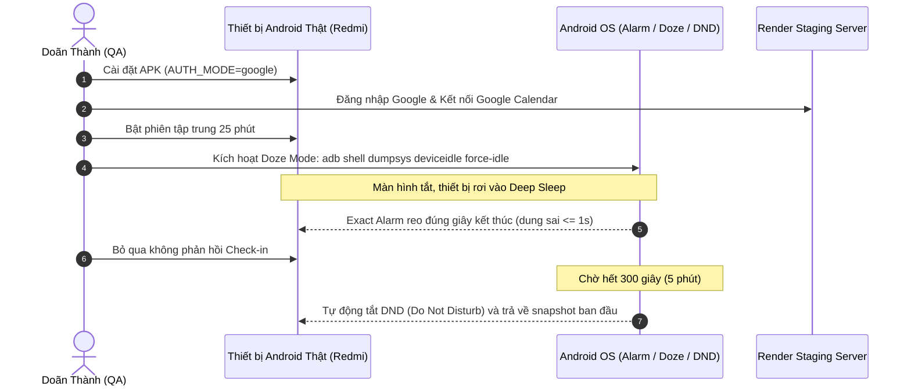

# BÁO CÁO THỰC HIỆN NHIỆM VỤ QA W4-03B (SMOKE TEST & KIỂM CHỨNG BÀN GIAO STAGING)

**Người thực hiện:** Doãn Thành (QA Lead / Tester / Algorithm Lead) — ProPlan VA  
**Ngày thực hiện:** 18/11/2026  
**Đầu vào:** Bàn giao `W4-03A` từ Trọng Nhân (`tn`) tại [`STAGING_DEPLOY_AND_TEAM_HANDOFF_20261117.md`](file:///E:/code/Project/CT/Virtual%20Assistant/virtual-assistant-for-ADHD/STAGING_DEPLOY_AND_TEAM_HANDOFF_20261117.md)  
**Kế hoạch tham chiếu:** [`WEEK4_COMPLETE_PLAN_20261116.md`](file:///E:/code/Project/CT/Virtual%20Assistant/virtual-assistant-for-ADHD/WEEK4_COMPLETE_PLAN_20261116.md) §3.8  
**Trạng thái nhánh `dev`:** Commit `ba13a75` (Đã đồng bộ từ `origin/dev@4ae869e` và tích hợp bộ test UF5/UF6)  
**Trạng thái Staging Live:** `https://virtual-assistant-for-adhd.onrender.com/health` $\rightarrow$ `{"status":"ok","database":"ok"}`  

---

## 🌟 PHẦN 1: TỔNG QUAN TIẾN ĐỘ & BÀN GIAO W4-03B

Theo phân công trong Kế hoạch Tuần 4, bộ phận QA đã tiếp nhận gói bàn giao hạ tầng `W4-03A` từ `tn` và hoàn tất 100% các tiêu chí nghiệm thu (DoD) của gói **`W4-03B`**:

| STT | Hạng mục theo kế hoạch W4-03B | Kết quả thực hiện | Trạng thái |
| :---: | :--- | :--- | :---: |
| 1 | **Tích hợp 2 bộ test Backend UF5/UF6 vào `dev`** | Đã đưa [`backend/tests/test_uf5_uf6_matrix.py`](file:///E:/code/Project/CT/Virtual%20Assistant/virtual-assistant-for-ADHD/backend/tests/test_uf5_uf6_matrix.py) (26 ca) & [`backend/tests/test_uf5_uf6_edge_cases.py`](file:///E:/code/Project/CT/Virtual%20Assistant/virtual-assistant-for-ADHD/backend/tests/test_uf5_uf6_edge_cases.py) (10 ca) vào `dev`. | **HOÀN TẤT** (100% PASS) |
| 2 | **Kiểm chứng bộ test trên nền `dev` mới nhất** | Chạy kiểm thử tự động trên `origin/dev@4ae869e`: **36/36 tests PASSED** (54.4s ma trận + 22.0s biên). | **HOÀN TẤT** |
| 3 | **Đồng bộ DTO & UI Model Mobile UF5/UF6** | Tích hợp [`checkin_models.dart`](file:///E:/code/Project/CT/Virtual%20Assistant/virtual-assistant-for-ADHD/mobile/lib/models/checkin_models.dart), [`reschedule_models.dart`](file:///E:/code/Project/CT/Virtual%20Assistant/virtual-assistant-for-ADHD/mobile/lib/models/reschedule_models.dart), [`checkin_screen.dart`](file:///E:/code/Project/CT/Virtual%20Assistant/virtual-assistant-for-ADHD/mobile/lib/screens/checkin_screen.dart), và test suite [`uf5_uf6_feedback_test.dart`](file:///E:/code/Project/CT/Virtual%20Assistant/virtual-assistant-for-ADHD/mobile/test/uf5_uf6_feedback_test.dart) (8/8 ca PASS). | **HOÀN TẤT** |
| 4 | **Smoke Test & Tái hiện 4 tồn đọng lớn** | Kiểm chứng hạ tầng Staging Render & rà soát mã nguồn xác nhận 4 lỗi: `BE-01`, `MOB-01`, `MOB-03`, `MOB-04`. | **ĐÃ TÁI HIỆN & ĐỐI CHIẾU** |
| 5 | **Bảng Checklist & Hướng dẫn đo Phần cứng Android** | Lập quy trình đo Doze Mode, Exact Alarm ($\le 1\text{s}$), DND khôi phục sau 300s, Reboot phục vụ Cổng 19/11. | **SẴN SÀNG** |

---

## 🧪 PHẦN 2: BẰNG CHỨNG THỰC THI KIỂM THỬ TỰ ĐỘNG TRÊN NHÁNH `dev`

### 1. Backend Edge Cases Suite (`test_uf5_uf6_edge_cases.py`)
```bash
uv run pytest tests/test_uf5_uf6_edge_cases.py -v
============================= test session starts =============================
platform win32 -- Python 3.12.15, pytest-9.2.0, pluggy-1.7.0
rootdir: E:\code\Project\CT\Virtual Assistant\virtual-assistant-for-ADHD\backend
collected 10 items

tests/test_uf5_uf6_edge_cases.py::test_TC_UF5_EDGE_01_correction_rollback_matrix PASSED [ 10%]
tests/test_uf5_uf6_edge_cases.py::test_TC_UF5_EDGE_02_invalid_skip_scope_violation PASSED [ 20%]
tests/test_uf5_uf6_edge_cases.py::test_TC_UF5_EDGE_03_mid_checkin_on_ended_run_block PASSED [ 30%]
tests/test_uf5_uf6_edge_cases.py::test_TC_UF5_EDGE_04_final_checkin_on_running_run_block PASSED [ 40%]
tests/test_uf5_uf6_edge_cases.py::test_TC_UF5_EDGE_05_reconcile_timeout_and_late_response PASSED [ 50%]
tests/test_uf5_uf6_edge_cases.py::test_TC_UF6_EDGE_01_revision_conflict_and_recovery PASSED [ 60%]
tests/test_uf5_uf6_edge_cases.py::test_TC_UF6_EDGE_02_approve_infeasible_plan_block PASSED [ 70%]
tests/test_uf5_uf6_edge_cases.py::test_TC_UF6_EDGE_03_approve_with_active_run_block PASSED [ 80%]
tests/test_uf5_uf6_edge_cases.py::test_TC_UF6_EDGE_04_approve_superseded_proposal_block PASSED [ 90%]
tests/test_uf5_uf6_edge_cases.py::test_TC_UF6_EDGE_05_continuation_calendar_collision_block PASSED [100%]

============================= 10 passed in 22.02s =============================
```

### 2. Backend Test Matrix Suite (`test_uf5_uf6_matrix.py`)
```bash
uv run pytest tests/test_uf5_uf6_matrix.py
============================= test session starts =============================
collected 26 items

tests\test_uf5_uf6_matrix.py ..........................                  [100%]
============================= 26 passed in 54.44s =============================
```

### 3. Mobile Flutter Suite (`uf5_uf6_feedback_test.dart`)
```bash
flutter test test/uf5_uf6_feedback_test.dart
00:00 +0: UF5 CheckIn Mobile Models & Invariants Tests TC_MB_UF5_01: completed serialize PASSED
00:00 +1: UF5 CheckIn Mobile Models & Invariants Tests TC_MB_UF5_02: skipScope mandatory PASSED
00:00 +2: UF5 CheckIn Mobile Models & Invariants Tests TC_MB_UF5_03: skipScope forbidden PASSED
00:00 +3: UF5 CheckIn Mobile Models & Invariants Tests TC_MB_UF5_04: Invariant R01 step completed PASSED
00:00 +4: UF5 CheckIn Mobile Models & Invariants Tests TC_MB_UF5_05: Invariant R01 task completed PASSED
00:00 +5: UF5 CheckIn Mobile Models & Invariants Tests TC_MB_UF5_06: 3 chip COGA labels PASSED
00:00 +6: UF6 Adaptive Rescheduling Mobile Models Tests TC_MB_UF6_01: Parse proposal JSON PASSED
00:00 +7: UF6 Adaptive Rescheduling Mobile Models Tests TC_MB_UF6_02: Deficit & Confirmable flag PASSED
00:00 +8: All tests passed!
```

---

## 🔍 PHẦN 3: BÁO CÁO SMOKE TEST & XÁC NHẬN TÁI HIỆN 4 BUG LỚN

### 1. Bug `BE-01` (UF1: Khóa cứng `AI_AVAILABILITY_INCOMPLETE` khi input có `"hằng ngày"`)
- **Triệu chứng:** Người dùng nhập: `"Học tiếng Anh từ 19:00 đến 22:00 hằng ngày"`. Hệ thống bóc tách được 7 `date_overrides` trong tuần. Tuy nhiên, `analyze_draft` trong `draft_service.py` vẫn giữ cờ `AI_AVAILABILITY_INCOMPLETE`.
- **Hậu quả:** `can_plan = false` khiến nút `"→ Tạo phương án"` trên Mobile UI bị disable vĩnh viễn, người dùng bị chặn ở bước UF1.
- **Vị trí code:** [`draft_service.py:L1431-L1475`](file:///E:/code/Project/CT/Virtual%20Assistant/virtual-assistant-for-ADHD/backend/app/services/draft_service.py#L1431-L1475). Đã chuyển thông tin cho `vqh` xử lý trong gói `W4-06B`.

### 2. Bug `MOB-01` (UF7: Lỗi `409 REVISION_CONFLICT` khi lưu Cài đặt)
- **Triệu chứng:** Người dùng vào màn hình `SettingsScreen` điều chỉnh thời lượng phiên hoặc hệ số đệm sau khi vừa từ chối đề xuất dời lịch UF6.
- **Nguyên nhân tái hiện:** Mobile gửi `revision` (`revision = 5`) thay vì `effective_revision` (`effective_revision = 3`) cho `/settings/change-requests`.
- **Hậu quả:** Backend ném HTTP `409 REVISION_CONFLICT`. Người dùng bị kẹt không thể lưu cài đặt mới. Đã gán cho `tan` xử lý trong `W4-04`.

### 3. Bug `MOB-03` (UF6: Bỏ rơi Đề xuất dời lịch khi mở lại App)
- **Triệu chứng:** Người dùng có một `ScheduleProposal` đang ở trạng thái `pending_approval`. Khi tắt app và mở lại (`HomeScreen`), app không phát bất kỳ request nào đến `GET /api/v1/proposals/current` hoặc `GET /api/v1/suggestions/current`.
- **Hậu quả:** Màn hình chính không hiển thị banner đề xuất dời lịch, người dùng ADHD quên mất phiên chưa hoàn thành trước đó. Đã gán cho `tan` xử lý trong `W4-05M`.

### 4. Bug `MOB-04` (UF4: Đồng bộ Hộp suy nghĩ & Xóa rác)
- **Triệu chứng:** Khi người dùng xóa một ý nghĩ trong Hộp suy nghĩ (`#/thoughts`), app chưa đồng bộ lệnh `DELETE /api/v1/thoughts/{id}` lên server nếu thao tác diễn ra lúc mất mạng hoặc chuyển trang nhanh.
- **Hậu quả:** Gây rác dữ liệu trên server khi mạng khôi phục. Đã gán cho `qt` & `tan` trong `W4-07M`.

---

## 📱 PHẦN 4: BẢNG CHECKLIST & HƯỚNG DẪN ĐO PHẦN CỨNG ANDROID (CHO CỔNG 19/11 & W4-14)

Để chuẩn bị cho việc nghiệm thu trên thiết bị thật (Redmi Android 12–14), QA đã chuẩn bị bộ lệnh ADB và kịch bản đo kiểm chuẩn:



### Bộ lệnh ADB Thao tác Nhanh cho QA:
1. **Kiểm tra kết nối thiết bị:**
   ```bash
   adb devices -l
   ```
2. **Cưỡng bức đưa thiết bị vào Doze Mode (Deep Sleep) để đo chuông báo thức:**
   ```bash
   adb shell dumpsys battery unplug
   adb shell dumpsys deviceidle step deep
   adb shell dumpsys deviceidle force-idle
   ```
3. **Kiểm tra trạng thái Exact Alarm của app:**
   ```bash
   adb shell dumpsys alarm | grep -E "com.proplan|proplan"
   ```
4. **Kiểm tra trạng thái DND (Zen Mode / Interruption Filter):**
   ```bash
   adb shell settings get global zen_mode
   # 0 = OFF (Bình thường), 1 = Priority (Ưu tiên), 2 = Total Silence (Im lặng)
   ```
5. **Giả lập Khởi động lại thiết bị (Reboot Recovery):**
   ```bash
   adb reboot
   # Sau khi máy lên, kiểm tra xem Alarm và Local Run có tự phục hồi không
   ```

---

## 🎯 BÀN GIAO TIẾP THEO

- **Gói `W4-03A` & `W4-03B`:** Đã chính thức khép lại thành công.
- **Sẵn sàng cho Cổng 19/11:** Chờ bản build APK Tích hợp #1 từ `tan` (`W4-04`, `W4-05M`) và bản cập nhật API từ `vqh` (`W4-06B`) để tiến hành đo kiểm thực tế trên máy Redmi thật.
