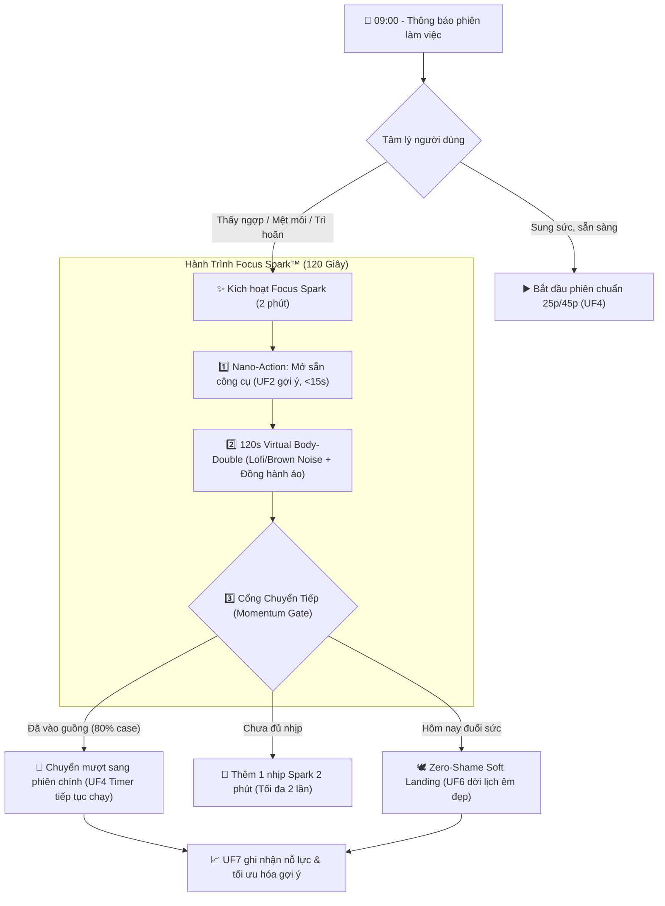
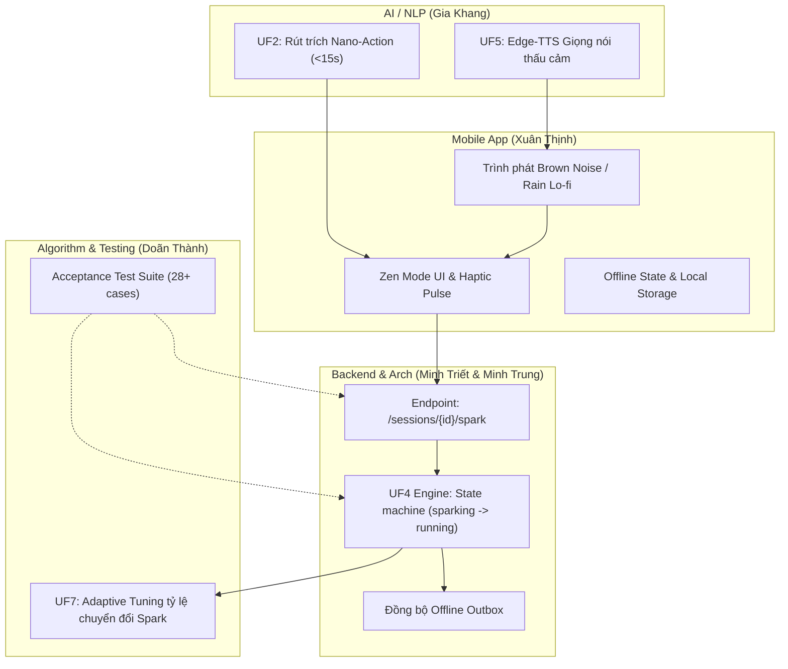

# Đề Xuất Tính Năng Đột Phá Cho ProPlan VA: Focus Spark™
## Giải Pháp Trợ Lực Khởi Động Vi Mô (Micro-Initiation) & Bạn Đồng Hành Ảo (Virtual Body-Doubling) Tối Ưu UX Cho Người Dùng ADHD

> **Tác giả đề xuất**: Doãn Thành (`Toto2k77` / Tester & Algorithm Lead)  
> **Dự án**: ProPlan VA (`virtual-assistant-for-ADHD`)  
> **Ngày hoàn thiện**: 20/11/2026 (Bản nâng cấp toàn diện thảo luận nhóm)  
> **Phân hệ cốt lõi**: Cầu nối liên hoàn **UF2 (Phân rã việc) ➔ UF4 (Timer) ➔ UF5 (Check-in) ➔ UF6 (Reschedule) ➔ UF7 (Học thích ứng)**  
> **Trạng thái mã nguồn**: Giữ nguyên trạng codebase, chỉ đặc tả giải pháp, thiết kế UX và kịch bản kiểm thử.

---

## 1. Cơ Sở Khoa Học & Bối Cảnh Tâm Lý Học ADHD

### 1.1. "Tử Huyệt" Của Các Ứng Dụng Năng Suất Thông Thường
Người mắc hội chứng ADHD (Attention Deficit Hyperactivity Disorder) sở hữu cơ chế dẫn truyền thần kinh dopamine khác biệt:
1. **Thiếu hụt kích hoạt hành động (Task Initiation Deficit)**: Khó khăn lớn nhất không phải là làm việc, mà là **bước qua giây phút đầu tiên** để ngồi vào bàn. Một khối công việc 45–60 phút kích hoạt phản ứng sợ hãi vô thức (ADHD Freeze/Paralysis).
2. **Cảm giác tội lỗi khi trễ hẹn (Notification Guilt & RSD)**: Khi chuông reo mà không làm được, thông báo màu đỏ dồn dập khiến người dùng rơi vào vòng xoáy mặc cảm (Shame Spiral), dẫn đến hành vi xóa app (Churn) sau 3–5 ngày đầu.
3. **Mù thời gian (Time Blindness)**: Người ADHD chỉ có 2 mốc thời gian: *"Bây giờ"* (Now) và *"Không phải bây giờ"* (Not Now). Họ không thể cảm nhận 1 tiếng trôi qua thế nào, nhưng họ cảm nhận được **2 phút**.

### 1.2. Giá Trị Của Phương Pháp "Body-Doubling" & "2-Minute Spark"
- **Body-Doubling (Người đồng hành song song)**: Nghiên cứu tâm lý chỉ ra người ADHD tăng tới **300% khả năng tập trung** khi có một người khác cùng ngồi yên lặng làm việc bên cạnh.
- **Micro-Stepping (Hành động nano)**: Khi rào cản hành động được hạ thấp xuống mức **dưới 15 giây** (ví dụ: *"chỉ cần mở sẵn file"*), vỏ não trước trán không còn coi tác vụ đó là mối đe dọa, giúp kích hoạt dopamine tự nhiên.

---

## 2. Tổng Quan Tính Năng: Focus Spark™

**Focus Spark™** là chế độ khởi động vi mô 120 giây biến ProPlan thành một người bạn đồng hành ảo, hỗ trợ người dùng vượt qua rào cản tâm lý ban đầu để tiến vào trạng thái tập trung sâu (Hyperfocus).



---

## 3. Đặc Tả Giao Diện & Kịch Bản Tương Tác UX/UI (Mobile Screens)

Dưới đây là mô phỏng giao diện và luồng chạm thực tế mà bạn **Xuân Thịnh (Mobile Lead)** có thể triển khai trên Flutter:

### Màn Hình 1: Thông Báo Chạm Nhẹ (Lock Screen / Notification Banner)
Thay vì thông báo giục giã mang tính phán xét, hệ thống gửi thông báo đồng hành ấm áp:

```
┌────────────────────────────────────────────────────────┐
│ 🔔 PROPLAN COMPANION                            09:00  │
│                                                        │
│ ☕ Báo cáo tài chính tháng 11                          │
│ "Chào Minh! Đừng lo về cả 60 phút lúc này. Chúng mình │
│  chỉ ngồi cạnh nhau 2 phút thôi nhé? Dừng lúc nào cũng │
│  được cả."                                             │
│                                                        │
│  [ ✨ SPARK 2 PHÚT ]    [ ▶️ Vào luôn 45p ]   [ Dời ] │
└────────────────────────────────────────────────────────┘
```

### Màn Hình 2: Hành Động Siêu Nhỏ (Nano-Action Screen - 15 giây)
AI (từ UF2) tự động trích xuất bước vật lý đầu tiên đơn giản nhất của tác vụ:

```
┌────────────────────────────────────────────────────────┐
│                      FOCUS SPARK                       │
│                                                        │
│                  🌱 BƯỚC KHỞI ĐỘNG                     │
│                                                        │
│   "Nhiệm vụ duy nhất lúc này:                          │
│    Mở file Word 'BaoCaoT11.docx' lên và để đó.         │
│    Chưa cần viết gì cả!"                               │
│                                                        │
│             ┌──────────────────────────────┐           │
│             │   [✓] TÔI ĐÃ MỞ XONG FILE     │           │
│             └──────────────────────────────┘           │
│                                                        │
│              Chạm nhẹ để bắt đầu 120 giây              │
└────────────────────────────────────────────────────────┘
```

### Màn Hình 3: Màn Hình Đồng Hành Ảo (Virtual Body-Doubling Zen Mode)
Khi đồng hồ 120 giây chạy, app kích hoạt chế độ Zen:

```
┌────────────────────────────────────────────────────────┐
│  🎧 Tiếng ồn nâu (Brown Noise) ▾          🔇 Tắt mic   │
│                                                        │
│                      ╭─────────╮                       │
│                      │  (o.o)  │  ◄── Trợ lý ảo ngồi   │
│                      │  /|_|\  │      gõ phím bên bạn  │
│                      ╰─────────╯                       │
│                     [☕ Tách trà]                      │
│                                                        │
│                        01:45                           │
│                 "Đang cùng bạn làm việc..."            │
│                                                        │
│     ⚪ ─────────────── 🔘 ──────────────── ⚪          │
│   (Thanh hơi thở nhịp nhàng giúp làm dịu tâm trí)      │
│                                                        │
│  [ Dừng lại nhẹ nhàng ]                                │
└────────────────────────────────────────────────────────┘
```

### Màn Hình 4: Cổng Động Lực (The Momentum Gate - Hết 120 giây)
Khi hết 120 giây, điện thoại rung nhịp đôi êm dịu (Haptic), **không có tiếng chuông réo rắt**:

```
┌────────────────────────────────────────────────────────┐
│                     HẾT 2 PHÚT RỒI!                    │
│                                                        │
│          Cảm giác của bạn lúc này thế nào?             │
│                                                        │
│  ┌──────────────────────────────────────────────────┐  │
│  │ 🚀 ĐANG VÀO GUỒNG RỒI! (Chuyển sang 25 phút)     │  │
│  └──────────────────────────────────────────────────┘  │
│  ┌──────────────────────────────────────────────────┐  │
│  │ 🌱 CẦN THÊM 2 PHÚT NỮA ĐỂ CHUẨN BỊ               │  │
│  └──────────────────────────────────────────────────┘  │
│  ┌──────────────────────────────────────────────────┐  │
│  │ 🕊️ HÔM NAY MÌNH ĐUỐI SỨC (Hạ cánh an toàn)        │  │
│  └──────────────────────────────────────────────────┘  │
└────────────────────────────────────────────────────────┘
```

### Màn Hình 5: Hạ Cánh An Toàn (Zero-Shame Soft Landing)
Nếu chọn dừng lại, hệ thống lập tức xoa dịu tâm lý:
> *"Tuyệt vời! Bạn đã vượt qua sự trì hoãn để ngồi xuống bàn 2 phút. Hôm nay năng lượng chưa đủ, mình đã cất bài báo cáo sang 14:00 chiều nay rồi nhé. Hãy uống một ngụm nước và nghỉ ngơi đi nào!"*

---

## 4. Tác Động Chiến Lược Đến Tỷ Lệ Giữ Chân Người Dùng (User Retention)

| Chỉ Số Giữ Chân | Ứng Dụng Thông Thường | ProPlan Với Focus Spark™ |
| :--- | :--- | :--- |
| **Day-1 Retention** | Người dùng mở app tạo task hoành tráng, nhưng đến giờ làm thì bỏ cuộc vì ngợp. | Có ngay **"Chiến thắng khởi đầu" (Instant Win)** chỉ sau 2 phút tương tác đầu tiên. |
| **Day-7 Retention** | Task quá hạn tích tụ thành một "Bức tường xấu hổ" (*Wall of Shame*), người dùng sợ mở app. | Mọi phiên đều có lối thoát an toàn; người dùng coi app là bạn đồng hành chứ không phải ông chủ phán xét. |
| **Day-30 Retention** | 80% người dùng ADHD bỏ ứng dụng to-do truyền thống sau 1 tháng. | Duy trì thói quen ngồi vào bàn nhờ tích lũy điểm **"Momentum Sparks"** (ghi nhận số lần vượt qua trì hoãn). |

---

## 5. Phân Công & Tích Hợp Đội Ngũ (Team Collaboration Matrix)

Để tính năng triển khai mượt mà, đây là ma trận kết nối trách nhiệm giữa các thành viên:



1. **Minh Triết & Minh Trung (Backend Architecture)**:
   - Thêm cột `is_spark_session`, `spark_outcome` vào bảng `execution_runs`.
   - Endpoint: `POST /api/v1/sessions/{id}/spark` và `POST /api/v1/runs/{id}/spark/extend-to-full`.
   - Bảo đảm tuân thủ quy tắc đồng hồ lệch mạng `+300s` (UF5-T2) và tính nhất quán khi hủy/tiếp tục.
2. **Xuân Thịnh (Mobile Lead)**:
   - Xây dựng giao diện Zen Mode tối giản, tích hợp thư viện âm thanh nền (Brown Noise / Mưa rơi) phát offline.
   - Hiệu ứng thở (Breathing Animation) đồng bộ với đồng hồ 120s.
3. **Gia Khang (AI/NLP Lead)**:
   - Prompt sinh bước Nano-Action từ tiêu đề tác vụ (Prompt ngắn, tập trung thao tác vật lý).
   - Kiểm duyệt bộ từ điển thấu cảm (Non-judgmental Dictionary), không để lọt từ ngữ áp lực.
4. **Doãn Thành (Tester & Algorithm Lead)**:
   - Viết toàn bộ bộ kiểm thử tự động (E2E & Unit Test) bao phủ các ca chuyển trạng thái.
   - Thiết kế thuật toán UF7: Học khung giờ nào người dùng hay dùng Spark để tự động gợi ý trước.

---

## 6. Đặc Tả Bộ Test Cases Nghiệm Thu (Acceptance Test Suite)

Dưới đây là các ca kiểm thử cụ thể được bổ sung vào bộ kiểm thử chấp nhận của dự án:

### Test Case 1: Khởi tạo phiên Spark độc lập, không khóa chặt phiên 60 phút
- **File**: `backend/tests/test_uf4_uf5_focus_spark.py`
- **Mục tiêu**: Đảm bảo tạo `execution_run` với trạng thái `sparking`, thời gian 120s, không can thiệp sai lệch vào Google Calendar.

```python
@pytest.mark.asyncio
async def test_spark_initiation_creates_micro_run_without_locking_user(client, db_session, test_user, test_session):
    """Xác minh bấm Spark 2 phút tạo run tạm thời không áp đặt cam kết dài hạn."""
    payload = {
        "nano_action_confirmed": True,
        "ambient_sound": "brown_noise",
        "client_timestamp": "2026-11-20T09:00:00Z"
    }
    resp = await client.post(
        f"/api/v1/sessions/{test_session.id}/spark",
        json=payload,
        headers={"Authorization": f"Bearer {test_user.token}"}
    )
    assert resp.status_code == 201
    body = resp.json()
    assert body["is_spark_session"] is True
    assert body["state"] == "sparking"
    assert body["target_duration_seconds"] == 120
    assert body["ambient_sound"] == "brown_noise"
    # Đảm bảo chưa kích hoạt CalendarSync dời lịch không cần thiết
    assert body.get("calendar_synced") is False
```

### Test Case 2: Chuyển tiếp mượt sang phiên chính khi hết 120s (Momentum Extension)
- **Mục tiêu**: Khi người dùng chọn tiếp tục, phiên `sparking` chuyển mượt sang `running`, thời gian 120s được tính gộp vào thời lượng làm việc thực tế mà không tạo bản ghi rác.

```python
@pytest.mark.asyncio
async def test_spark_momentum_transition_preserves_accumulated_time(client, db_session, active_spark_run):
    """Xác minh chuyển tiếp mượt mà vào phiên Pomodoro chính thức."""
    resp = await client.post(
        f"/api/v1/runs/{active_spark_run.id}/spark/extend-to-full",
        json={"chosen_duration_minutes": 25},
        headers={"Authorization": f"Bearer {active_spark_run.user.token}"}
    )
    assert resp.status_code == 200
    data = resp.json()
    assert data["state"] == "running"
    assert data["is_spark_session"] is False
    assert data["spark_outcome"] == "momentum_extended"
    # Kế thừa 120s khởi động vào tổng thời gian tập trung
    assert data["total_focus_accumulated_seconds"] >= 120
```

### Test Case 3: Hạ cánh êm đẹp (Gentle Exit) - Không trừ điểm, kích hoạt UF6 Reschedule
- **Mục tiêu**: Người dùng bấm dừng sau 2 phút, hệ thống ghi nhận `gentle_parked`, không đánh dấu `failed`, và tự động sinh bản ghi trong outbox UF6 để dời lịch.

```python
@pytest.mark.asyncio
async def test_spark_gentle_exit_triggers_zero_penalty_and_uf6_reschedule(client, db_session, active_spark_run):
    """Xác minh dừng sau 2 phút không phạt điểm và kích hoạt đề xuất dời lịch UF6."""
    resp = await client.post(
        f"/api/v1/runs/{active_spark_run.id}/spark/gentle-exit",
        json={"reason": "low_energy"},
        headers={"Authorization": f"Bearer {active_spark_run.user.token}"}
    )
    assert resp.status_code == 200
    data = resp.json()
    assert data["state"] == "parked"
    assert data["spark_outcome"] == "gentle_parked"
    assert data["penalty_score"] == 0
    # UF6 tự động tạo proposal dời lịch
    assert data["reschedule_proposal_id"] is not None
```

### Test Case 4: Kiểm duyệt ngôn từ phi phán xét & Fallback âm thanh
- **Mục tiêu**: Chặn tuyệt đối từ ngữ chỉ trích, đảm bảo hệ thống có cơ chế fallback âm thanh an toàn khi offline.

```python
def test_spark_empathy_vocabulary_and_offline_audio_fallback():
    """Kiểm tra độ thấu cảm của thông điệp và cơ chế âm thanh offline."""
    from app.services.spark_service import get_spark_micro_copy, get_ambient_sound_asset
    
    copy = get_spark_micro_copy(stage="soft_landing")
    forbidden = ["thất bại", "bỏ cuộc", "chậm trễ", "phải", "ngay lập tức", "lười"]
    for word in forbidden:
        assert word not in copy.lower(), f"Phát hiện từ ngữ gây áp lực cho người ADHD: {word}"
        
    # Kiểm tra tài nguyên âm thanh có sẵn cục bộ (offline asset)
    asset_path = get_ambient_sound_asset("brown_noise")
    assert asset_path.endswith(".mp3") or asset_path.endswith(".ogg")
```

### Test Case 5: Đồng bộ ngoại tuyến (Offline Outbox Sync)
- **Mục tiêu**: Khi không có mạng, người dùng vẫn bấm Spark được bình thường, dữ liệu được ghi vào local SQLite/SharedPreferences và đẩy lên backend khi online trở lại.

```python
@pytest.mark.asyncio
async def test_spark_offline_outbox_replay(client, db_session, test_user):
    """Xác minh phát lại bản ghi Spark từ outbox ngoại tuyến mà không bị xung đột revision."""
    cached_spark_event = {
        "event_id": "evt-spark-offline-001",
        "action": "spark_extended",
        "duration_seconds": 120,
        "client_timestamp": "2026-11-20T09:02:00Z"
    }
    resp = await client.post(
        "/api/v1/sync/replay-outbox",
        json={"events": [cached_spark_event]},
        headers={"Authorization": f"Bearer {test_user.token}"}
    )
    assert resp.status_code == 200
    assert resp.json()["processed_count"] == 1
```

---

## 7. Các Điểm Thảo Luận Sẵn Sàng Cho Buổi Họp Nhóm (Meeting Talking Points)

Khi đưa tài liệu này ra họp cùng Triết, Trung, Thịnh, Khang và Nhiệm, bạn có thể tự tin khẳng định 3 giá trị cốt lõi:

1. **Khả năng hiện thực hóa kỹ thuật cao (High Feasibility)**:
   - Không cần đập đi xây lại hệ thống. Focus Spark kế thừa 90% logic phiên làm việc của UF4 và cơ chế skip chips/rollback của UF5.
2. **Khắc phục đúng điểm nghẽn của đề tài (Addressing Real ADHD Need)**:
   - Giáo viên hướng dẫn và hội đồng đánh giá sẽ đánh giá cực kỳ cao tính nhân văn và cơ sở tâm lý học thần kinh khi ứng dụng hiểu được sự khó khăn trong 120 giây đầu tiên của người ADHD.
3. **Tạo ra sự khác biệt cạnh tranh vượt trội (USP - Unique Selling Proposition)**:
   - Trong khi Forest, Pomodoro Timer hay Todoist chỉ biết đếm ngược và trừng phạt người dùng, ProPlan là ứng dụng duy nhất biết **ngồi cạnh làm việc cùng người dùng (Body-Doubling)**.

---
*Tài liệu được cập nhật và kiểm tra hoàn chỉnh, sẵn sàng cho việc trình bày và thảo luận nhóm.*
