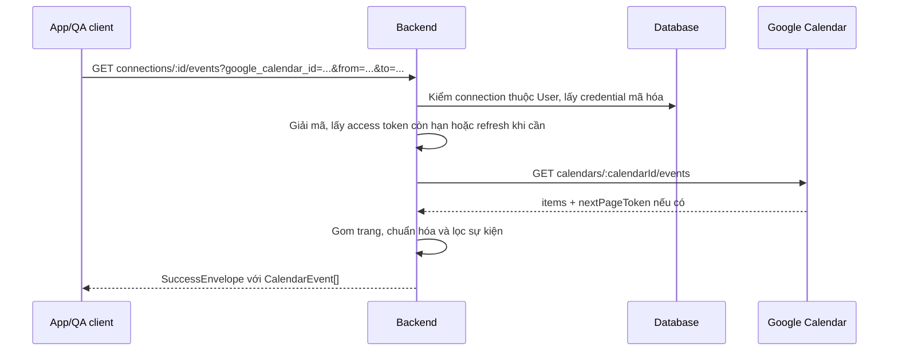
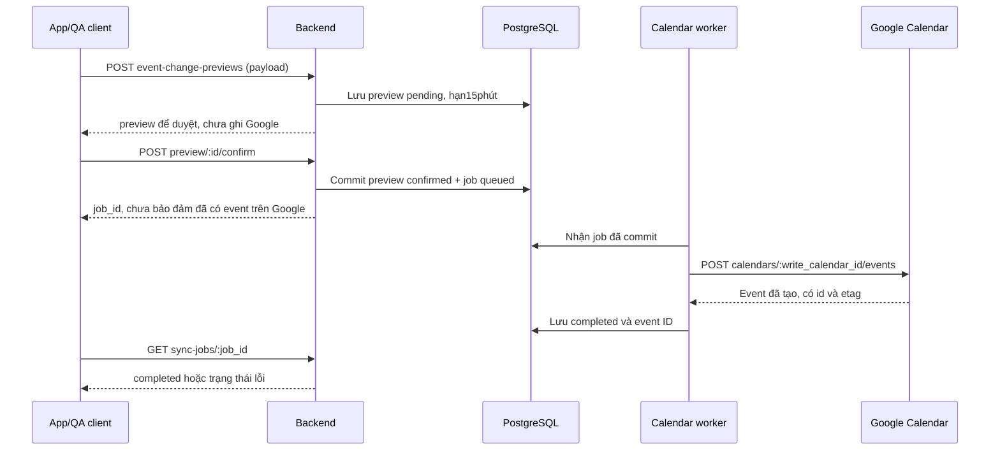

# Kết quả thực tế và luồng dữ liệu Google Calendar — 11/11/2026

## 1. Kết quả đã kiểm tra

Đã đọc trực tiếp lịch QA qua Backend và đối chiếu ba job create/update/delete trong PostgreSQL bằng transaction READ ONLY. Lượt này không tạo sự kiện mới. Việc thêm/sửa/xóa được trình bày dưới đây là kết quả lần QA thật trước đó, có payload còn lưu trong database và script kiểm chứng; không phải thao tác vừa tạo lại.

| Nội dung | Kết quả |
|---|---|
| Backend source nền | `backend@76c5632` + bản sửa OpenAPI PR17 đang triển khai |
| PostgreSQL QA | PostgreSQL17.11; database `proactive_qa`; Alembic `20261108_01` |
| Calendar | `ProActive QA`, secondary calendar, quyền `owner`, đã chọn đọc và ghi |
| Lần CRUD trước | Bắt đầu 11/11/2026 14:19:52 +0700;25HTTPsteps đều đúng expected |
| Lần đọc lại | 11/11/2026 14:43:59 +0700 |
| GET danh sách Calendar | HTTP200; thấy đúng lịch QA |
| GET events hiện tại | HTTP200; `data=[]` |
| Ba job cũ | create/update/delete đều `completed`; `last_error_code=null` |
| Event QA sau cleanup | GET trả404; event đã được xóa sau khi test |

`data=[]` là kết quả hiện tại trong cửa sổ truy vấn, phù hợp việc event QA đã dọn. Không nên tìm event demo đó trên Google Calendar ở thời điểm đọc tài liệu này rồi kết luận thêm thất bại. Backend không trả danh sách tất cả dữ liệu trong tài khoản, chỉ lịch và khoảng thời gian được truy vấn, qua bộ lọc chuẩn hóa.

**Phạm vi:** process QA dùng PostgreSQL thật + Calendar thật + `AUTH_MODE=dev_user`, background worker tắt. `.env` mặc định app vẫn SQLite + Calendarfake + dev_user; chưa cấu hình audiences/JWTkey cho appGooglelogin. Kết nối Calendar không đồng nghĩa Mobile đã đăng nhập Google thật. Không đổi `.env`/DB app hoặc đọc event lịch cá nhân trong lượt này.

## 2. Các ID dùng trong lần test

| ID | Giá trị thật của tài nguyên QA |
|---|---|
| connection_id — kết nối trong DB app | `fa57a634-ca0c-4c30-bb33-87985433dfe1` |
| google_calendar_id — lịch trên Google | `246815878c0785e079641698859af0de86ab536b67a09af93bd67aabcaf92af7@group.calendar.google.com` |
| google_event_id — event Google đã được tạo, sau đó xóa | `gfcm23curem8i5ncjjtfm0sn2c` |
| preview_id tạo event | `79800934-35aa-4a93-aa92-ff67e12f32d7` |
| job_id tạo event | `ad103126-e7f3-4ff9-8dfa-62a51a13f8f4` |

Các ID này là định danh tài nguyên QA; chúng không phải access_token, refresh_token hoặc client_secret. Toàn bộ token được giữ ở Backend và không chép vào file này.

## 3. Luồng đọc: Google Calendar → Backend → app



### 3.1. Đọc danh sách lịch

App gọi `GET /api/v1/calendar/connections/{connection_id}/calendars`. Backend dùng Calendar token để đọc Google CalendarList; app không trực tiếp giữ token Google. Dưới đây là **item QA thực đọc lại** trong response `data.items`, không phải toàn bộ danh sách lịch cá nhân:

```json
{
  "id": "246815878c0785e079641698859af0de86ab536b67a09af93bd67aabcaf92af7@group.calendar.google.com",
  "summary": "ProActive QA",
  "description": null,
  "primary": false,
  "access_role": "owner",
  "background_color": "#ac725e",
  "selected_for_read": true,
  "selected_for_write": true
}
```

`selected_for_read=true` nghĩa là lịch này được chọn làm nguồn đọc; `selected_for_write=true` nghĩa là đang là lịch đích ghi của connection. Mặc định thiết kế là đọc các lịch người dùng chọn và ghi một lịch riêng; test này chỉ chọn secondary QA cho cả hai để tránh đụng lịch cá nhân.

### 3.2. Đọc sự kiện

Endpoint app:

```http
GET /api/v1/calendar/connections/fa57a634-ca0c-4c30-bb33-87985433dfe1/events?google_calendar_id=<URL_ENCODED_QA_CALENDAR_ID>
Authorization: Bearer <app_access_token>
```

Header trên là contract ở `AUTH_MODE=google`. Server QA hiện dùng guarded dev_user nên lần đọc này không dùng appJWT; không suy rằng endpoint production là public. Có thể thêm `from`/`to` theo ISO8601 có offset và `limit`1–250. Nếu bỏ from/to, router hiện dùng từ thời điểm hiện tại tới14ngày sau và limit50.

Backend gọi Google, theo source `RealGoogleCalendarClient.list_events`:

```http
GET https://www.googleapis.com/calendar/v3/calendars/{calendarId}/events
Authorization: Bearer <google_calendar_access_token>

timeMin=<UTC start>
timeMax=<UTC end>
singleEvents=true
orderBy=startTime
maxResults=250
pageToken=<nếu có trang tiếp>
```

Google trả raw `items`; Backend gom `nextPageToken`, chuẩn hóa thành DTO gồm `connection_id`, `google_calendar_id`, `google_event_id`, `title`, `start_at`, `end_at`. Raw `summary` trở thành `title`; `start.dateTime`/`end.dateTime` trở thành mốc có offset. Hàm normalize có xử lý date all-day và loại event `cancelled`/`transparent`, nhưng các biến thể này chưa được nghiệm thu riêng bằng Google thật trong lượt QA.

**Response HTTP200 thực đọc lại:**

```json
{
  "data": [],
  "meta": {
    "request_id": "req-90bb7ea2",
    "server_time": "2026-11-11T14:43:59.687413+07:00"
  }
}
```

Vì event test đã bị xóa nên lần đọc hiện tại không có DTO event. Lần QA trước đã GET event sau create và sau update thành công và assert title/time; artifact cũ giữ HTTPstatus và oracle trong script, không giữ nguyên full rawGoogle response. File này không dựng một response rawGoogle200 giả làm log cũ.

Khi dùng Calendar cho UF1/UF2, chỉ coi event bận là phần trừ khỏi giờ rảnh user xác nhận. Google trống không thay giờ rảnh user; lỗi đọc nguồn không được biến thành nguồn rảnh. GET events trong tài liệu này chưa tự tạo PlanningContext/Candidate hoặc dời Task.

## 4. Luồng ghi: app → preview → confirm → outbox → Google



### 4.1. Payload thực đã dùng để tạo preview

Request `POST /api/v1/calendar/event-change-previews` trong lần QA:

```json
{
  "operation": "create",
  "connection_id": "fa57a634-ca0c-4c30-bb33-87985433dfe1",
  "google_calendar_id": "246815878c0785e079641698859af0de86ab536b67a09af93bd67aabcaf92af7@group.calendar.google.com",
  "payload": {
    "summary": "ProActive QA CRUD 6441cc013c04",
    "description": "Temporary automated QA event; safe to remove.",
    "start": {
      "dateTime": "2026-11-12T07:19:53+00:00"
    },
    "end": {
      "dateTime": "2026-11-12T07:34:53+00:00"
    }
  }
}
```

Payload event ở trên được đối chiếu lại từ `calendar_sync_jobs.payload_snapshot` bằng SELECT READ ONLY đúng job QA. Không lấy từ một ví dụ giả định. Giờ Google được ghi bằng UTC: bắt đầu **12/11/2026 14:19:53 +0700**, kết thúc **12/11/2026 14:34:53 +0700**, dài15phút.

Backend lưu preview có `kind=event_change`, `operation=create`, `status=pending`, payload lồng như request và expires_at=now+15phút; trả `preview_id=79800934-35aa-4a93-aa92-ff67e12f32d7`. Bước này chỉ commit dữ liệu preview trong DB. QA đã GET lại và assert chưa có event mang title đó trước confirm.

### 4.2. Người dùng xác nhận

```http
POST /api/v1/calendar/event-change-previews/79800934-35aa-4a93-aa92-ff67e12f32d7/confirm
Content-Type: application/json
```

```json
{
  "expected_preview_revision": null
}
```

`null` là giá trị dùng trong bài QA, không phải khuyến nghị bỏ kiểm revision trong UI sản phẩm. API có nhận expected_preview_revision, chỉ đối chiếu khi cả expected và base_connection_revision hiện hữu; luồng manual event preview hiện không gán base_connection_revision. Cần kiểm lại cách dùng revision trước khi client dựa vào nó như một bảo đảm chống stale.

Confirm kiểm owner, expiry/status và job đã tồn tại. Trong một lần commit, backend lưu preview confirmed và job queued với `idempotency_key=manual_event_change_<preview_id>`. Bấm confirm lặp trong thời hạn trả lại cùng job. QA đã kiểm cùng job_id, không tạo thêm event trong happy path này.

### 4.3. Dữ liệu gửi trực tiếp lên Google

Worker gọi:

```http
POST https://www.googleapis.com/calendar/v3/calendars/{connection.write_calendar_id}/events
Authorization: Bearer <google_calendar_access_token>
Content-Type: application/json
```

Body gửi Google chính là `payload_snapshot`, **không có** connection_id, preview_id, job_id hoặc appJWT:

```json
{
  "summary": "ProActive QA CRUD 6441cc013c04",
  "description": "Temporary automated QA event; safe to remove.",
  "start": {
    "dateTime": "2026-11-12T07:19:53+00:00"
  },
  "end": {
    "dateTime": "2026-11-12T07:34:53+00:00"
  }
}
```

Lịch thực sự nhận event do `connection.write_calendar_id` quyết định ở worker. Trong QA này write_calendar_id khớp google_calendar_id đã chọn. Không nên hiểu rằng điền một google_calendar_id bất kỳ vào request sẽ tự quyết định lịch đích của worker; cần đối chiếu cấu hình khi đổi lịch ghi giữa preview và worker.

Google sinh event ID `gfcm23curem8i5ncjjtfm0sn2c` trong manual-create này. Worker ghi ID vào job.target_ref khi target_kind=event, chuyển job_state=completed và cập nhật last_successful_sync_at. Raw Google response có id/etag được code dùng; full raw response cũ không được lưu trong artifact nên không chép giả vào đây.

### 4.4. Kết quả job thật đọc lại

`GET /api/v1/calendar/sync-jobs/ad103126-e7f3-4ff9-8dfa-62a51a13f8f4` trả HTTP200 hiện tại:

```json
{
  "data": {
    "job_id": "ad103126-e7f3-4ff9-8dfa-62a51a13f8f4",
    "connection_id": "fa57a634-ca0c-4c30-bb33-87985433dfe1",
    "target_kind": "event",
    "target_ref": "gfcm23curem8i5ncjjtfm0sn2c",
    "operation": "create",
    "job_state": "completed",
    "attempt_count": 0,
    "next_retry_at": null,
    "last_error_code": null
  },
  "meta": {
    "request_id": "req-90bbfa7c",
    "server_time": "2026-11-11T14:44:00.293392+07:00"
  }
}
```

`completed` cùng GET event200 và assertion title/time ở lần QA là bằng chứng create thành công. `attempt_count=0` là giá trị thật lưu trong job; trong code nó tăng khi lỗi/retry, không có nghĩa worker chưa chạy.

Background worker của QA bị tắt. Bài QA chủ động gọi `POST /calendar/connections/{connection_id}/refresh` để process queue rồi poll job. **Endpoint refresh hiện có side effect xử lý các job của user (limit20), không chỉ đọc lịch và không lọc riêng connection_id khi gọi worker.** Vì vậy lượt đối chiếu này chỉ dùng GET, không gọi refresh hay tạo lại event.

## 5. Sau create: cập nhật và dọn event test

Payload update thật vẫn cùng event ID, thêm `UPDATED` vào title và tăng thời điểm kết thúc5phút:

```json
{
  "summary": "ProActive QA CRUD 6441cc013c04 UPDATED",
  "description": "Temporary automated QA event; safe to remove.",
  "start": {
    "dateTime": "2026-11-12T07:19:53+00:00"
  },
  "end": {
    "dateTime": "2026-11-12T07:39:53+00:00"
  }
}
```

Giờ kết thúc mới: **12/11/2026 14:39:53 +0700**. Update đi qua preview/confirm/job, adapter hiện dùng Google `PUT /calendars/{calendarId}/events/{eventId}`. Nếu job có expected_google_etag thì thêm `If-Match`; Google412 chuyển conflict trong worker. Bài QA này không gửi expected_google_etag, nên chưa chứng minh xử lý race/412 thật.

| Operation | Job ID | Trạng thái thực đọc lại |
|---|---|---|
| create | `ad103126-e7f3-4ff9-8dfa-62a51a13f8f4` | completed |
| update | `777f5075-3a57-4feb-a066-04f818ec9588` | completed |
| delete | `4ef48e37-bd7a-46bb-adf5-f95ab56b6e5e` | completed |

Delete cũng qua preview/confirm/job; worker gọi Google DELETE, sau đó bài QA kiểm event không còn trong list. **Kết quả GET event thực ở lần đọc lại này:** HTTP404.

```json
{
  "detail": "Sự kiện không hợp lệ hoặc đã bị hủy."
}
```

Việc event không xuất hiện bây giờ là cleanup chủ động của bài test, không phải lỗi đồng bộ. Nội dung payload và job còn trong PostgreSQL là lịch sử xử lý, không đồng nghĩa event còn tồn tại trên Google.

## 6. Khi app ghi Session sau UF2 confirm thì dữ liệu khác gì?

Test thật trên là **manual event CRUD**, chưa phải bằng chứng E2E Mobile→UF2→Google. Theo code `plan_service.py`, sau confirm lịch chính thức, backend chuẩn bị CalendarEventLink và job `target_kind=session_event`, gắn session_id/revision, lưu outbox cùng transaction rồi mới để worker gửi.

Payload dưới đây là **minh họa đúng cấu trúc source, không phải event đã gửi trong lần QA**; giờ và ID là ví dụ:

```json
{
  "id": "<deterministic_google_event_id>",
  "summary": "ProPlan VA Focus Session",
  "start": {
    "dateTime": "2026-11-12T14:00:00+07:00",
    "timeZone": "Asia/Ho_Chi_Minh"
  },
  "end": {
    "dateTime": "2026-11-12T14:25:00+07:00",
    "timeZone": "Asia/Ho_Chi_Minh"
  },
  "transparency": "opaque",
  "reminders": {
    "useDefault": false,
    "overrides": []
  },
  "extendedProperties": {
    "private": {
      "proactive_session_id": "<session_uuid>",
      "proactive_schedule_revision": "1"
    }
  }
}
```

| Field | Ý nghĩa |
|---|---|
| id | ID event được backend xác định trước cho Session để hỗ trợ retry |
| summary | Hiện là tiêu đề chung ProPlan VA Focus Session, không tự lấy tên Task |
| start/end | Giờ Session đã chốt; source thêm timeZone Asia/Ho_Chi_Minh |
| transparency=opaque | Hiển thị event chiếm lịch/busy |
| reminders | Không dùng nhắc mặc định Google, không thêm overrides trong payload này |
| extendedProperties.private | Gắn session_id và schedule_revision để liên kết nội bộ; không phải token |

Raw audio/Thought, transcript, mật khẩu và Google credentials không nằm trong payload Session này. Chốt lịch app và đồng bộ Google là hai trạng thái: confirm thành công chưa bảo đảm Google đã nhận; UI cần đọc trạng thái job/sync. AppJWT dùng cho app→Backend, Calendar access_token dùng cho Backend→Google.

## 7. Mức đánh giá hiện tại và việc tiếp theo

- Đã xác minh: PostgreSQL thật còn kết nối/migration đúng; Calendar thật đọc lịch/events được; lịch sử create/update/delete có25HTTPsteps đúng expected,3jobcompleted và cleanup404. PostgreSQL79testscopePASS là evidence độc lập trước đó, không phải fullsuite vừa chạy lại trênPG.
- Sửa PR17 hiện đã đạt82Auth/OpenAPI và fullBackend402PASS/6SKIP/1XFAIL bằng DB tạm/provider giả; các con số này không thay evidence Google thật hoặc full598case.
- Chưa nghiệm thu: Google Sign-In app thật/Android/Web hai tài khoản; full Backend trênPG; Calendar tokenexpiry/refresh/revoke/412/mạng lỗi/recurring/all-day; E2E MobileUF2confirm→Sessionevent.
- Các điểm source cần lưu ý khi mở rộng Calendar: revision ở manual preview chưa là bảo đảm stale đầy đủ; worker dùng write_calendar_id hiện tại; refresh có side effect process queue. Đây là nhận xét từ code, chưa phải lỗi được tái hiện bằng race test và không được lặng lẽ sửa trong patchAuthPR17.

## 8. Nguồn kiểm chứng

- Source: [Calendar router](../../backend/app/api/v1/calendar.py), [Calendar service](../../backend/app/services/calendar_service.py), [Google adapter](../../backend/app/services/google_calendar_client.py), [worker](../../backend/app/services/calendar_sync_worker.py), [normalization](../../backend/app/services/planning/calendar_ingestion.py), [UF2 plan service](../../backend/app/services/plan_service.py).
- [Auth verification và cấu hình QA](PR17_AUTH_VERIFICATION.md), [Auth contract](AUTH_GUIDE.md).
- Evidence local bổ sung (gitignored, không bắt buộc để đọc tài liệu): `_temp/pr17_fix_20261111/calendar_readback.json`, `_temp/auth_implementation_20261111/qa_598/calendar_live_crud_results.json`, `CALENDAR_LIVE_REPORT.md`, `test_calendar_live_crud.py`.

### 25 HTTPsteps đã được ghi trong lần CRUD trước

Đây là log status lịch sử của bài QA, không phải full HTTPresponse. Body mẫu chính xác hoặc snapshot hiện tại đã được phân biệt ở các phần trên.

| # | API (prefix /api/v1/calendar) | HTTP | Oracle status |
|---|---|---|---|
| 1 | `GET /connections` | 200 | PASS |
| 2 | `GET /connections/fa57a634-ca0c-4c30-bb33-87985433dfe1/calendars` | 200 | PASS |
| 3 | `POST /connections/fa57a634-ca0c-4c30-bb33-87985433dfe1/configuration-previews` | 200 | PASS |
| 4 | `POST /configuration-previews/fcfb9d37-0110-4e7b-bafd-a43603e0affb/confirm` | 200 | PASS |
| 5 | `GET /connections/fa57a634-ca0c-4c30-bb33-87985433dfe1/events?google_calendar_id=246815878c0785e079641698859af0de86ab536b67a09af93bd67aabcaf92af7%40group.calendar.google.com` | 200 | PASS |
| 6 | `POST /event-change-previews` | 200 | PASS |
| 7 | `GET /connections/fa57a634-ca0c-4c30-bb33-87985433dfe1/events?google_calendar_id=246815878c0785e079641698859af0de86ab536b67a09af93bd67aabcaf92af7%40group.calendar.google.com` | 200 | PASS |
| 8 | `POST /event-change-previews/79800934-35aa-4a93-aa92-ff67e12f32d7/confirm` | 200 | PASS |
| 9 | `POST /event-change-previews/79800934-35aa-4a93-aa92-ff67e12f32d7/confirm` | 200 | PASS |
| 10 | `POST /connections/fa57a634-ca0c-4c30-bb33-87985433dfe1/refresh` | 200 | PASS |
| 11 | `GET /sync-jobs/ad103126-e7f3-4ff9-8dfa-62a51a13f8f4` | 200 | PASS |
| 12 | `GET /connections/fa57a634-ca0c-4c30-bb33-87985433dfe1/events/gfcm23curem8i5ncjjtfm0sn2c?google_calendar_id=246815878c0785e079641698859af0de86ab536b67a09af93bd67aabcaf92af7%40group.calendar.google.com` | 200 | PASS |
| 13 | `GET /connections/fa57a634-ca0c-4c30-bb33-87985433dfe1/events?google_calendar_id=246815878c0785e079641698859af0de86ab536b67a09af93bd67aabcaf92af7%40group.calendar.google.com` | 200 | PASS |
| 14 | `POST /event-change-previews` | 200 | PASS |
| 15 | `GET /connections/fa57a634-ca0c-4c30-bb33-87985433dfe1/events/gfcm23curem8i5ncjjtfm0sn2c?google_calendar_id=246815878c0785e079641698859af0de86ab536b67a09af93bd67aabcaf92af7%40group.calendar.google.com` | 200 | PASS |
| 16 | `POST /event-change-previews/f35d23f7-b131-45ac-bd57-0a7ef7b3e760/confirm` | 200 | PASS |
| 17 | `POST /connections/fa57a634-ca0c-4c30-bb33-87985433dfe1/refresh` | 200 | PASS |
| 18 | `GET /sync-jobs/777f5075-3a57-4feb-a066-04f818ec9588` | 200 | PASS |
| 19 | `GET /connections/fa57a634-ca0c-4c30-bb33-87985433dfe1/events/gfcm23curem8i5ncjjtfm0sn2c?google_calendar_id=246815878c0785e079641698859af0de86ab536b67a09af93bd67aabcaf92af7%40group.calendar.google.com` | 200 | PASS |
| 20 | `POST /event-change-previews` | 200 | PASS |
| 21 | `POST /event-change-previews/8c79d8f8-5622-402d-965f-0281b4b8ef1d/confirm` | 200 | PASS |
| 22 | `POST /connections/fa57a634-ca0c-4c30-bb33-87985433dfe1/refresh` | 200 | PASS |
| 23 | `GET /sync-jobs/4ef48e37-bd7a-46bb-adf5-f95ab56b6e5e` | 200 | PASS |
| 24 | `GET /connections/fa57a634-ca0c-4c30-bb33-87985433dfe1/events/gfcm23curem8i5ncjjtfm0sn2c?google_calendar_id=246815878c0785e079641698859af0de86ab536b67a09af93bd67aabcaf92af7%40group.calendar.google.com` | 404 | PASS |
| 25 | `GET /connections/fa57a634-ca0c-4c30-bb33-87985433dfe1/events?google_calendar_id=246815878c0785e079641698859af0de86ab536b67a09af93bd67aabcaf92af7%40group.calendar.google.com` | 200 | PASS |
