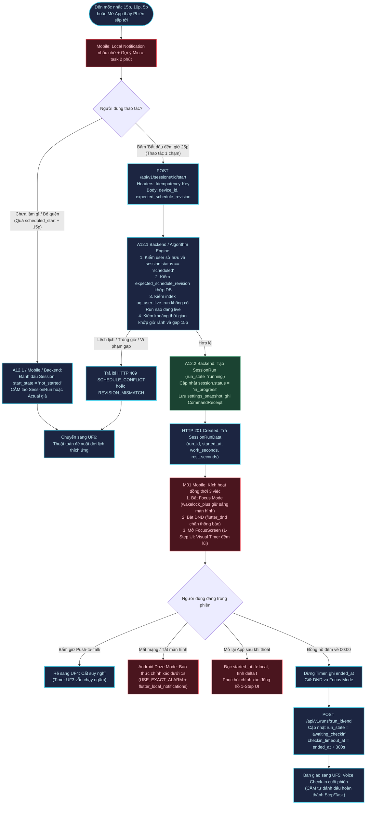
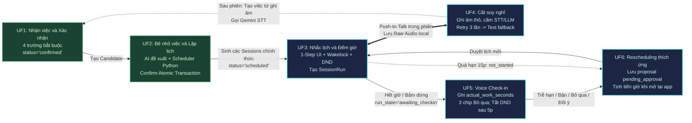
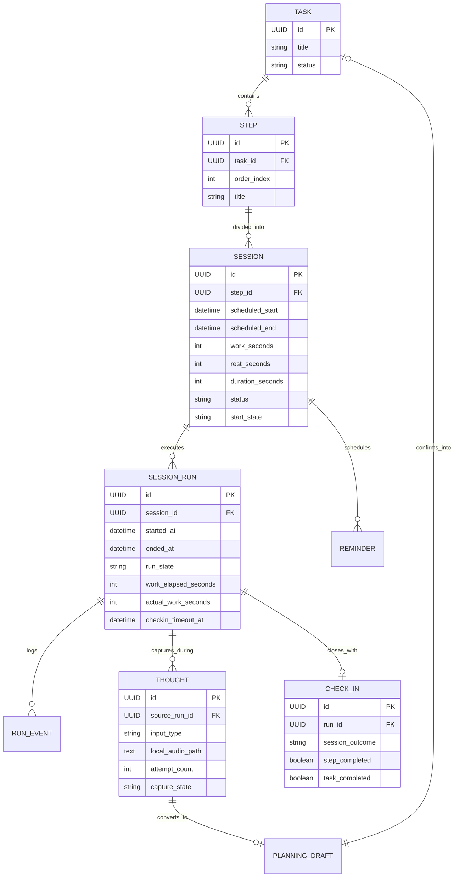

# BÁO CÁO PHÂN TÍCH CHUYÊN SÂU USER FLOW 3 (UF3) & USER FLOW 4 (UF4) — DỰ ÁN PROPLAN VA

> **Người thực hiện:** Antigravity AI Pair Programmer  
> **Người tiếp nhận (Developer Profile):** Quốc Hưng (`vqh`) — Backend Lead & Algorithm Designer  
> **Ngày lập:** 03/11/2026  
> **Workspace:** `d:\HCMUS\CT\ProActive` | **Git Branch:** `backend` (HEAD `571fff7` + 25 modified files + migration `20261103_01_c01_sources.py`)  
> **Trạng thái:** Báo cáo Phân tích & Đề xuất Kỹ thuật (Chưa can thiệp code/migration/DB)

---

## 1. NGUỒN ĐÃ ĐỌC, NHÁNH/CODE PHÂN TÍCH VÀ GIỚI HẠN

### 1.1. Nguồn tài liệu & Codebase đã rà soát
1. **Quy tắc & Hồ sơ cá nhân hóa:**
   - [`AGENTS.md`](file:///d:/HCMUS/CT/ProActive/AGENTS.md): Quy tắc bất biến (Strict Guardrail) về mô hình 3 tầng (`Task -> Steps -> Sessions`), 7 User Flows, cơ chế DND/Focus Mode, Raw Audio UF4, Rolling Horizon và Graceful Degradation.
   - [`DEVELOPER.md`](file:///d:/HCMUS/CT/ProActive/DEVELOPER.md): Chân dung lập trình viên cục bộ `vqh` (Quốc Hưng) — Backend Lead & Algorithm Designer; định hướng tư duy: kiến trúc bền vững, async/await, SQLAlchemy 2.0, Pydantic v2, chống race condition và bảo toàn tính bất biến của dữ liệu.
2. **Tài liệu bàn giao & Kiến trúc Backend:**
   - `_temp/PROJECT_HANDOFF.md`: Bản cập nhật hiện trạng mới nhất ngày 03/11/2026 (dọn dẹp `PlanningPart` / `CandidatePart`, chuyển sang mô hình chuẩn `Task -> Steps -> Sessions`).
   - [`docs/backend/schema.md`](file:///d:/HCMUS/CT/ProActive/docs/backend/schema.md): Đặc tả đối tượng dữ liệu O07 đến O18, các trường chi tiết, kiểu dữ liệu, ràng buộc và mapping API dòng 16–28.
   - [`docs/backend/backend_structure.md`](file:///d:/HCMUS/CT/ProActive/docs/backend/backend_structure.md): Cấu trúc thư mục mục tiêu và nguyên tắc cô lập module.
   - [`docs/backend/MOBILE_UF1_UF2_API_HANDOFF_GUIDE.md`](file:///d:/HCMUS/CT/ProActive/docs/backend/MOBILE_UF1_UF2_API_HANDOFF_GUIDE.md) & `_temp/docs/API_guide.md`: Hợp đồng 20 API UF1–UF2 và cơ chế Idempotency-Key.
   - `_temp/docs/BACKEND_DOCS_TASKS_CHECKLIST.md` & `_temp/docs/API_KIEM_TRA_TUNG_ENDPOINT_20261102.md`.
3. **Tài liệu Google Docs (`1X1zIWny1nOWCfkS4zLEdn71uZLhYLu5OkHlUPKcdoxE`):**
   - **Thẻ 01 (Nghiệp vụ - `t.a5x8wat1j2ax`):** Nghiệp vụ UF3 (Nhắc lịch, micro-task, 1-tap start, Doze mode timer, DND, xử lý `not_started` sau 15 phút) và UF4 (Raw audio ghi âm thô, không STT/LLM trong phiên, retry tối đa 3 lần, fallback text, STT sau phiên khi user bấm tạo việc).
   - **Thẻ 02 (Đối tượng & Dữ liệu - `t.8pj2un7fawnd`):** Bảng đặc tả các trường dữ liệu cho `O09 Session`, `O12 SessionRun`, `O10 RunEvent`, `O16 Reminder`, `O17 DeviceState`, `O14 Thought`, `O13 CheckIn`, `O18 CommandReceipt`.
   - **Thẻ 03 (Hợp đồng API - `t.yvz2ob24pqkp`):** Bảng tổng hợp API dòng 16 đến 28.
   - **Thẻ 04 (Bài toán & Phân công - `t.dk4juq71zmx2`):** Danh sách mã bài toán chính thức cho Tuần 5: `A11`, `A12.0`, `A12.1`, `A12.2`, `A12.3`, `A13`, `A21`, `I04`, `A18`, `A22.2`, `M01`.
   - **Thẻ 05 (Kế hoạch & Kiểm chứng - `t.kjy4pdl7ks56`):** Các ca kiểm thử chấp nhận `K07` đến `K12`.
4. **Google Sheets API (`1RTI0Hv0DydDX5S0DMq1clSFmGggCuGkAMORynke6J0w`):**
   - Rà soát trực tiếp Dòng 16 đến 28 (Session Start, Live Run, Run Events, End Run, Device State, Reminders, Reminder Receipt, Thoughts CRUD, Thought to Draft).
5. **Mã nguồn dự án:**
   - **Backend (`backend/app/`):** [`api/v1/router.py`](file:///d:/HCMUS/CT/ProActive/backend/app/api/v1/router.py), [`api/v1/focus.py`](file:///d:/HCMUS/CT/ProActive/backend/app/api/v1/focus.py), [`api/v1/thoughts.py`](file:///d:/HCMUS/CT/ProActive/backend/app/api/v1/thoughts.py), [`api/v1/voice.py`](file:///d:/HCMUS/CT/ProActive/backend/app/api/v1/voice.py), [`models/execution.py`](file:///d:/HCMUS/CT/ProActive/backend/app/models/execution.py), [`models/thought.py`](file:///d:/HCMUS/CT/ProActive/backend/app/models/thought.py), [`models/session.py`](file:///d:/HCMUS/CT/ProActive/backend/app/models/session.py), [`models/system.py`](file:///d:/HCMUS/CT/ProActive/backend/app/models/system.py), [`models/planning.py`](file:///d:/HCMUS/CT/ProActive/backend/app/models/planning.py).
   - **Mobile (`mobile/`):** `pubspec.yaml`, `android/app/src/main/AndroidManifest.xml`, `packages/flutter_dnd/`, [`services/dnd_service.dart`](file:///d:/HCMUS/CT/ProActive/mobile/lib/services/dnd_service.dart), [`services/timer_service.dart`](file:///d:/HCMUS/CT/ProActive/mobile/lib/services/timer_service.dart), [`services/audio_recorder_service.dart`](file:///d:/HCMUS/CT/ProActive/mobile/lib/services/audio_recorder_service.dart), [`screens/focus_screen.dart`](file:///d:/HCMUS/CT/ProActive/mobile/lib/screens/focus_screen.dart), `screens/uf2_screens.dart` (`SessionReminderScreen`).

---

### 1.2. Hiện trạng Code thực tế vs. Hợp đồng & Giới hạn
| Phân hệ | Thành phần | Trạng thái thực tế trong Code | Đánh giá so với Hợp đồng & Thẻ 04 |
| :--- | :--- | :--- | :--- |
| **Backend** | `models/execution.py` (`SessionRun`, `CheckIn`, `RunEvent`) | **Đã có code SQLAlchemy 2.0** hoàn chỉnh, có check constraints, index `uq_user_live_run`. | Khớp 100% với Thẻ 02 và `schema.md`. |
| **Backend** | `models/thought.py` (`Thought`) | **Đã có code SQLAlchemy 2.0**, có constraint `attempt_count BETWEEN 1 AND 3`. | Khớp 100% với Thẻ 02. |
| **Backend** | `models/session.py` (`Session`) | **Đã có code**, có check `duration_seconds = work_seconds + rest_seconds`, `micro_task_seconds`. | Khớp 100%: Micro-task nằm ngoài duration của phiên. |
| **Backend** | `api/v1/voice.py` (`POST /voice/transcriptions`) | **Đã có code thật** (dòng 115–273), có kiểm tra `run.ended_at is not None` khi chuyển Thought sang Draft (chặn lỗi 409). | Khớp hợp đồng Dòng 8 & Thẻ 01. |
| **Backend** | `api/v1/focus.py` (Dòng 16–20) | **Chỉ có 1 dòng comment** (Placeholder), chưa có code endpoint. | **Chưa triển khai** (Thuộc bài toán `A12.2`, `I04`). |
| **Backend** | `api/v1/thoughts.py` (Dòng 24–28) | **Chỉ có 1 dòng comment** (Placeholder), chưa có code endpoint. | **Chưa triển khai** (Thuộc bài toán `A13`, `A21`). |
| **Backend** | `api/v1/router.py` | Chưa `include_router` cho `focus`, `thoughts`, `checkin`, `reschedule`. | Cần mount sau khi viết router. |
| **Backend** | `schemas/execution.py`, `schemas/thought.py` | `thought.py` chỉ có 1 dòng comment, `execution.py` chưa tồn tại trong `schemas/`. | **Thiếu Pydantic v2 Schemas** cho các API Dòng 16–28. |
| **Mobile** | `FocusScreen`, `TimerService`, `DndService`, `AudioRecorderService`, `FocusProvider` | **100% là Placeholder (mỗi file 1 dòng comment)**. | **Chưa triển khai** (Thuộc bài toán `M01`, `A11`, `A12.3`). |
| **Mobile** | `SessionReminderScreen` (trong `uf2_screens.dart`) | Có UI mockup tĩnh; nút `"Bắt đầu 25p"` chỉ bật popup `showMelbelInfo()`. | Chưa kết nối phần cứng và chưa gọi API backend. |
| **Mobile** | `AndroidManifest.xml` | **Chỉ có quyền INTERNET**; THIẾU `RECORD_AUDIO`, `ACCESS_NOTIFICATION_POLICY`, `WAKE_LOCK`, `SCHEDULE_EXACT_ALARM`, `POST_NOTIFICATIONS`. | **Lỗ hổng chặn kiểm thử thiết bị** (Sẽ crash ngay khi gọi Mic/DND). |
| **Mobile** | `packages/flutter_dnd` | Nhánh `dev` có patch tương thích AGP 8 / Android 36, nhưng `mobile/pubspec.yaml` vẫn trỏ pub.dev cũ. | Cần đổi dependency sang `path: packages/flutter_dnd`. |

---

## 2. SƠ ĐỒ TỔNG QUAN LUỒNG NGHIỆP VỤ (MERMAID)

### 2.1. Sơ đồ User Flow 3 (UF3) — Nhắc lịch & Bắt đầu Phiên tập trung


---

### 2.2. Sơ đồ User Flow 4 (UF4) — Cất suy nghĩ bằng Raw Audio

```mermaid
flowchart TD
    classDef hasCode fill:#1b4332,stroke:#40916c,stroke-width:2px,color:#d8f3dc;
    classDef inContract fill:#1c2541,stroke:#48cae4,stroke-width:2px,color:#caf0f8;
    classDef missing fill:#4a151e,stroke:#e63946,stroke-width:2px,color:#ffccd5;

    ActiveUF3["Đang trong phiên tập trung UF3<br/>(Timer đếm ngược đang chạy)"]:::inContract --> PTT_Press["Người dùng bấm giữ nút Push-to-Talk<br/>'Cất suy nghĩ' (Microphone)"]:::missing

    PTT_Press --> CheckMicPermission{"Đã cấp quyền Mic?"}
    CheckMicPermission -- "Chưa có quyền" --> RequestMic["Yêu cầu quyền RECORD_AUDIO tại chỗ"]:::missing
    
    CheckMicPermission -- "Đã có" --> StartRecord["AudioRecorderService: Bắt đầu thu âm thô<br/>Ghi luồng PCM/AAC trực tiếp vào file .m4a/.wav<br/>TUYỆT ĐỐI CẤM gọi STT hoặc LLM"]:::missing

    StartRecord --> PTT_Release["Người dùng buông nút Push-to-Talk"]:::missing

    PTT_Release --> SaveRawFile{"Lưu file âm thanh thô vào đĩa thiết bị"}

    SaveRawFile -- "Thất bại (Lỗi mic/đĩa)" --> RetryCheck{"Số lần thử dưới 3?"}
    RetryCheck -- "Còn lượt (thử lại)" --> RetryRecord["Cho phép người dùng bấm thu lại<br/>(Tăng attempt_count)"]:::missing
    RetryCheck -- "Đã thử đủ 3 lần vẫn lỗi" --> TextFallback["A13 Fallback: Mở ô nhập text tại chỗ<br/>'Không thể thu âm, bạn gõ nhanh suy nghĩ nhé'<br/>Timer UF3 vẫn không bị ngắt"]:::missing

    SaveRawFile -- "Thành công" --> SaveLocalThought["Tạo DraftThought cục bộ:<br/>client_thought_id, source_run_id, local_audio_path,<br/>attempt_count, capture_state='captured_untranscribed'"]:::missing

    TextFallback --> SaveLocalThought
    SaveLocalThought --> ReturnUF3["Quay lại giao diện 1-Step UI UF3 ngay lập tức<br/>(Đảm bảo không gián đoạn sự tập trung)"]:::inContract

    SaveLocalThought -.-> SyncThought["(Chạy nền khi có mạng) POST /api/v1/thoughts<br/>Đồng bộ metadata Thought lên Backend"]:::inContract

    ReturnUF3 --> SessionEnded["Phiên UF3 kết thúc và hoàn tất Check-in UF5"]:::inContract

    SessionEnded --> OpenInbox["Người dùng mở Hộp nháp suy nghĩ (Thought Inbox)"]:::missing

    OpenInbox --> UserDecide{"Người dùng chọn gì?"}
    UserDecide -- "Chỉ nghe lại / Giữ làm note" --> PlayAudio["Nghe phát lại file .m4a local"]:::missing
    UserDecide -- "Xóa bỏ" --> DeleteThought["DELETE /api/v1/thoughts/:id<br/>Xóa metadata và xóa file audio"]:::inContract
    UserDecide -- "Tạo việc từ ghi âm này" --> CallSTT["POST /api/v1/voice/transcriptions<br/>Header: Idempotency-Key<br/>Form: file, purpose='thought_to_draft', thought_id"]:::hasCode

    CallSTT --> CheckRunState["Backend voice.py: check_thought()<br/>Kiểm run.ended_at is not None"]:::hasCode
    CheckRunState -- "Run còn đang chạy" --> RejectSTT["HTTP 409 SESSION_STILL_RUNNING<br/>'Chỉ chuyển chữ sau khi phiên dừng'"]:::hasCode
    CheckRunState -- "Run đã kết thúc" --> CallGeminiSTT["A21 VoiceService: Gọi Gemini 3.5 Transcribe<br/>Nhận văn bản tiếng Việt bóc tách"]:::hasCode

    CallGeminiSTT --> ForwardUF1["Khởi tạo PlanningDraft:<br/>input_source='thought', source_thought_id=thought_id<br/>Chuyển tiếp người dùng sang UF1"]:::hasCode

    ForwardUF1 --> CompleteUF2["Người dùng duyệt kế hoạch UF2 thành công<br/>(POST /candidates/:id/confirm)"]:::hasCode

    CompleteUF2 --> UpdateConverted["Cập nhật thoughts.converted_task_id = task.id<br/>Kích hoạt chính sách dọn dẹp audio"]:::hasCode
```


---

### 2.3. Sơ đồ Tích hợp và Ghép nối Liên User Flow (UF1 <--> UF2 --> UF3 <--> UF4 --> UF5 --> UF6)


---

## 3. PHÂN TÍCH UF3 THEO TỪNG BƯỚC (TỪ NGOÀI VÀO TRONG)

### Bước 1: Lấy Session chính thức và hiển thị phiên sắp tới
- **Từ ngoài vào trong:** Người dùng mở ứng dụng $\rightarrow$ `HomeScreen` đọc dữ liệu $\rightarrow$ Gọi API `GET /api/v1/schedule?from={now}&to={now+24h}` (Dòng 15 Sheet) $\rightarrow$ Backend [`api/v1/schedule.py`](file:///d:/HCMUS/CT/ProActive/backend/app/api/v1/schedule.py) $\rightarrow$ Service [`plan_service.get_schedule()`](file:///d:/HCMUS/CT/ProActive/backend/app/services/plan_service.py) truy vấn bảng `sessions` $\rightarrow$ Trả về danh sách phiên chính thức $\rightarrow$ Mobile hiển thị thẻ "Phiên tiếp theo" (Tên Task, Tên Bước, Thời lượng 25 phút, Deadline).
- **Quy tắc bất biến:** Chỉ đọc từ bảng `sessions` chính thức gắn với `schedule_versions` đã duyệt; tuyệt đối không hiển thị các phiên nháp từ `plan_candidates`.

### Bước 2: Lập và xử lý lời nhắc trước phiên (Reminders)
- **Cơ chế thiết bị:** Dựa vào `scheduled_start` của phiên, Mobile lập 3 mốc thông báo cục bộ qua `flutter_local_notifications`: `15 phút`, `10 phút`, và `5 phút` trước giờ G.
- **Dữ liệu Backend:** Bảng `reminders` lưu các bản ghi lời nhắc với `dedupe_key = f"{session_id}_{revision}_{offset_seconds}"` để chống gửi trùng.
- **Tương tác:** Người dùng nhận thông báo với âm thanh dịu nhẹ, mở thẳng vào màn hình `SessionReminderScreen`.

### Bước 3: Hiển thị Micro-task khởi động 2 phút
- **Bản chất nghiệp vụ:** AI (Gemini Flash qua `A12.0`) đã gắn sẵn 1 hành động vật lý siêu nhỏ vào trường `sessions.micro_task_text` (ví dụ: *"Mở file dàn ý và đặt tiêu đề tài liệu"*).
- **Quy tắc bất biến cốt lõi:**
  1. Micro-task là bước đệm tâm lý giải tỏa tê liệt khởi động, **HOÀN TOÀN KHÔNG CỘNG VÀO `duration_seconds`** của phiên chính (ràng buộc DB `CheckConstraint("duration_seconds = work_seconds + rest_seconds")`).
  2. Không có đồng hồ đếm ngược riêng cho micro-task.
  3. Không bắt buộc người dùng phải bấm xác nhận đã làm xong micro-task; người dùng có thể làm ngay hoặc bấm "Bắt đầu đếm giờ" bất kỳ lúc nào.

### Bước 4: Người dùng bấm "Bắt đầu đếm giờ [X]p" (1-Tap Start)
- **Tình huống:** Người dùng sẵn sàng tập trung, bấm nút Primary CTA duy nhất trên giao diện.
- **Quy tắc bất biến:** Bấm nút mới chính thức tính là bắt đầu thực hiện. Tuyệt đối không tự động kích hoạt phiên khi đến giờ hẹn nếu người dùng chưa bấm.

### Bước 5: Kiểm tra điều kiện bắt đầu phiên phía Backend (Bài toán `A12.1`)
- **API Call:** Mobile gửi `POST /api/v1/sessions/{session_id}/start` kèm header `Idempotency-Key` và body `{ "expected_schedule_revision": 1, "device_id": "dev_123", "requested_start_at": "..." }`.
- **Ràng buộc kiểm tra nghiêm ngặt (`A12.1`):**
  1. *Quyền sở hữu:* `session.user_id == current_user.user_id`.
  2. *Trạng thái:* `session.status == 'scheduled'` và `session.start_state == 'waiting'`.
  3. *Tính duy nhất của Live Run:* Truy vấn DB kiểm tra không có bản ghi nào vi phạm index `uq_user_live_run` (`run_state IN ('running', 'paused', 'awaiting_checkin')`). Nếu đang có phiên khác chạy dở $\rightarrow$ từ chối ngay lập tức (HTTP 409).
  4. *Kiểm tra toàn khoảng thực tế (Whole Interval Feasibility):* Tại thời điểm bấm thực tế `actual_start`, khoảng làm việc `[actual_start, actual_start + duration_seconds]` có:
     - Nằm trọn trong khung giờ rảnh khả dụng của ngày hôm nay không?
     - Có đè lên sự kiện bận từ Calendar không?
     - Có đảm bảo khoảng đệm tối thiểu `min_inter_session_gap_seconds` (15 phút / 900s) với phiên liền kề không?
     - Có đúng thứ tự bước (`order_index`) không?
- **Quy tắc xử lý:** Nếu bắt đầu sớm hoặc muộn mà gây xung đột lịch $\rightarrow$ **CẤM tự ý xáo trộn hoặc dời Task khác**. Backend trả về mã lỗi kèm gợi ý dời lịch sang **UF6** để người dùng chủ động duyệt.

### Bước 6: Khởi tạo `SessionRun` (Bài toán `A12.2`)
- Backend mở transaction:
  - Tạo bản ghi `SessionRun` mới: `run_state = 'running'`, `active_phase = 'work'`, `work_elapsed_seconds = 0`, `rest_elapsed_seconds = 0`, `started_at = now()`.
  - Lưu `settings_snapshot`: Snapshot cấu hình user tại thời điểm chạy (`work_duration_seconds`, `rest_duration_seconds`, `k_buffer`).
  - Cập nhật `session.status = 'in_progress'` và `session.start_state = 'started'`.
  - Ghi nhận `CommandReceipt`.
- Trả về HTTP 201 Created kèm dữ liệu `SessionRunData`.

### Bước 7: Mobile kích hoạt Chế độ Tập trung (Focus Mode & DND)
- Ngay khi nhận được phản hồi thành công từ Backend, Mobile thực thi đồng thời:
  1. `WakelockPlus.enable()`: Giữ màn hình luôn sáng dịu, không bị tắt đột ngột làm mất tập trung.
  2. `FlutterDnd.setInterruptionFilter(FlutterDnd.INTERRUPTION_FILTER_ALARMS)`: Bật DND, chỉ cho phép chuông báo thức lọt qua.
  3. Báo cáo trạng thái thiết bị lên Backend: `PUT /api/v1/devices/{device_id}/state` với `dnd_apply_state = 'applied'`, `dnd_owner_run_id = run_id`.
  4. Điều hướng vào **Giao diện 1-Step UI (`FocusScreen`)**: Chỉ hiển thị đúng tên bước hiện tại, vòng tròn đếm lùi thời gian (*Visual Timer*), và 1 nút Push-to-Talk duy nhất *"Cất suy nghĩ"* (tuân thủ W3C COGA $\le 3$ phần tử).

### Bước 8: Đếm giờ chính xác & Xử lý Android Doze Mode / App Restart
- **Android Doze Mode:** Khi người dùng úp máy hoặc tắt màn hình, hệ điều hành Android sẽ đưa CPU vào trạng thái ngủ sâu (Doze Mode), vô hiệu hóa `Timer.periodic`. Mobile giải quyết bằng cách đăng ký một báo thức chính xác qua `flutter_local_notifications` với quyền `SCHEDULE_EXACT_ALARM` / `USE_EXACT_ALARM` và chế độ `AndroidScheduleMode.exactAllowWhileIdle`. Chuông reo hết phiên đảm bảo dung sai $\le 1\text{s}$.
- **Rời app và mở lại:** Mobile lưu mốc `started_at` vào local storage. Khi người dùng mở lại app sau khi bị gián đoạn, Mobile tính toán `DateTime.now().difference(started_at)` để vẽ lại đồng hồ tức thì mà không bị trôi giây hay mất trạng thái.

### Bước 9: Xử lý quá hạn bắt đầu (`not_started` sau 15 phút)
- **Quy tắc bất biến:** Nếu sau `scheduled_start + 15 phút` (900s) mà người dùng vẫn không bấm "Bắt đầu", trạng thái phiên được chốt:
  - `session.start_state = 'not_started'`.
  - `session.status = 'missed'`.
  - **TUYỆT ĐỐI CẤM** tạo `SessionRun` giả hoặc ghi nhận thời gian thực tế `actual_work_seconds`.
  - Phiên này được đưa vào danh sách cần dời lịch của **UF6** khi người dùng mở lại ứng dụng.

### Bước 10: Hết giờ phiên & Bàn giao sang UF5
- Đồng hồ đếm ngược chạm mốc `00:00`.
- Mobile dừng timer, rung chuông êm dịu, và gửi lệnh kết thúc: `POST /api/v1/runs/{run_id}/end` kèm `work_elapsed_seconds`.
- Backend cập nhật `SessionRun`:
  - `ended_at = now()`.
  - `run_state = 'awaiting_checkin'`.
  - `checkin_timeout_at = now() + 300s` (Mốc 5 phút tự động đóng).
- **Chính sách DND cuối phiên:** Tiếp tục giữ DND trong lúc trợ lý ảo thực hiện Voice Check-in cuối phiên (UF5).
- **CẤM TỰ HOÀN THÀNH:** Hết giờ chỉ có nghĩa là hết thời lượng làm việc của phiên, **tuyệt đối không tự động đánh dấu hoàn thành `Session`, `Step` hay `Task`**. Quyền xác nhận hoàn thành thuộc về UF5.

---

## 4. PHÂN TÍCH UF4 THEO TỪNG BƯỚC (GHI NHẬN SUY NGHĨ & CHUYỂN THÀNH KẾ HOẠCH)

### Bước 1: Kích hoạt khi đang tập trung trong phiên UF3
- **Tình huống:** Người dùng đang làm việc trong phiên UF3 thì nảy sinh một ý tưởng bất chợt hoặc một việc phát sinh ngoài luồng (hiện tượng phổ biến của người có hội chứng ADHD).
- **Thao tác:** Người dùng bấm và giữ nút Push-to-Talk hình Micro *"Cất suy nghĩ"* trên màn hình 1-Step UI.

### Bước 2: Liên kết với `SessionRun` nguồn
- Mobile ghi nhận mã phiên chạy hiện tại: `source_run_id = current_run.id`.
- Điều này thiết lập mối liên kết nguồn gốc để hệ thống biết ý nghĩ này phát sinh trong lúc đang làm phiên nào của công việc nào.

### Bước 3: Thu và lưu file âm thanh thô (Raw Audio Recording)
- **Hành động thiết bị:** Mobile gọi `audio_recorder_service` kích hoạt micro và ghi âm trực tiếp luồng âm thanh vào bộ nhớ cục bộ thiết bị dưới định dạng `.m4a` hoặc `.wav`.
- **QUY TẮC BẤT BIẾN NGHIÊM NGẶT (Strict Guardrail):**
  1. **TUYỆT ĐỐI CẤM** gọi STT (Speech-to-Text).
  2. **TUYỆT ĐỐI CẤM** gọi LLM (Gemini).
  3. **TUYỆT ĐỐI CẤM** bắt người dùng đọc lại, xác nhận hay chỉnh sửa câu chữ trên màn hình.
  4. Việc cất suy nghĩ **không được làm dừng hoặc sai lệch đồng hồ đếm ngược của UF3**.

### Bước 4: Xử lý lỗi thu âm & Cơ chế Thử lại / Text Fallback (Bài toán `A13`)
- **Nhánh lỗi thu/lưu:**
  - Nếu xảy ra lỗi phần cứng micro hoặc ghi file thất bại: Hệ thống cho phép người dùng bấm thử lại tối đa **3 lần** (`attempt_count BETWEEN 1 AND 3`).
  - **Giới hạn 3 lần thử được kiểm soát ở đâu?** Được định nghĩa tại CheckConstraint `attempt_limit` trong DB backend (`models/thought.py`) và được đếm trực tiếp trên biến trạng thái của Mobile UI.
  - **Text Fallback (Ưu tiên 2):** Nếu sau 3 lần vẫn lỗi thu âm $\rightarrow$ giao diện tự động trượt mở một ô nhập văn bản nhanh tại chỗ với thông điệp: *"Chưa thu được âm thanh, bạn gõ nhanh vài chữ để cất ý nghĩ nhé"*. Timer UF3 vẫn tiếp tục chạy liên tục.

### Bước 5: Lưu Thought cục bộ & Đồng bộ Metadata lên Backend
- **Tại thiết bị:** Tạo bản ghi `DraftThought` cục bộ lưu trong SQLite/SecureStorage:
  - `client_thought_id`: UUID do client sinh.
  - `source_run_id`: UUID của phiên chạy.
  - `local_audio_path`: Đường dẫn file `/data/user/0/.../cache/thought_123.m4a`.
  - `attempt_count`: Số lần đã bấm thu (1..3).
  - `capture_state`: `'captured_untranscribed'`.
- **Đồng bộ Backend:** Gửi API nền `POST /api/v1/thoughts` (Dòng 24 Sheet) để lưu metadata lên server (chưa upload file audio nặng để tiết kiệm băng thông và pin).

### Bước 6: Mở lại Thought sau khi mất mạng hoặc khởi động lại thiết bị
- Nhờ file audio và metadata đã được lưu kiên cố trong bộ nhớ cục bộ của máy (`local_audio_path`), kể cả khi thiết bị mất kết nối Internet hoàn toàn hoặc máy bị sập nguồn/khởi động lại, danh sách suy nghĩ đã cất trong Hộp nháp (Inbox) không bao giờ bị mất mát.

### Bước 7: Chuyển Thought sang Draft UF1 sau khi phiên kết thúc (Bài toán `A21`)
- **Thời điểm kích hoạt:** **Chỉ sau khi phiên UF3 đã kết thúc** và người dùng mở "Hộp nháp suy nghĩ", chọn một bản ghi và bấm nút *"Tạo việc từ ghi âm này"*.
- **Gọi API chuyển chữ:** Mobile gọi `POST /api/v1/voice/transcriptions` (Dòng 8 Sheet) với `purpose = "thought_to_draft"`, `thought_id = thought.id` và file audio upload dạng multipart.
- **Phép kiểm tra bất biến phía Backend ([`voice.py`](file:///d:/HCMUS/CT/ProActive/backend/app/api/v1/voice.py:171-177)):**
  ```python
  if thought.source_run_id is not None:
      run = await db.scalar(select(SessionRun).where(SessionRun.id == thought.source_run_id))
      if run.ended_at is None:
          raise AppError(
              status_code=409,
              code="SESSION_STILL_RUNNING",
              message="Chỉ chuyển chữ sau khi phiên dừng.",
              next_action="wait_for_session_end",
          )
  ```
  Backend từ chối thẳng thừng bằng HTTP 409 nếu phiên chạy nguồn chưa kết thúc!
- **Thực hiện STT:** Backend sử dụng `Gemini 3.5 Transcribe` chuyển file âm thanh thành chuỗi văn bản Tiếng Việt chuẩn xác.
- **Bàn giao sang UF1:** Khởi tạo `PlanningDraft` với `input_source = 'thought'`, `source_thought_id = thought.id`, `raw_input = transcript_text` và điều hướng người dùng sang màn hình UF1 để xác nhận 4 trường thông tin.

### Bước 8: Chốt Task UF2 và cập nhật liên kết Thought
- Người dùng hoàn thành UF1 và tiếp tục bẻ nhỏ việc ở UF2.
- Khi người dùng bấm **Chốt kế hoạch chính thức** (`POST /api/v1/candidates/{id}/confirm` - Dòng 12 Sheet):
  - Backend cập nhật bản ghi `thoughts.converted_task_id = new_task.id`.
  - Đóng dấu hoàn tất vòng đời của một suy nghĩ (Thought $\rightarrow$ Draft $\rightarrow$ Task $\rightarrow$ Official Schedule).
  - Kích hoạt quy định lưu trữ (`retention`): Xóa file ghi âm thô sau thời hạn quy định để bảo vệ dung lượng thiết bị và quyền riêng tư người dùng.

---

## 5. BẢNG CHI TIẾT 12 THUỘC TÍNH CHO TỪNG BƯỚC NGHIỆP VỤ

### Bảng 5.1. Các bước thuộc User Flow 3 (UF3)

| Thuộc tính | Bước 3.1: Nhắc lịch & Micro-task | Bước 3.2: Kiểm tra Start (A12.1) | Bước 3.3: Tạo Run & Bật Focus/DND (A12.2) | Bước 3.4: Xử lý Not Started (+15p) | Bước 3.5: Hết giờ & Bàn giao UF5 |
| :--- | :--- | :--- | :--- | :--- | :--- |
| **1) Tình huống & Mục đích** | Trước phiên 15/10/5p; báo thức & gợi ý hành động siêu nhỏ giảm tê liệt. | User bấm "Bắt đầu"; kiểm tra khả thi thực tế trước khi kích hoạt. | Chấp nhận phiên; tạo SessionRun, bật DND & Wakelock, mở 1-Step UI. | Quá scheduled_start + 15p user không bấm start; ghi nhận phiên lỡ. | Timer đếm về 0; chốt thời lượng làm việc thực tế, giữ DND để check-in. |
| **2) Điều kiện tiên quyết** | Session đã được confirm ở UF2 (`status='scheduled'`). | Session đang ở `start_state='waiting'`; app có mạng hoặc cache lệnh. | Bước 3.2 trả về kết quả hợp lệ; thiết bị có quyền DND/Wakelock. | Thời gian hiện tại $> \text{scheduled\_start} + 900\text{s}$; chưa có Run. | SessionRun đang ở trạng thái `run_state='running'`. |
| **3) Chủ thể thực hiện** | Mobile (Notifications) + AI (Đã sinh micro-task). | Backend (`A12.1` Scheduler Engine). | Backend (`A12.2`) + Mobile (`M01` DND/Timer/Wakelock). | Backend (Worker/Check engine) hoặc Mobile khi mở app. | Mobile (Timer) + Backend (SessionRun service). |
| **4) Đầu vào & Nguồn** | `scheduled_start`, `micro_task_text` từ bảng `sessions`. | `session_id`, `requested_start_at`, `expected_schedule_revision`. | `session_id`, `user_id`, `settings_snapshot` từ user preferences. | `session_id`, `server_time`. | `run_id`, `ended_at`, `work_elapsed_seconds` từ đồng hồ mobile. |
| **5) Phép kiểm & Ràng buộc** | Không đếm giờ micro-task; không cộng vào `duration_seconds`. | Kiểm quyền sở hữu; không có run live (`uq_user_live_run`); khoảng rảnh; gap 15p. | `started_at <= now()`; `active_phase='work'`; `segment_index=0`. | Không tạo actual giả; không tạo `SessionRun` giả; chuyển sang UF6. | `ended_at >= started_at`; giữ DND trong lúc hỏi Check-in. |
| **6) Thứ tự xử lý** | Đọc DB $\rightarrow$ Hẹn alarm OS $\rightarrow$ Bắn notification kèm micro-task. | Nhận request $\rightarrow$ Khóa user $\rightarrow$ Query DB $\rightarrow$ Chạy thuật toán kiểm khoảng. | Mở DB Transaction $\rightarrow$ Insert `SessionRun` $\rightarrow$ Update Session $\rightarrow$ Commit $\rightarrow$ Trả JSON $\rightarrow$ Bật DND/Wakelock. | Quét cron/mở app $\rightarrow$ So sánh mốc 900s $\rightarrow$ Cập nhật `start_state='not_started'`. | Timer 00:00 $\rightarrow$ Rung chuông $\rightarrow$ Gửi API `/end` $\rightarrow$ Đổi state `awaiting_checkin` $\rightarrow$ Bật voice UF5. |
| **7) Dữ liệu Đọc / Ghi** | Đọc: `sessions`, `reminders`. Ghi: `reminders.delivery_state`. | Đọc: `sessions`, `schedule_versions`, `session_runs`, `calendar_events`. | Ghi: `session_runs` (insert), `sessions` (update status), `command_receipts`. | Đọc: `sessions`. Ghi: `sessions.start_state='not_started'`, `sessions.status='missed'`. | Ghi: `session_runs.ended_at`, `checkin_timeout_at`, `work_elapsed_seconds`. |
| **8) Đầu ra trả về** | Giao diện nhắc nhở `SessionReminderScreen`. | JSON lỗi 409 (nếu xung đột) hoặc cờ cho phép tạo Run. | JSON `SuccessEnvelope[SessionRunData]`; Màn hình 1-Step UI FocusScreen. | Session cập nhật `not_started`; Đề xuất dời lịch UF6. | Chuyển sang màn hình Voice Check-in UF5. |
| **9) Chuyển trạng thái** | `reminders`: `scheduled` $\rightarrow$ `delivered`. | `sessions`: giữ nguyên kiểm tra. | `sessions.status`: `scheduled` $\rightarrow$ `in_progress`; `runs`: $\rightarrow$ `running`. | `sessions.start_state`: `waiting` $\rightarrow$ `not_started`. | `session_runs.run_state`: `running` $\rightarrow$ `awaiting_checkin`. |
| **10) Lỗi, Retry & Phục hồi** | Lỡ thông báo OS $\rightarrow$ Hiển thị lại thẻ Hero khi user mở HomeScreen. | Lệch revision/trùng giờ $\rightarrow$ Trả lỗi 409 $\rightarrow$ Mở proposal UF6 dời phiên. | Rớt mạng khi bấm Start $\rightarrow$ Replay bằng `Idempotency-Key` cũ $\rightarrow$ Khôi phục Run. | Mở app trễ $\rightarrow$ Không xóa lịch cũ, giữ nguyên để UF6 tính toán lại. | Mất mạng khi hết giờ $\rightarrow$ Lưu `ended_at` local, đồng bộ ngay khi có mạng. |
| **11) File & Hàm đảm nhiệm** | Mobile: `SessionReminderScreen`. BE: `models/system.py` (`Reminder`). | BE: `services/planning/validation.py` / `scheduler_engine.py` (chưa ghép hàm). | BE: `api/v1/focus.py` (chưa code), `models/execution.py`. Mobile: `focus_screen.dart`. | BE: `services/plan_service.py` (chưa có worker). Mobile: `home_screen.dart`. | BE: `api/v1/focus.py` (chưa code). Mobile: `timer_service.dart`. |
| **12) Mã Task Thẻ 04 & Còn thiếu** | **`A11`** (Cài lời nhắc); **`A12.0`** (Micro-task). Còn thiếu: logic nhắc nền Android. | **`A12.1`** (Kiểm tra điều kiện bắt đầu). Còn thiếu: Hàm kiểm tra toàn khoảng thực tế. | **`A12.2`** (Tạo SessionRun); **`M01`** (1-Step UI). Còn thiếu: Router focus & DND service. | **`A12.1`** (Xử lý quá hạn). Còn thiếu: Background job cập nhật `not_started`. | **`A12.2`** (Kết thúc Run); **`A12.3`** (Giữ DND). Còn thiếu: Endpoint `/end` và timeout 300s. |

---

### Bảng 5.2. Các bước thuộc User Flow 4 (UF4)

| Thuộc tính | Bước 4.1: Bấm giữ PTT trong phiên | Bước 4.2: Thu âm & Lưu Raw Audio | Bước 4.3: Xử lý Lỗi & Text Fallback | Bước 4.4: Sau phiên chuyển sang STT | Bước 4.5: Khép vòng đời sang Task |
| :--- | :--- | :--- | :--- | :--- | :--- |
| **1) Tình huống & Mục đích** | Đang làm việc nảy sinh ý nghĩ; bấm giữ mic để ghi nhận tức thì. | Lưu file âm thanh thô `.m4a` vào máy; không làm đứt mạch tập trung. | Thu âm hỏng (hết bộ nhớ/lỗi mic); cho thử lại 3 lần hoặc gõ nhanh. | Phiên kết thúc; user mở Inbox bấm "Tạo việc"; gọi Gemini STT bóc chữ. | Hoàn thành lập kế hoạch UF1/UF2; gắn `converted_task_id` vào Thought. |
| **2) Điều kiện tiên quyết** | Đang có `SessionRun` hoạt động (`run_state='running'`). | Quyền `RECORD_AUDIO` đã cấp; bộ nhớ máy còn chỗ. | Lỗi phát sinh trong Bước 4.2; `attempt_count` $\le 3$. | Phiên nguồn đã kết thúc (`run.ended_at is not None`); có kết nối mạng. | Kế hoạch UF2 đã được xác nhận thành công (`POST /candidates/{id}/confirm`). |
| **3) Chủ thể thực hiện** | Người dùng (Thao tác bấm giữ). | Mobile (`AudioRecorderService`). | Mobile UI (`AudioRecorderService` + Ô Text Fallback). | Backend (`voice.py` / `VoiceService` Gemini Transcribe). | Backend (`plan_service.confirm_candidate`). |
| **4) Đầu vào & Nguồn** | Sự kiện Touch Down trên nút PTT. | Luồng tín hiệu âm thanh từ micro điện thoại. | Mã lỗi I/O từ hệ điều hành; chuỗi text gõ tay (nếu fallback). | File audio multipart, `purpose='thought_to_draft'`, `thought_id`. | `candidate_id`, `idempotency_key`, `source_thought_id`. |
| **5) Phép kiểm & Ràng buộc** | CẤM dừng timer UF3; CẤM hiện dialog hỏi xác nhận. | CẤM gọi STT/LLM; định dạng file `.m4a`/`.wav`; giới hạn size. | `attempt_count` tối đa 3 lần; sau 3 lần bắt buộc mở text fallback. | Phép kiểm `check_thought()`: `run.ended_at` không được null (lỗi 409). | Giao dịch nguyên tử (Atomic); chỉ đánh dấu converted khi tạo Task thật. |
| **6) Thứ tự xử lý** | Nhận touch down $\rightarrow$ Kiểm tra mic $\rightarrow$ Bắt đầu thu âm. | Người dùng buông tay $\rightarrow$ Đóng file stream $\rightarrow$ Lưu local DB $\rightarrow$ Bắn API sync metadata. | Ghi nhận lỗi $\rightarrow$ Tăng `attempt_count` $\rightarrow$ Cho thử lại $\rightarrow$ Nếu = 3 mở text box. | Nhận request $\rightarrow$ Kiểm tra quyền & trạng thái Run $\rightarrow$ Gọi Gemini STT $\rightarrow$ Tạo Draft. | Confirm candidate $\rightarrow$ Insert Task $\rightarrow$ Update `thoughts.converted_task_id`. |
| **7) Dữ liệu Đọc / Ghi** | Đọc: `active_run_id` từ RAM/State. | Ghi: File `.m4a` trên bộ nhớ; Ghi local DB: `DraftThought`. | Ghi: `thoughts.attempt_count`, `thoughts.text_content` (nếu text). | Đọc: `thoughts`, `session_runs`. Ghi: `planning_drafts` (insert). | Đọc: `planning_drafts.source_thought_id`. Ghi: `thoughts.converted_task_id`. |
| **8) Đầu ra trả về** | Hiệu ứng thị giác nút bấm đang thu âm. | File âm thanh thô đã lưu kiên cố; Trở lại Timer 1-Step UI ngay lập tức. | Bản ghi Thought dạng Text; trở lại Timer UF3. | `TranscriptionData` `{ text: "...", input_source: "thought" }` $\rightarrow$ Màn hình UF1. | `ConfirmCandidateResult` có chứa Task mới và liên kết Thought hoàn tất. |
| **9) Chuyển trạng thái** | Không thay đổi trạng thái Run. | `thoughts.capture_state`: `'captured_untranscribed'`. | `thoughts.input_type`: `'voice'` $\rightarrow$ `'text'`. | `planning_drafts.stage`: `'collecting'`. | `thoughts`: hoàn tất chuyển đổi (`converted_task_id != null`). |
| **10) Lỗi, Retry & Phục hồi** | Chưa cấp quyền mic $\rightarrow$ Xin quyền tại chỗ trong 1 chạm. | Lỗi ghi đĩa $\rightarrow$ Tự động dọn file rác, kích hoạt retry. | Thử lại thất bại cả 3 lần $\rightarrow$ Mở text fallback, không làm mất ý nghĩ. | Mạng chập chờn khi gọi STT $\rightarrow$ Thử lại bằng `Idempotency-Key` cũ, không mất file. | Lỗi DB khi confirm UF2 $\rightarrow$ Rollback toàn bộ, Thought vẫn giữ nguyên chờ confirm lại. |
| **11) File & Hàm đảm nhiệm** | Mobile: `FocusScreen` (PTT Button). | Mobile: `audio_recorder_service.dart`. | Mobile: `audio_recorder_service.dart` & `focus_screen.dart`. | BE: `api/v1/voice.py` (`transcribe_voice`), `services/voice_service.py`. | BE: `services/plan_service.py` (`confirm_candidate`), `models/thought.py`. |
| **12) Mã Task Thẻ 04 & Còn thiếu** | **`A13`** (Thu âm trong phiên). Còn thiếu: Code UI PTT button. | **`A13`** (Lưu file âm thanh thô). Còn thiếu: Code service ghi âm Flutter. | **`A13`** (Retry 3 lần & Text fallback). Còn thiếu: Logic đếm retry & form text. | **`A21`** (Chuyển đổi STT sau phiên). **Đã có code backend**, thiếu UI Mobile. | **`A18`** (Confirm nguyên tử). **Đã có code backend**, thiếu nối update thought. |

---

## 6. PHÂN TÍCH OBJECT DATA VÀ CÁC TRƯỜNG DỮ LIỆU

### 6.1. Bảng Object Data `O09: Session` (Phiên tập trung chính thức)
- **Tác dụng:** Đại diện cho một phiên làm việc/nghỉ ngơi cụ thể đã được chốt kế hoạch chính thức.
- **Role quản lý:** Backend Lead / Algorithm Designer tạo qua `confirm_candidate` (UF2); Backend cập nhật trạng thái khi chạy UF3.
- **Loại dữ liệu:** Bảng cơ sở dữ liệu bền vững (`sessions`), có ID công khai UUID, khóa ngoại `step_id`, `user_id`.

| Tên trường | Kiểu dữ liệu | Bắt buộc / Nullable | Tác dụng nghiệp vụ | Nguồn tạo | Khi nào thay đổi? | Ràng buộc nghiệp vụ |
| :--- | :--- | :--- | :--- | :--- | :--- | :--- |
| `id` | `UUID` | Bắt buộc | Khóa chính duy nhất của phiên | Backend (`uuid4()`) | Không bao giờ | Khóa chính |
| `user_id` | `UUID` | Bắt buộc | Xác định người sở hữu | Backend (`current_user`) | Không bao giờ | FK $\rightarrow$ `users.id`, index |
| `step_id` | `UUID` | Bắt buộc | Thuộc về bước hành động nào | Backend (Từ candidate) | Không bao giờ | FK $\rightarrow$ `steps.id`, ondelete RESTRICT |
| `scheduled_start` | `UTCDateTime` | Bắt buộc | Mốc thời gian bắt đầu dự kiến | Thuật toán Scheduler | Khi dời lịch ở UF6 | Phải có timezone UTC |
| `scheduled_end` | `UTCDateTime` | Bắt buộc | Mốc thời gian kết thúc dự kiến | Thuật toán Scheduler | Khi dời lịch ở UF6 | `CheckConstraint("scheduled_end > scheduled_start")` |
| `micro_task_text` | `Text` | Nullable | Gợi ý hành động 2 phút khởi động | AI Gemini Flash (A12.0) | Khi user sửa Candidate | Tối đa 255 ký tự, câu cụ thể |
| `micro_task_seconds` | `Integer` | Nullable | Thời lượng micro-task (thường 120s) | Cấu hình Preferences | Không thay đổi | **Không tính vào `duration_seconds`** |
| `work_seconds` | `Integer` | Bắt buộc | Tổng giây làm việc trong phiên | Thuật toán Scheduler | Khi dời lịch / cấu hình | `CheckConstraint("work_seconds > 0")` |
| `rest_seconds` | `Integer` | Bắt buộc | Tổng giây nghỉ giải lao đi kèm | Thuật toán Scheduler | Khi dời lịch / cấu hình | `CheckConstraint("rest_seconds >= 0")` |
| `duration_seconds` | `Integer` | Bắt buộc | Tổng thời lượng phiên | Thuật toán tính toán | Khi sửa thời lượng | `CheckConstraint("duration_seconds = work_seconds + rest_seconds")` |
| `segments` | `JSON` | Bắt buộc | Danh sách các chặng work/rest nhỏ | Thuật toán chia chặng | Không thay đổi | Danh sách các block Pomodoro |
| `schedule_revision`| `Integer` | Bắt buộc | Phiên bản lịch chính thức | Backend | Tăng khi duyệt UF6 | `CheckConstraint("schedule_revision >= 1")` |
| `status` | `String(32)` | Bắt buộc | Trạng thái vòng đời phiên | Backend (Mặc định `scheduled`)| Chuyển trạng thái UF3/5 | `scheduled`, `in_progress`, `completed`, `missed` |
| `start_state` | `String(32)` | Bắt buộc | Trạng thái bắt đầu | Backend (Mặc định `waiting`)  | Khi bấm start / quá 15p | `waiting`, `started`, `not_started` |
| `start_decision_due_at`| `UTCDateTime` | Nullable | Hạn chót bấm bắt đầu (+15p) | Backend (`start + 900s`)  | Khi dời lịch | Đúng bằng `scheduled_start + 15 phút` |

---

### 6.2. Bảng Object Data `O12: SessionRun` (Phiên thực thi thực tế)
- **Tác dụng:** Ghi nhận toàn bộ tiến trình thực thi trực tiếp trên thiết bị của một phiên tập trung.
- **Role quản lý:** Backend (`A12.2`) tạo khi nhận lệnh start; Mobile gửi sự kiện cập nhật; UF5 chốt kết quả.
- **Loại dữ liệu:** Bảng cơ sở dữ liệu bền vững (`session_runs`), cô lập đa người dùng qua `uq_user_live_run`.

| Tên trường | Kiểu dữ liệu | Bắt buộc / Nullable | Tác dụng nghiệp vụ | Nguồn tạo | Khi nào thay đổi? | Ràng buộc nghiệp vụ |
| :--- | :--- | :--- | :--- | :--- | :--- | :--- |
| `id` | `UUID` | Bắt buộc | Khóa chính của phiên chạy | Backend (`uuid4()`) | Không bao giờ | Khóa chính |
| `session_id` | `UUID` | Bắt buộc | Phiên lịch được thực thi | Client gửi lên | Không bao giờ | FK $\rightarrow$ `sessions.id`, ondelete RESTRICT |
| `user_id` | `UUID` | Bắt buộc | Người sở hữu | Backend (`current_user`) | Không bao giờ | FK $\rightarrow$ `users.id`, index |
| `device_id` | `String(128)` | Bắt buộc | Thiết bị đang giữ quyền chạy | Mobile báo cáo | Khi chuyển thiết bị | Định danh phần cứng thiết bị |
| `started_at` | `UTCDateTime` | Bắt buộc | Thời điểm bấm bắt đầu thực tế | Backend ghi nhận lúc nhận lệnh | Không bao giờ | Mốc chuẩn tính trôi thời gian |
| `ended_at` | `UTCDateTime` | Nullable | Thời điểm kết thúc phiên chạy | Mobile gửi lúc dừng/hết giờ | Khi kết thúc phiên | `CheckConstraint("ended_at >= started_at")` |
| `run_state` | `String(32)` | Bắt buộc | Trạng thái máy trạng thái phiên | Mặc định `'running'` | Pause, await check-in | `running`, `paused`, `awaiting_checkin`, `completed`, `abandoned` |
| `active_phase` | `String(32)` | Bắt buộc | Giai đoạn hiện tại (làm hay nghỉ) | Mặc định `'work'` | Chuyển chặng Pomodoro | `'work'`, `'rest'` |
| `segment_index` | `Integer` | Nullable | Chỉ số chặng Pomodoro hiện tại | Mặc định `0` | Chuyển chặng | `CheckConstraint("segment_index >= 0")` |
| `work_elapsed_seconds` | `Integer` | Bắt buộc | Số giây làm việc thực tế đã trôi | Mặc định `0` | Cập nhật định kỳ / cuối | `CheckConstraint("work_elapsed_seconds >= 0")` |
| `rest_elapsed_seconds` | `Integer` | Bắt buộc | Số giây nghỉ ngơi đã trôi | Mặc định `0` | Cập nhật định kỳ | `CheckConstraint("rest_elapsed_seconds >= 0")` |
| `actual_work_seconds` | `Integer` | Nullable | Thời lượng làm việc cuối cùng | UF5 chốt | Khi check-in / sửa tay | `CheckConstraint("actual_work_seconds >= 0")` |
| `actual_source` | `String(32)` | Nullable | Nguồn gốc con số actual | UF5 ghi nhận | Khi check-in | `'timer_proxy'`, `'self_report'` |
| `outcome` | `String(32)` | Bắt buộc | Kết quả phiên làm việc | Mặc định `'unknown'` | UF5 chốt | `'completed'`, `'incomplete'`, `'busy'`, `'skipped'`, `'no_respond'` |
| `checkin_timeout_at` | `UTCDateTime` | Nullable | Hạn chót trả lời check-in (5p) | Backend tính `ended_at + 300s` | Không thay đổi | Dùng cho cron tự tắt DND |
| `settings_snapshot` | `JSON` | Bắt buộc | Bản chụp cài đặt tại thời điểm chạy| Backend sao chép | Không thay đổi | Chứa work/rest/buffer thời điểm đó |
| `dnd_release_at` | `UTCDateTime` | Nullable | Thời điểm cần giải phóng DND | Backend tính toán | Khi tắt DND | Tự động trả DND nếu app crash |

---

### 6.3. Bảng Object Data `O14: Thought` (Hộp nháp suy nghĩ thô)
- **Tác dụng:** Lưu trữ các suy nghĩ/ý tưởng phát sinh đột xuất dạng âm thanh thô hoặc văn bản nhanh.
- **Role quản lý:** Mobile (`A13`) thu âm và lưu local; Backend đồng bộ metadata; Voice (`A21`) gọi STT sau phiên.
- **Loại dữ liệu:** Bảng cơ sở dữ liệu (`thoughts`), có khóa ngoại lỏng sang `session_runs` và liên kết sang `planning_drafts`.

| Tên trường | Kiểu dữ liệu | Bắt buộc / Nullable | Tác dụng nghiệp vụ | Nguồn tạo | Khi nào thay đổi? | Ràng buộc nghiệp vụ |
| :--- | :--- | :--- | :--- | :--- | :--- | :--- |
| `id` | `UUID` | Bắt buộc | Khóa chính của Thought | Backend (`uuid4()`) | Không bao giờ | Khóa chính |
| `user_id` | `UUID` | Bắt buộc | Người sở hữu | Backend (`current_user`) | Không bao giờ | FK $\rightarrow$ `users.id` |
| `client_thought_id` | `String(128)` | Bắt buộc | Mã ID tạm do Mobile sinh | Mobile client | Không bao giờ | `UniqueConstraint("user_id", "client_thought_id")` |
| `source_run_id` | `UUID` | Nullable | Phiên chạy nguồn phát sinh ý nghĩ | Mobile gửi lên | Không bao giờ | FK $\rightarrow$ `session_runs.id`, ondelete RESTRICT |
| `input_type` | `String(32)` | Bắt buộc | Phương thức nhập liệu | Mobile xác định | Khi đổi sang fallback | `'voice'`, `'text'` |
| `local_audio_path` | `Text` | Nullable | Đường dẫn file âm thanh trên máy | Mobile lưu trữ | Khi đổi đường dẫn | Đường dẫn file cục bộ thiết bị |
| `audio_storage_ref` | `Text` | Nullable | Khóa lưu trữ trên server/cloud | Backend upload | Khi đồng bộ media | Tạm thời null (chưa upload audio) |
| `text_content` | `Text` | Nullable | Nội dung chữ nếu nhập fallback | Người dùng gõ | Khi sửa chữ | Chỉ có khi `input_type='text'` |
| `attempt_count` | `Integer` | Bắt buộc | Số lần thử ghi âm | Mobile đếm | Khi user bấm thử lại | `CheckConstraint("attempt_count BETWEEN 1 AND 3")` |
| `capture_state` | `String(32)` | Bắt buộc | Trạng thái xử lý suy nghĩ | Hệ thống | Khi gọi STT / chuyển việc | `'captured_untranscribed'`, `'transcribed'`, `'converted'` |
| `converted_task_id` | `UUID` | Nullable *(Đề xuất)* | Mã Task chính thức sau khi chốt UF2 | Backend `confirm_candidate` | Khi chốt UF2 thành công | Khép chuỗi vòng đời Thought $\rightarrow$ Task |
| `retention_expires_at`| `UTCDateTime`| Nullable | Mốc thời gian tự động xóa audio | Backend tính theo chính sách| Không thay đổi | Dọn dẹp dữ liệu âm thanh |

---

### 6.4. Bảng Object Data `O16: Reminder` (Bản ghi Lời nhắc nhở)
- **Tác dụng:** Theo dõi lịch gửi và trạng thái nhận các thông báo nhắc trước phiên (15p, 10p, 5p).
- **Role quản lý:** Backend quản lý lịch gửi; Mobile (`A11`) nhận và phản hồi biên nhận.

| Tên trường | Kiểu dữ liệu | Bắt buộc / Nullable | Tác dụng nghiệp vụ | Nguồn tạo | Khi nào thay đổi? | Ràng buộc nghiệp vụ |
| :--- | :--- | :--- | :--- | :--- | :--- | :--- |
| `id` | `UUID` | Bắt buộc | Khóa chính bản ghi nhắc | Backend | Không bao giờ | Khóa chính |
| `user_id` | `UUID` | Bắt buộc | Người nhận | Backend | Không bao giờ | FK $\rightarrow$ `users.id` |
| `session_id` | `UUID` | Bắt buộc | Phiên tập trung cần nhắc | Backend | Không bao giờ | FK $\rightarrow$ `sessions.id`, ondelete RESTRICT |
| `schedule_revision` | `Integer` | Bắt buộc | Revision của lịch khi đặt nhắc | Backend | Khi đổi lịch | Chống nhắc theo lịch cũ đã hủy |
| `kind` | `String(32)` | Bắt buộc | Loại mốc nhắc | Backend | Không bao giờ | `'offset_15m'`, `'offset_10m'`, `'offset_5m'`, `'start'` |
| `fire_at` | `UTCDateTime` | Bắt buộc | Mốc thời gian bắn thông báo | Backend tính toán | Khi đổi lịch | Index tìm kiếm lời nhắc |
| `dedupe_key` | `String(255)` | Bắt buộc | Khóa chống trùng thông báo | Backend ghép chuỗi | Không bao giờ | `UniqueConstraint("user_id", "dedupe_key")` |
| `delivery_state` | `String(32)` | Bắt buộc | Trạng thái gửi | Mặc định `'scheduled'`| Khi bắn / khi user bấm | `'scheduled'`, `'delivered'`, `'acknowledged'`, `'dismissed'` |
| `user_action` | `String(32)` | Nullable | Hành động người dùng khi nhận | Mobile gửi về | Khi user tương tác | `'start_now'`, `'snooze_5m'`, `'reschedule'`, `'dismiss'` |
| `device_id` | `String(128)` | Nullable | Thiết bị đã nhận thông báo | Mobile báo cáo | Khi nhận biên nhận | Định danh thiết bị |

---

### 6.5. Bảng Object Data `O17: DeviceState` (Trạng thái Thiết bị Ngoại vi)
- **Tác dụng:** Báo cáo quyền và khả năng phần cứng thực tế của thiết bị lên Backend, đặc biệt là quyền DND và chuông Doze Mode.
- **Loại dữ liệu:** Báo cáo dạng DTO qua API `PUT /api/v1/devices/{device_id}/state` (Dòng 21 Sheet) và lưu cache trên Server.

| Tên trường | Kiểu dữ liệu | Bắt buộc / Nullable | Tác dụng nghiệp vụ | Nguồn tạo | Khi nào thay đổi? | Ràng buộc nghiệp vụ |
| :--- | :--- | :--- | :--- | :--- | :--- | :--- |
| `device_id` | `String(128)` | Bắt buộc | Mã định danh thiết bị | Mobile sinh và lưu | Không bao giờ | Khóa định danh |
| `dnd_permission` | `Boolean` | Bắt buộc | Quyền can thiệp DND của OS | Mobile kiểm tra OS | Khi user cấp/thu quyền | Cần `ACCESS_NOTIFICATION_POLICY` |
| `microphone_permission` | `Boolean` | Bắt buộc | Quyền thu âm micro | Mobile kiểm tra OS | Khi user cấp/thu quyền | Cần `RECORD_AUDIO` |
| `alarm_capability` | `String(32)` | Bắt buộc | Khả năng báo thức chính xác | Mobile kiểm tra OS | Không thay đổi | `'exact_alarm_supported'`, `'inexact_only'` |
| `active_run_id` | `UUID` | Nullable | Phiên chạy thiết bị đang thực thi | Mobile gửi lên | Khi bắt đầu / kết thúc | Khớp với `SessionRun.id` |
| `dnd_owner_run_id` | `UUID` | Nullable | Phiên chạy đang sở hữu quyền DND | Mobile gửi lên | Khi bật/tắt DND | **Chỉ owner mới được tắt DND** |
| `dnd_apply_state` | `String(32)` | Bắt buộc | Trạng thái bật DND thực tế | Mobile báo cáo | Khi bật/tắt DND | `'applied'`, `'failed'`, `'not_permitted'`, `'released'` |
| `reported_at` | `UTCDateTime` | Bắt buộc | Thời điểm thiết bị gửi báo cáo | Mobile (`DateTime.now()`)| Mỗi lần gửi state | Có timezone |

---

## 7. MỐI QUAN HỆ GIỮA CÁC OBJECTS (DATA RELATIONSHIPS & INVARIANTS)



### Các Ràng buộc & Bất biến Dữ liệu Cốt lõi (Invariants):
1. **Phân cấp 3 Tầng Nghiêm ngặt:** `Task` $\rightarrow$ `Steps` $\rightarrow$ `Sessions`. Không có tầng trung gian `PlanningPart`.
2. **Bất biến Thời lượng Phiên:** `duration_seconds = work_seconds + rest_seconds`. Trường `micro_task_seconds` hoàn toàn tách biệt, không được cộng vào tổng thời lượng phiên.
3. **Tính Duy nhất của Live Run:** Index `uq_user_live_run` chặn triệt để tình huống một người dùng có 2 phiên chạy đồng thời ở trạng thái `'running'`, `'paused'`, hoặc `'awaiting_checkin'`.
4. **Cô lập Đa Người dùng Bền vững ([`configure_integrity()`](file:///d:/HCMUS/CT/ProActive/backend/app/models/integrity.py)):** Mọi bảng dữ liệu đều kế thừa `OwnedMixin` (`user_id`). Cơ chế integrity tự động gắn thêm composite foreign key `(fk_id, user_id)` để đảm bảo một người dùng không thể can thiệp hay liên kết đến dữ liệu của người khác, kể cả khi can thiệp trực tiếp bằng câu lệnh SQL.
5. **Khép kín Vòng đời:** Chuỗi liên kết khép kín hoàn hảo: `Thought` $\rightarrow$ `PlanningDraft` $\rightarrow$ `PlanCandidate` $\rightarrow$ `Task` $\rightarrow$ `Step` $\rightarrow$ `Session` $\rightarrow$ `SessionRun` $\rightarrow$ `Thought mới`.

---

## 8. BẢNG TỔNG HỢP API UF3 & UF4 (THEO SHEET DÒNG 16–28)

| Dòng Sheet | HTTP Method | Đường dẫn Endpoint | Header bắt buộc | Body Request chính | Response chính | Mã lỗi cần bắt | Ghi chú nghiệp vụ |
| :---: | :---: | :--- | :--- | :--- | :--- | :--- | :--- |
| **16** | `POST` | `/api/v1/sessions/{session_id}/start` | `Idempotency-Key` | `expected_schedule_revision`, `device_id`, `requested_start_at` | `SessionRunData` (HTTP 201) | `404` (Không thấy session), `409` (Trùng lịch/Đang có run live), `422` (Sai revision) | Kiểm tra `A12.1`, tạo `SessionRun`, chuyển session sang `in_progress`. |
| **17** | `GET` | `/api/v1/runs/active` | Không | Không | `SessionRunData` hoặc `null` | `401` (Chưa đăng nhập) | Mobile gọi khi mở lại app để phục hồi trạng thái đang chạy. |
| **18** | `GET` | `/api/v1/runs/{run_id}` | Không | Không | `SessionRunData` | `404` (Không tìm thấy) | Đọc chi tiết phiên chạy và thời gian tích lũy. |
| **19** | `POST` | `/api/v1/runs/{run_id}/events` | `Idempotency-Key` | `device_id`, `expected_run_revision`, `events: [...]` | `RunEventsResult` | `404`, `409` (Lệch revision) | Đồng bộ sự kiện trong phiên: tạm dừng, tiếp tục, chuyển chặng. |
| **20** | `POST` | `/api/v1/runs/{run_id}/end` | `Idempotency-Key` | `device_id`, `expected_run_revision`, `ended_at`, `work_elapsed_seconds` | `SessionRunData` (state='awaiting_checkin') | `404`, `409` (Run đã đóng) | Kết thúc đếm giờ, tính `checkin_timeout_at = ended_at + 300s`, bàn giao UF5. |
| **21** | `PUT` | `/api/v1/devices/{device_id}/state` | Không | `dnd_permission`, `microphone_permission`, `active_run_id`, `dnd_apply_state` | `DeviceStateResult` | `422` (Dữ liệu không hợp lệ) | Mobile báo cáo quyền và khả năng phần cứng thực tế lên Backend. |
| **22** | `GET` | `/api/v1/reminders` | Không | Query: `from`, `to`, `schedule_revision` | `ReminderListData` | `422` (Sai khoảng ngày) | Mobile lấy danh sách các mốc nhắc để hẹn giờ báo thức OS. |
| **23** | `POST` | `/api/v1/reminders/{reminder_id}/receipt` | `Idempotency-Key` | `device_id`, `delivery_state`, `user_action`, `occurred_at` | `ReminderReceiptResult` | `404`, `409` (Gửi trùng) | Mobile gửi biên nhận khi thông báo đã hiển thị hoặc user bấm nút. |
| **24** | `POST` | `/api/v1/thoughts` | `Idempotency-Key` | `client_thought_id`, `source_run_id`, `input_type`, `attempt_count`, `text_content` | `ThoughtData` (HTTP 201) | `422` (attempt > 3), `409` (Trùng client_id) | Đồng bộ metadata suy nghĩ đã cất lên Backend. |
| **25** | `GET` | `/api/v1/thoughts` | Không | Query: `limit`, `cursor` | `ThoughtListData` | Không | Lấy danh sách suy nghĩ trong Hộp nháp (Inbox). |
| **26** | `GET` | `/api/v1/thoughts/{thought_id}` | Không | Không | `ThoughtData` | `404` (Không tìm thấy) | Xem chi tiết một suy nghĩ. |
| **27** | `POST` | `/api/v1/thoughts/{thought_id}/draft` | `Idempotency-Key` | `expected_thought_revision`, `text_content` | `PlanningDraftData` | `404`, `409` (Run chưa dừng) | Chuyển trực tiếp Thought dạng text sang Draft UF1. |
| **28** | `DELETE`| `/api/v1/thoughts/{thought_id}` | Không | Query / Header revision | `DeleteResult` | `404` (Không tìm thấy) | Xóa bỏ một suy nghĩ trong Hộp nháp. |
| **8** | `POST` | `/api/v1/voice/transcriptions` | `Idempotency-Key` | Multipart: `file`, `purpose='thought_to_draft'`, `thought_id` | `TranscriptionData` | `404`, `409` (`SESSION_STILL_RUNNING`), `413` | Gọi STT chuyển âm thanh Thought sang chữ; chặn nếu run chưa kết thúc. |

---

## 9. MA TRẬN BÀI TOÁN THẺ 04 & PHÂN CÔNG TRÁCH NHIỆM

*Cập nhật ngày 07/11/2026 sau khi hoàn tất tích hợp W01–W08 Backend (commits `05e4ff0`, `d927a14`, `0c51a59`). Đối chiếu trực tiếp với Thẻ 04 (`t.dk4juq71zmx2`), `docs/week1_detailed_plan.md` và `docs/week2_detailed_plan.md`.*

### 9.1. Bảng Đối Chiếu Chi Tiết & Trạng Thái Thực Thi Toàn Bộ Tasks Thẻ 04 (Chuẩn Tuần 1)

| Mã Task | Role | Đầu ra cần bàn giao | Trạng thái kỹ thuật & Bằng chứng thực tế |
|:---|:---|:---|:---|
| **C01 / P01** | Backend Lead (`vqh`) | Chuẩn hóa 3 tầng Task–Step–Session, nguồn giờ rảnh riêng, optimistic revision | **[HOÀN THÀNH 100%]** Đã loại bỏ hoàn toàn PlanningPart; nối nguồn giờ riêng DraftAvailability; 41/41 test SQLite đạt. |
| **P02** | Database (`tn`) | SQLAlchemy 2.0 ORM, migrations core, snapshot giờ và tương thích dữ liệu cũ | **[HOÀN THÀNH 100%]** 11 models ORM hoàn chỉnh; 3 migration scripts (20261030_01, 20261103_01, 20261107_02); test độ bền DB đạt. |
| **P03** | Backend Lead (`vqh`) | Hạ tầng FastAPI, Exception Handlers, Uvicorn, Lockfile | **[HOÀN THÀNH 100%]** Khởi động localhost ổn định; Swagger/OpenAPI đầy đủ; cấu hình CORS và middleware. |
| **V01 / P04** | Voice Lead (`kai`) | Audio do user gửi lên → STT bóc chữ / báo lỗi rõ ràng | **[HOÀN THÀNH 100%]** Nối Groq Whisper và Gemini 3.5 Transcribe; bóc chữ chuẩn xác tiếng Việt; có fallback khi mạng lỗi. |
| **A01** | AI Lead (`mt`) | Trích xuất nội dung, mục tiêu, phạm vi công việc từ text/voice | **[HOÀN THÀNH 100%]** Prompt Gemini Flash trích xuất chuẩn xác; Pydantic v2 schema validation chặt chẽ. |
| **A02.1** | AI Lead (`mt`) | Trích xuất thời gian, deadline, giờ rảnh; gộp câu hỏi làm rõ 1 vòng | **[HOÀN THÀNH 100%]** Tự động phát hiện thông tin thiếu, gom toàn bộ vào clarification_questions (Single-Round Clarification). |
| **A02.2** | Algorithm (`vqh`, `qt`) | Kiểm tra tính khả thi đầu vào, chặn ảo giác thời gian của AI | **[HOÀN THÀNH 100%]** Hàm validate_planning_prerequisites kiểm tra deadline không trôi về quá khứ và có giờ rảnh. |
| **A03 / I01** | Backend Lead (`vqh`) | Lưu nháp Draft, merge bổ sung, confirm chốt đầu vào UF1 | **[HOÀN THÀNH 100%]** Endpoint /tasks/draft và /confirm-summary hoạt động tốt; lưu bền vững. |
| **A04** | AI Lead (`mt`) | AI phân rã Task → Steps có thứ tự, đầu ra; giữ unexpanded_scope | **[HOÀN THÀNH 100%]** Prompt bẻ nhỏ công việc chuẩn; bảo toàn phạm vi chưa chia hết khi công việc quá lớn. |
| **A05** | Algorithm (`vqh`, `qt`) | Hệ số đệm cá nhân hóa (k_buffer = 1.2) | **[HOÀN THÀNH 100%]** Nhân buffer vào thời lượng làm việc chính; tuyệt đối không nhân vào thời gian nghỉ hoặc micro-task. |
| **A06** | Algorithm (`vqh`, `qt`) | Cắt khoảng rảnh trống (T_free) và xếp các Sessions work/rest | **[HOÀN THÀNH 100%]** Thuật toán Two-pointer interval subtraction; giữ khoảng nghỉ tối thiểu 15 phút (gap 900s). |
| **A07** | Algorithm (`qt`, `vqh`) | Ưu tiên lịch ổn định đa nhiệm 4-tuple, không dời Task đã chốt | **[HOÀN THÀNH 100%]** Hàm compute_task_priority_key (deadline, importance, start_at, stable_tie_breaker) đạt 69+ assertions test. |
| **A08** | Algorithm (`vqh`, `qt`) | Tính toán thiếu hụt thời gian trước Deadline (Delta T_deficit) | **[HOÀN THÀNH 100%]** Công thức tính Delta T = T_req - T_free; báo lỗi PLAN_NOT_CONFIRMABLE để user nới deadline. |
| **A09** | Algorithm (`vqh`, `qt`) | Chiến lược Rolling Horizon 14 ngày (2–3 tuần gần nhất) | **[HOÀN THÀNH 100%]** Chỉ xếp lịch chi tiết các phiên cho 14 ngày tới, giữ nguyên tổng thể dự án. |
| **A10** | Algorithm (`vqh`, `qt`) | Đóng gói Candidate và báo cáo khả thi phương án chia việc | **[HOÀN THÀNH 100%]** Endpoint POST /candidates và GET /candidates/{id} trả về đầy đủ sessions và cảnh báo thiếu giờ. |
| **P07 / I02** | Backend Lead (`vqh`) | Điều phối nguồn Draft → Context → Candidate | **[HOÀN THÀNH 100%]** Khóa cứng nguồn Draft và Context; cho phép nhập bước thủ công khi AI gặp sự cố. |
| **P07 / A18 (UF2)**| Backend Lead (`vqh`) | Confirm UF2 nguyên tử, Optimistic Locking revision, receipt chống trùng | **[HOÀN THÀNH 100%]** Lưu Task, Steps, Sessions trong 1 transaction duy nhất; rollback sạch nếu lỗi. |
| **A11** | Router (`kc`) / Voice (`kai`) | Đặt lịch lời nhắc trước phiên 15p, 10p, 5p ([900, 600, 300]) | **[BE ĐẠT 100%]** DTO & validation trong focus.py, service/device_service.py. Mobile lập lịch local notification khi Doze mode. |
| **A12.0** | AI Lead (`mt`) | Sinh Micro-task 2 phút khởi động (Launchpad) | **[HOÀN THÀNH 100%]** AI sinh câu hành động 2p khi tạo Candidate; lưu cột sessions.micro_task_text; không cộng duration. |
| **A12.1** | Algorithm (`vqh`) | Kiểm tra điều kiện bắt đầu phiên (Start Window Feasibility) | **[BE ĐẠT 100%]** Test W04 pass: kiểm start window, grace period 15p, gap 15p, chặn lấn lịch; trả 409 SESSION_MISSED nếu quá 15p. |
| **A12.2** | Router (`kc`) / Service (`vqh`) | Router focus.py, run_service.py: quản lý SessionRun | **[BE ĐẠT 100%]** Commit 0c51a59, d927a14; ràng buộc uq_user_live_run; đảm bảo 1 live Run/user; chặn 2 Run đồng thời. |
| **A12.3** | Voice / Mobile (`kai`) | Bật Focus Mode, DND an toàn và Wakelock | **[BE ĐẠT 100%]** API sẵn sàng; lazy timeout 5p tự dọn Run & nhả DND. Mobile đang ghép flutter_dnd và wakelock_plus. |
| **A13** | Router (`kc`) / Service (`vqh`) | Thu âm thô UF4 (Raw Audio PTT .m4a), thoughts.py, thought_service.py | **[BE ĐẠT 100%]** Lưu metadata .m4a thô, Undo 5s, bảo vệ cấm gọi STT/LLM trong phiên. Mobile ghép recorder PTT, retry 3 lần, text fallback. |
| **A21** | Voice (`kai`, `kc`) | Chuyển âm thanh Thought sang chữ sau phiên (STT) | **[BE ĐẠT 100%]** check_thought() chặn 409 khi phiên đang chạy; cho phép bóc chữ khi đã kết thúc để tạo Draft UF1. |
| **I04** | Backend / Mobile | Tích hợp luồng Focus & Đồng bộ | **[BE SẴN SÀNG 100%]** 97 unit/integration tests pass. Mobile đang ghép FocusScreen với API Dòng 16–21. |
| **A18 (UF3/4)** | Backend Lead (`vqh`) | Idempotency replay lệnh qua CommandReceipt cho start/end/thought | **[HOÀN THÀNH 100%]** Bảng command_receipts lưu kết quả, replay an toàn khi rớt mạng hoặc double-tap. |
| **Check-in min**| Router (`kc`) / Service (`vqh`) | Endpoint PUT /check-ins/{id}/response cho Chọn nghỉ / Báo bận | **[HOÀN THÀNH 100%]** Lazy timeout 5p tự dọn Run sang no_response, nhả DND an toàn, không suy hoàn thành phiên. |
| **M01** | Mobile Lead (`tan`, `qt`) | Giao diện 1-Step UI & Timer | **[ĐANG GHÉP MOBILE]** Dựng màn hình tập trung W3C COGA <= 3 phần tử, đồng hồ đếm ngược, nút PTT. |
| **K07-12** | QA Lead (`thành`) | Bộ kiểm chứng UF3 & UF4 | **[BE ĐẠT 100%]** 97 tests pass + 34/34 bước Console E2E W08. QA đang đo máy thật: Doze mode, chuông <= 1s. |

---

### 9.2. Highlight Nhóm Tasks Chưa Hoàn Thành Cần Thực Hiện Tiếp

| Mã Task | Phân nhóm | Role phụ trách | Trạng thái hiện tại | Phần còn lại & Kế hoạch xử lý |
|:---|:---|:---|:---|:---|
| **Auth JWT** | Nợ kỹ thuật | Backend Lead (`vqh`) | ⚠️ **[CẦN LÀM NGAY]** `security.py` đang dùng stub `resolve_dev_current_user` | Thay thế bằng JWT Decoder thực tế; tạo endpoint `POST /api/v1/auth/google` xác thực Google ID Token và cấp Access/Refresh Token. |
| **RAM Cache** | Nợ kỹ thuật | Backend Lead (`vqh`) | ⚠️ **[CẦN LÀM NGAY]** Biến in-memory `_FAKE_DRAFTS_BY_OWNER` trong `draft_service.py` | Dọn sạch biến dict RAM; chuyển 100% sang `PlanningDraftModel` và bảng `command_receipts` trên DB. |
| **A20** | Nghiên cứu | Algorithm (`vqh`, `qt`) | ⚠️ **[TỒN ĐỌNG — ĐANG HOÃN]** Chưa đủ dữ liệu lâm sàng thực tế | Tạm giữ $k_{\text{buffer}} = 1.2$ làm giả định thiết kế; thu thập dữ liệu pilot khi có người dùng thử nghiệm. |
| **A22.1 / A22.2** | Tích hợp | Backend Lead (`vqh`) | ⚠️ **[TỒN ĐỌNG — SẮP LÀM]** Hoãn tích hợp thật ở Tuần 2; đã có thiết kế 2 chiều | Triển khai theo lộ trình 4 mốc: C01 (Auth Bridge) $\rightarrow$ C02 (OAuth Fernet & Cal) $\rightarrow$ C03 (Trừ giờ bận) $\rightarrow$ C04 (Outbox Sync Worker). |
| **UF5 Mở rộng** | Tính năng mới | Voice (`kai`) / Service (`vqh`) | ⏳ **[CHƯA LÀM — TUẦN 3]** Tuần 2 mới có CheckIn tối thiểu bằng nút bấm | Hội thoại Voice Check-in 2 chiều qua `edge-tts`, xử lý 3 chip Skip (`[Hoãn làm sau]`, `[Bỏ phiên]`, `[Bỏ bước]`), SnackBar Undo 5s. |
| **UF6** | Tính năng mới | Backend Lead (`vqh`) | ⏳ **[CHƯA LÀM — TUẦN 3]** Chưa có logic Adaptive Rescheduling | Tạo endpoint `POST /proposals`; logic lưu `pending_approval` khi tắt app và tịnh tiến giờ thực tế tại thời điểm mở lại app. |
| **UF7** | Tính năng mới | Backend Lead (`vqh`) | ⏳ **[CHƯA LÀM — TUẦN 3]** Chưa có Worker tính Buffer MA 7–10 phiên | Xây dựng Worker chạy ngầm tính độ lệch $k_{\text{history}}$ và tự động gửi gợi ý điều chỉnh lịch nhẹ nhàng vào cuối tuần. |
| **PostgreSQL Staging**| Kiểm thử | Database (`tn`) | ⏳ **[CHƯA LÀM — TUẦN 3]** Mới kiểm thử 100% trên SQLite | Thiết lập môi trường PostgreSQL Staging và chạy toàn bộ suite 209+ tests để đảm bảo tính tương thích trước khi release. |

---

## 10. VÍ DỤ CỤ THỂ VÀ 10 TÌNH HUỐNG LỖI / NGOẠI LỆ (FAILURE SCENARIOS & RECOVERY)

### Ví dụ Kịch bản Chuẩn (Happy Path)
1. **08:45:** Anh Bình nhận thông báo nhẹ: *"Phiên 1: Soạn dàn ý báo cáo sẽ bắt đầu lúc 09:00. Bạn có 2 phút khởi động: Mở sẵn file Word và gõ tiêu đề"*.
2. **08:58:** Anh Bình mở app, đọc gợi ý micro-task, mở file Word trên máy tính.
3. **09:00:** Anh Bình bấm nút `"Bắt đầu đếm giờ 25p"`.
4. **Hệ thống kích hoạt:** Backend tạo `SessionRun(id=run_01)`. Điện thoại tự động bật DND, giữ sáng màn hình và chuyển sang giao diện 1-Step UI chỉ có đồng hồ đếm lùi `25:00`.
5. **09:12:** Đang làm việc, anh Bình chợt nhớ phải gọi điện cho mẹ. Anh bấm giữ nút *"Cất suy nghĩ"* nói: *"Trưa gọi điện cho mẹ hỏi thăm sức khỏe"*, rồi buông tay.
6. **Xử lý ngầm:** Điện thoại lưu file `thought_01.m4a` vào máy, gửi metadata lên server. Đồng hồ đếm lùi vẫn chạy mượt mà ở giây `12:48`.
7. **09:25:** Chuông hết giờ reo nhẹ. Điện thoại giữ DND và chuyển sang Voice Check-in UF5: *"Bạn đã hoàn thành phiên làm việc chưa?"*.
8. **11:30:** Sau khi xong việc, anh Bình vào Hộp nháp, thấy bản ghi âm lúc nãy, bấm *"Tạo việc từ ghi âm này"*. Trợ lý bóc chữ và đưa vào UF1 để lên lịch tự động.

---

### Mười Nhánh Dễ Phát Sinh Lỗi và Cách Phục Hồi

1. **Lỗi 1: Người dùng bấm Start trễ sau 16 phút (`not_started`)**
   - *Hiện tượng:* Phiên hẹn lúc 09:00, nhưng 09:16 người dùng mới mở app và bấm Start.
   - *Xử lý chuẩn:* Backend kiểm tra `now() > scheduled_start + 900s`. Phiên đã bị đánh dấu `start_state = 'not_started'`. Backend từ chối tạo Run (HTTP 409 `SESSION_MISSED`). Mobile hiển thị thông báo dịu dàng không phán xét (*Guilt-free*) và chuyển sang **UF6** để dời phiên sang khung giờ rảnh kế tiếp.
2. **Lỗi 2: Bấm Start sớm hoặc muộn làm lấn vào lịch bận Calendar (`A12.1`)**
   - *Hiện tượng:* Phiên 25p hẹn 14:00, nhưng 14:10 mới bấm Start. Lúc này khoảng làm việc `14:10 – 14:35` bị đè vào cuộc họp lúc 14:30.
   - *Xử lý chuẩn:* Thuật toán `A12.1` phát hiện vi phạm khoảng rảnh. Backend không cho Start, không tự ý dịch cuộc họp, mà chuyển giao diện sang UF6 đề xuất rút ngắn phiên còn 15 phút hoặc dời sau cuộc họp.
3. **Lỗi 3: Chặn đứng tình huống 2 phiên chạy song song (Race Condition)**
   - *Hiện tượng:* Người dùng đăng nhập trên 2 máy hoặc bấm liên tiếp 2 phiên.
   - *Xử lý chuẩn:* Database kích hoạt index `uq_user_live_run`. Lệnh thứ hai bị từ chối với lỗi HTTP 409 `LIVE_RUN_ALREADY_EXISTS`, trả về `run_id` của phiên đang chạy để Mobile điều hướng lại đúng phiên đó.
4. **Lỗi 4: Lỗi phần cứng Micro khi cất suy nghĩ UF4**
   - *Hiện tượng:* Máy hỏng mic hoặc bị app khác chiếm mic.
   - *Xử lý chuẩn:* `AudioRecorderService` bắt lỗi I/O, tăng biến `attempt_count`. Cho phép bấm thử lại. Đến lần thứ 3 vẫn lỗi $\rightarrow$ tự động kích hoạt **Text Fallback** trượt mở ô gõ chữ, không làm mất ý tưởng của người dùng.
5. **Lỗi 5: Cố tình gọi STT khi phiên chạy chưa kết thúc**
   - *Hiện tượng:* Hacker hoặc lỗi giao diện gửi request `POST /voice/transcriptions` khi phiên UF3 vẫn đang đếm giờ.
   - *Xử lý chuẩn:* Hàm `check_thought()` trong [`voice.py`](file:///d:/HCMUS/CT/ProActive/backend/app/api/v1/voice.py:171-177) kiểm tra `run.ended_at is None` $\rightarrow$ ném ngay HTTP 409 `SESSION_STILL_RUNNING`, bảo vệ nguyên tắc cấm làm phiền phiên tập trung.
6. **Lỗi 6: Thiết bị rơi vào Android Doze Mode làm chết Timer**
   - *Hiện tượng:* Người dùng úp màn hình điện thoại xuống bàn, sau 3 phút Android tắt tiến trình chạy ngầm.
   - *Xử lý chuẩn:* Mobile đã cài đặt báo thức hệ thống qua `flutter_local_notifications` với `AndroidScheduleMode.exactAllowWhileIdle`. Khi hết giờ, hệ thống đánh thức máy dậy và phát chuông chính xác trong vòng 1 giây.
7. **Lỗi 7: Ứng dụng bị buộc dừng (Force Kill) hoặc Hết pin giữa chừng**
   - *Hiện tượng:* Đang chạy ở phút thứ 15 thì điện thoại sập nguồn.
   - *Xử lý chuẩn:* Khi cắm sạc mở lại app, Mobile gọi `GET /api/v1/runs/active`. Backend trả về `SessionRun` với `started_at`. Mobile so sánh với thời gian thực tế: Nếu đã quá tổng thời gian phiên $\rightarrow$ tự động chuyển sang màn hình Check-in UF5 để người dùng báo cáo thời gian thực tế (`actual_work_seconds`).
8. **Lỗi 8: Người dùng từ chối cấp quyền DND (Do Not Disturb)**
   - *Hiện tượng:* Android yêu cầu cấp quyền truy cập chính sách thông báo đặc biệt nhưng người dùng không bật.
   - *Xử lý chuẩn:* Mobile bắt trạng thái qua `flutter_dnd`. Nếu không có quyền, Mobile gửi `dnd_apply_state = 'not_permitted'` lên server, không làm sập app (crash). Trên UI hiển thị gợi ý thân thiện hướng dẫn người dùng tự gạt nút rung/im lặng bằng tay.
9. **Lỗi 9: Rớt mạng khi bấm nút "Bắt đầu" (Network Disconnection)**
   - *Hiện tượng:* Bấm Start nhưng mất kết nối Wi-Fi/4G.
   - *Xử lý chuẩn:* Mobile lưu request vào hàng đợi kèm `Idempotency-Key = cmd_start_xxx` và vẫn cho đồng hồ đếm giờ chạy cục bộ. Khi có mạng trở lại, Mobile gửi lại request cũ. Backend nhận ra lệnh cũ qua `command_service.replay()` và trả về kết quả đồng bộ mà không báo lỗi xung đột.
10. **Lỗi 10: Người dùng bỏ quên Check-in sau phiên (Không phản hồi UF5)**
    - *Hiện tượng:* Hết giờ phiên, chuông reo nhưng người dùng đã đi ra ngoài, không trả lời voice check-in.
    - *Xử lý chuẩn:* Backend đã đặt mốc `checkin_timeout_at = ended_at + 300s` (5 phút). Sau 5 phút, worker tự động cập nhật `outcome = 'no_respond'`, đóng phiên chạy và **tự động giải phóng DND** để người dùng không bị lỡ các cuộc gọi khẩn cấp bên ngoài.

---

## 11. KẾ HOẠCH KIỂM CHỨNG & NĂM CÂU HỎI CẦN THỐNG NHẤT VỚI NHÓM

### 11.1. Kế hoạch Kiểm chứng Kỹ thuật Đề xuất (Trước khi code)
- **Cấp độ 1 — Unit Tests (Backend Logic):**
  - Viết test cho thuật toán `A12.1` (`test_start_window_feasibility.py`): Giả lập các mốc `actual_start` sớm 10p, trễ 14p (chấp nhận), trễ 16p (từ chối `not_started`), đè lịch bận (từ chối 409).
  - Viết test ràng buộc DB cho `SessionRun` và `Thought`: Kiểm tra index `uq_user_live_run` chặn 2 run, kiểm tra `attempt_count` không thể vượt quá 3 hoặc nhỏ hơn 1.
- **Cấp độ 2 — API Integration Tests (ASGI / SQLite in-memory):**
  - Viết suite `test_focus_api.py`: Test chuỗi Dòng 16 $\rightarrow$ Dòng 19 $\rightarrow$ Dòng 20.
  - Viết suite `test_thoughts_api.py`: Test Dòng 24 (lưu thought) $\rightarrow$ Dòng 8 (gọi STT khi run đã ended_at) $\rightarrow$ Dòng 8 (gọi STT khi run chưa ended_at bị chặn 409).
- **Cấp độ 3 — Device System Tests (Android Emulator / Máy thật):**
  - Kiểm tra quyền: Cập nhật `AndroidManifest.xml` và chạy trên Android 13/14 để kiểm tra dialog xin quyền mic và DND.
  - Kiểm tra Doze Mode: Bật phiên 5 phút, khóa màn hình, dùng lệnh `adb shell dumpsys deviceidle force-idle` để ép máy vào Doze Mode và kiểm chứng chuông báo thức có reo đúng giây thứ 300 không.

---

### 11.2. Năm Câu hỏi Cốt lõi Cần Thống nhất trong Nhóm

1. **Về Cơ chế Báo thức Chính xác trên Android (Giao điểm Mobile Lead & QA):**
   - *Vấn đề:* Từ Android 12 trở lên, quyền `SCHEDULE_EXACT_ALARM` bị Google Play kiểm soát gắt gao; Android 13/14 yêu cầu `USE_EXACT_ALARM` cho ứng dụng báo thức/đồng hồ.
   - *Câu hỏi cho nhóm:* Nhóm có thống nhất khai báo quyền `android.permission.USE_EXACT_ALARM` trong `AndroidManifest.xml` cho bản build nộp đồ án để đảm bảo báo thức hoạt động 100% chính xác dưới Doze Mode không?
2. **Về Việc Đồng bộ File Audio Thô UF4 lên Server (Giao điểm Backend Lead & Mobile Lead):**
   - *Vấn đề:* Hiện tại API Dòng 24 `POST /api/v1/thoughts` chỉ gửi metadata chữ (`client_thought_id`, `source_run_id`, `input_type`). File audio `.m4a` vẫn nằm 100% ở máy người dùng cho đến khi bấm "Tạo việc" mới gửi lên endpoint STT Dòng 8.
   - *Câu hỏi cho nhóm:* Chúng ta có giữ nguyên thiết kế này (tiết kiệm băng thông và không cần Cloud Storage lưu file thô) hay muốn upload file audio ngay khi kết thúc phiên? *(Khuyến nghị: Giữ nguyên file thô ở local, chỉ gửi khi user bấm tạo việc).*
3. **Về Worker quét `not_started` sau 15 phút (Giao điểm Backend Lead):**
   - *Vấn đề:* Khi user không bấm Start sau 15 phút, ai sẽ là người đổi `start_state = 'not_started'`?
   - *Câu hỏi cho nhóm:* Chúng ta dùng **Lazy Evaluation** (khi user mở app hoặc gọi API bất kỳ thì Backend tự so sánh `now() > start + 15p` để cập nhật) hay cần dựng một background cron task/worker riêng? *(Khuyến nghị: Dùng Lazy Evaluation trong service để giữ kiến trúc Backend tinh gọn, không cần dựng Celery/Redis).*
4. **Về Quyền DND khi Thiết bị không hỗ trợ hoặc Người dùng từ chối (Giao điểm Mobile Lead):**
   - *Vấn đề:* Trên các thiết bị iOS hoặc một số dòng máy Android tùy biến (Xiaomi MIUI / Oppo ColorOS), quyền DND có thể bị chặn hoặc hoạt động không nhất quán.
   - *Câu hỏi cho nhóm:* Thống nhất quy tắc thiết kế: Nếu bật DND thất bại, app vẫn cho phép đếm giờ tập trung bình thường và chỉ hiển thị một `SnackBar` nhắc nhẹ *"Vui lòng gạt điện thoại sang chế độ Im lặng"*, tuyệt đối không chặn người dùng vào phiên đúng không?
5. **Về Gói Vá `flutter_dnd` trong Repo (Giao điểm Git & Build):**
   - *Vấn đề:* Package trên pub.dev không tương thích AGP 8, nhánh `dev` đã có bản vá `mobile/packages/flutter_dnd`.
   - *Câu hỏi cho nhóm:* Thống nhất cập nhật `mobile/pubspec.yaml` trỏ chính thức vào thư mục nội bộ `path: packages/flutter_dnd` để toàn bộ thành viên clone về là compile được ngay mà không bị gãy build Gradle.
