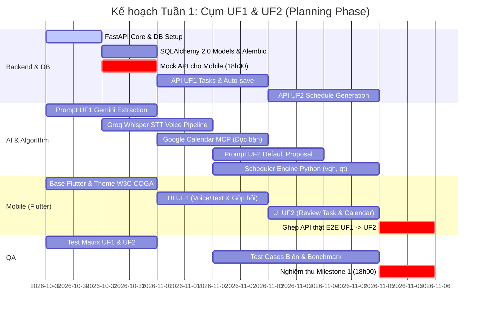

# KẾ HOẠCH CHI TIẾT TUẦN 1 (NGÀY 1 – 7): NỀN TẢNG & CỤM UF1 + UF2 (PLANNING PHASE)

> **Dự án:** ProPlan VA — Trợ lý ảo AI hỗ trợ lập kế hoạch cho người ADHD-I  
> **Mục tiêu tuần 1:** Hoàn thành hạ tầng cơ sở dữ liệu, bàn giao Mock API trong 48h, thông trọn vẹn luồng tiếp nhận công việc (**UF1**) và bẻ nhỏ việc kết hợp thuật toán xếp lịch Rolling Horizon (**UF2**) để có bản Demo Core Value ăn điểm ngay cuối Tuần 1.  
> **Người phụ trách chính:** Minh Trung (`mt` - Git Manager, Lead BA & AI Lead), Quốc Hưng (`vqh` - Backend Lead), Thanh An (`tan` - Mobile Lead), Doãn Thành (`thành` - QA Lead).

---

## 🎯 1. MỤC TIÊU TỐI THƯỢNG & TIÊU CHUẨN NGHIỆM THU TUẦN 1 (MILESTONE 1 DOD)

### Tiêu chuẩn Nghiệm thu Cuối Tuần 1 (Hạn chót: 18h00 Ngày 7):
1. **Môi trường & Cơ sở Dữ liệu:**
   - Chạy migration Alembic thành công tạo các bảng thực thể cốt lõi (`users`, `user_preferences`, `tasks`, `steps`, `sessions`) trên SQLite cục bộ và tương thích 100% với PostgreSQL.
   - Gán sẵn cấu hình mặc định (Default User Preferences: 25p làm / 5p nghỉ / buffer 1.2 / giờ rảnh 08:00–18:00).
2. **Luồng UF1 Hoàn chỉnh (End-to-End):**
   - Người dùng nhập công việc bằng **Giọng nói** (Groq Whisper STT) hoặc **Gõ chữ**.
   - Gemini 2.5 Flash trích xuất 4 trường bắt buộc (`Nội dung`, `Phạm vi`, `Khung giờ rảnh`, `Deadline`) với độ trễ $\le 2.0\text{s}$.
   - Nếu thiếu hoặc mâu thuẫn: Hiển thị bản tóm tắt trực quan và **gộp tất cả câu hỏi làm rõ trong 1 màn hình duy nhất** (không hỏi lắt nhắt nhiều vòng, không tự đoán dữ liệu).
   - Nếu người dùng ấn Back hoặc thoát app: Dữ liệu tự động lưu nháp (`status = 'draft'`) vào Hộp nháp.
3. **Luồng UF2 Hoàn chỉnh (End-to-End):**
   - AI (Gemini Flash) **chủ động sinh sẵn Default Decomposition Proposal** (2–5 bước, thời lượng dự kiến, gợi ý Micro-task 2 phút) kèm nút `"Tùy chỉnh theo ý tôi"` để giải phóng người dùng khỏi Tê liệt khởi động (ADHD Blank Canvas).
   - Thuật toán Python (`scheduler_engine.py`) xếp các phiên vào các khe rảnh trống ($T_{\text{free}}$) trước Deadline trong cửa sổ Rolling Horizon (2–3 tuần), nhân hệ số đệm mặc định $k_{\text{buffer}} = 1.2$.
   - Nếu $T_{\text{req}} > T_{\text{free}}$: Tính chính xác số phút thiếu hụt $\Delta T_{\text{deficit}} = T_{\text{req}} - T_{\text{free}}$ và thông báo rõ ràng; **tuyệt đối không tự ý dời các Task khác đã chốt**.
   - Khi người dùng bấm **Xác nhận**: Ghi vào lịch chính thức (`Official Schedule`).

---

## 👥 2. MA TRẬN PHÂN CÔNG 7 THÀNH VIÊN TRONG TUẦN 1

| Thành viên | Git Handle | Vai trò Tuần 1 | Phân hệ & Trách nhiệm Cụ thể |
| :--- | :--- | :--- | :--- |
| **Minh Trung** | `mt` | Git Manager, Lead BA & AI Lead | Thiết lập Git branching & PR template; viết System Prompt UF1 (trích xuất 4 trường gộp 1 vòng); viết System Prompt UF2 (Default Proposal + Micro-task 2p); bẫy Hallucination. |
| **Quốc Hưng** | `vqh` | Backend Lead & Scheduler Co-Lead | Kiến trúc FastAPI, `database.py`, JWT Auth, xuất Mock API JSON cho Mobile trước 18h Ngày 2; phối hợp `qt` xây dựng lõi `scheduler_engine.py`. |
| **Trang Tín** | `tn` & `kc` | Database Engineers | Thiết kế Schema SQLAlchemy 2.0 (`User`, `UserPreference`, `Task`, `Step`, `Session`), chạy Alembic migrations; CRUD API Tasks & Sessions. |
| **Quang Khải** | `kai` | Voice & MCP Lead | Tích hợp Groq Whisper STT (`whisper-large-v3-turbo`) cho UF1; tích hợp Google Calendar MCP đọc sự kiện bận ($T_{\text{busy}}$). |
| **Quốc Thịnh** | `qt` | Algorithm Engine Lead | Xây dựng module `free_time_calculator.py` và thuật toán kiểm tra khả thi $\Delta T_{\text{deficit}}$ trong `scheduler_engine.py` (không dời task khác). |
| **Thanh An** | `tan` & `kc` | Mobile Lead & UI | Dựng base Flutter, Theme W3C COGA dịu mắt; Màn hình UF1 (gộp câu hỏi làm rõ, auto-save nháp); Màn hình UF2 (Xem lịch 2–3 tuần, cảnh báo thiếu giờ $\Delta T$, nút Tùy chỉnh). |
| **Doãn Thành** | `thành` | QA / Test Lead | Xây dựng Test Matrix cho UF1 & UF2 (test thiếu giờ, test auto-save nháp, test mâu thuẫn thời gian); đo benchmark độ trễ LLM ($\le 2.5\text{s}$) và API CRUD ($\le 300\text{ms}$). |

---

## 📅 3. KẾ HOẠCH HÀNH ĐỘNG CHI TIẾT TỪNG NGÀY (DAY 1 $\rightarrow$ DAY 7)

### 📍 NGÀY 1 (Thứ Sáu): Khởi Động Hạ Tầng & Dựng Móng Kỹ Thuật
* **Backend:**
  - `vqh`: Viết file `backend/app/core/database.py` (AsyncEngine + SessionLocal + dependency `get_db()`) hỗ trợ cả SQLite và PostgreSQL. Viết `backend/app/main.py` bật CORSMiddleware.
  - `tn`: Viết các ORM Models cốt lõi trong `backend/app/models/`: `User`, `UserPreference` (có default config), `Task`, `Step`, `Session` theo chuẩn SQLAlchemy 2.0.
  - `mt`: Cấu hình file `backend/app/core/config.py` đọc các key `GEMINI_API_KEY`, `GROQ_API_KEY`. Cấu hình SDK `google-genai` gọi Gemini 2.5 Flash.
  - `kai`: Cấu hình thư viện `groq` trên Backend, test thử nghiệm STT nhận diện file âm thanh mẫu cho UF1.
* **Mobile:**
  - `tan` & `kc`: Khởi tạo base Flutter project, cài đặt `provider`, `dio`, `record`, `table_calendar`, `flutter_secure_storage`. Thiết lập Theme chuẩn W3C COGA (bảng màu Pastel, font chữ dễ đọc, Dark mode dịu nhẹ).
* **QA:**
  - `thành`: Xây dựng tài liệu Test Matrix chi tiết, lập danh sách 15 ca kiểm thử biên cho UF1 và UF2.

### 📍 NGÀY 2 (Thứ Bảy): Chạy Alembic Migration & Bàn Giao Mock API (MỐC CHỐT: 18h00)
* **Backend:**
  - `tn`: Chạy lệnh khởi tạo Alembic, sinh file migration `create_planning_tables`, chạy `alembic upgrade head` sinh file `proplan.db`.
  - `vqh`: Viết các Mock Endpoints trong `backend/app/api/v1/tasks.py` và `schedule.py` trả về dữ liệu mẫu:
    - `POST /api/v1/tasks/parse`: Trả về mẫu một Task trích xuất kèm câu hỏi làm rõ.
    - `POST /api/v1/schedule/generate`: Trả về danh sách Steps và Sessions đã xếp mẫu kèm $\Delta T_{\text{deficit}}$.
  - **⏰ Đúng 18h00:** `vqh` gửi tài liệu Swagger `http://localhost:8000/docs` và file JSON Contract cho `tan`.
* **Mobile:**
  - `tan`: Nạp Mock JSON vào `Dio` client, bắt đầu dựng màn hình UF1 và UF2 mà không cần đợi backend viết logic thật.
* **Algorithm & MCP:**
  - `kai`: Bắt đầu dựng service kết nối Google Calendar API qua MCP để đọc các khoảng thời gian bận ($T_{\text{busy}}$).
  - `qt`: Bắt đầu dựng khung hàm tính $T_{\text{req}}$, $T_{\text{free}}$ và $\Delta T$ trong `scheduler_engine.py`.

### 📍 NGÀY 3 & 4 (Chủ Nhật & Thứ Hai): Hiện Thực Hóa Luồng UF1 Thật (Gemini Flash & Voice STT)
* **AI & Voice:**
  - `mt`: Hoàn thiện hàm `extract_task_intent()` trong `ai_service.py`:
    - Gửi prompt `UF1_EXTRACTION_SYSTEM_PROMPT` kèm chuỗi nhập liệu lên Gemini Flash.
    - Ép kiểu trả về bằng Pydantic `TaskExtractionResult`.
    - Bọc `asyncio.wait_for(timeout=2.5)`. Nếu timeout, kích hoạt cơ chế dự phòng.
    - Bẫy lỗi: Đảm bảo Gemini không tự bịa deadline hoặc giờ rảnh.
  - `kai`: Hoàn thiện hàm `transcribe_audio()` trong `voice_service.py` dùng Groq Whisper (`whisper-large-v3-turbo`), đảm bảo chuyển voice tiếng Việt thành text trong $\le 500\text{ms}$.
* **Backend Core:**
  - `vqh` & `tn`: Nối hàm của `mt` và `kai` vào API `POST /api/v1/tasks/parse`. Khi trích xuất xong, tự động lưu bản tóm tắt vào bảng `tasks` (`status='draft'`). Viết endpoint `POST /api/v1/tasks/draft` phục vụ auto-save khi thoát app.
* **Mobile:**
  - `tan`: Hoàn thành giao diện màn hình nhập việc UF1: nút giữ nói (Voice) và ô nhập Text; màn hình Tóm tắt gộp câu hỏi làm rõ trong **1 màn hình duy nhất**; bắt sự kiện nút Back để gọi auto-save draft.

### 📍 NGÀY 5 (Thứ Ba): Hiện Thực Hóa Luồng UF2 Thật (AI Phân Rã & Scheduler Engine)
* **AI & Prompt:**
  - `mt`: Hoàn thiện Prompt `UF2_DECOMPOSITION_SYSTEM_PROMPT` cho Gemini Flash:
    - AI tự động sinh sẵn phương án chia bước chuẩn (**Default Proposal**) gồm 2–5 bước, thời lượng dự kiến và Micro-task khởi động 2 phút.
    - Ép kiểu bằng Pydantic `TaskDecompositionProposal`.
* **Thuật toán & Backend:**
  - `qt` & `vqh`: Hoàn thiện module `scheduler_engine.py`:
    - Đọc giờ bận từ `calendar_mcp_service.py` $\rightarrow$ xác định các khoảng rảnh ($T_{\text{free}}$).
    - Cắt Steps thành Sessions, nhân hệ số $k_{\text{buffer}} = 1.2$, chèn thời gian nghỉ 5 phút.
    - Kiểm tra khả thi: Nếu thiếu giờ, tính chính xác $\Delta T_{\text{deficit}} = T_{\text{req}} - T_{\text{free}}$ và trả về thông báo lý do; tuyệt đối không tự ý dời Task khác.
  - `tn`: Viết API `POST /api/v1/schedule/confirm` lưu các Session chính thức vào Database.
* **Mobile:**
  - `tan` & `kc`: Dựng màn hình duyệt kế hoạch UF2: Thẻ hiển thị tổng quan cả dự án, danh sách chi tiết các phiên trong 2–3 tuần đầu, Thẻ cảnh báo thiếu giờ $\Delta T$, nút `"Tùy chỉnh theo ý tôi"` và nút `"Xác nhận lịch"`.

### 📍 NGÀY 6 (Thứ Tư): Viết Unit Test & Tối Ưu Hóa (Pytest & Dart Analyze)
* **Backend:**
  - `vqh`, `mt`, `qt`: Viết test suite `pytest` trong `backend/tests/`:
    - Test trích xuất đầy đủ 4 trường $\rightarrow$ `is_complete == True`.
    - Test trích xuất thiếu trường $\rightarrow$ `is_complete == False`, danh sách câu hỏi gộp đầy đủ.
    - Test thuật toán xếp lịch: Trường hợp đủ giờ rảnh và trường hợp thiếu giờ rảnh báo đúng $\Delta T_{\text{deficit}}$.
    - Test giả lập Gemini phản hồi chậm $> 2.5\text{s}$ xem cơ chế fallback có hoạt động không.
* **Mobile:**
  - `tan`: Chạy `dart analyze` dọn sạch 100% warnings và errors. Kiểm tra độ phản hồi giao diện không drop frame dưới 60 FPS.
* **Ráp nối nội bộ:** Mobile chuyển cấu hình `baseUrl` từ Mock sang API thật trên máy Backend.

### 📍 NGÀY 7 (Thứ Năm): Nghiệm Thu Toàn Diện Milestone 1 (End-to-End Planning Demo)
* **Toàn đội ngũ:**
  - Cầm máy thật Android cài bản build APK v0.1, kết nối server Backend qua mạng LAN.
  - **Kịch bản nghiệm thu (UF1 $\rightarrow$ UF2):**
    1. Bấm nút nói: *"Tuần này mình cần làm báo cáo môn Phân tích Dữ liệu nộp trước 5h chiều Chủ Nhật, tối thứ 6 và sáng thứ 7 mình rảnh"*.
    2. Sau $\le 2\text{s}$, màn hình hiện bản tóm tắt đẹp mắt nhận diện đúng nội dung, deadline và giờ rảnh.
    3. Bấm thoát app đột ngột $\rightarrow$ Mở lại app vẫn thấy thẻ nhắc nháp (Auto-save draft).
    4. Bấm "Xác nhận tạo việc" $\rightarrow$ Màn hình UF2 lập tức hiển thị phương án chia 3 bước kèm việc khởi động 2 phút và lịch chi tiết từng phiên xếp vào tối thứ 6 và sáng thứ 7.
    5. Bấm "Xác nhận lịch" $\rightarrow$ Kế hoạch được lưu chính thức vào DB.
* **Ký duyệt Milestone 1:** `mt` (BA), `vqh` (BE Lead), `tan` (Mobile Lead) và `thành` (QA Lead) ký nghiệm thu Tuần 1, sẵn sàng cho Tuần 2 bước vào Thực thi tập trung (UF3 Focus Mode, DND, Báo thức Doze Mode và UF4 Cất suy nghĩ Raw Audio)!

---

## 🔒 4. QUY TẮC BẤT BIẾN (STRICT GUARDRAILS) CẦN GIÁM SÁT TRONG TUẦN 1

1. **Ở UF1:** CẤM Gemini tự ý gán hạn chót hoặc giờ rảnh nếu người dùng chưa nói. BẮT BUỘC gộp toàn bộ câu hỏi thiếu vào **1 lần hiển thị duy nhất**. Tự động lưu nháp khi thoát app.
2. **Ở UF2:** CẤM để LLM tự tính toán ngày giờ xếp lịch. Thuật toán Python đảm nhận 100% phép toán thời gian. **Tuyệt đối không tự ý dời các Task khác đã chốt**; nếu thiếu giờ rảnh, bắt buộc thông báo số phút thiếu hụt $\Delta T_{\text{deficit}}$ để người dùng tự quyết định.
3. **Về Giao diện Mobile:** CẤM dùng `AlertDialog` hỏi xác nhận; mọi thông báo thành công dùng SnackBar nhẹ nhàng có nút Hoàn tác trong 5 giây.
4. **Về Quản lý Git:** Mỗi PR phải có ít nhất 2 approvals (trong đó có `mt` review nghiệp vụ/guardrails). CẤM commit file `.env`, file `.db` hoặc file audio thử nghiệm lên Git.
