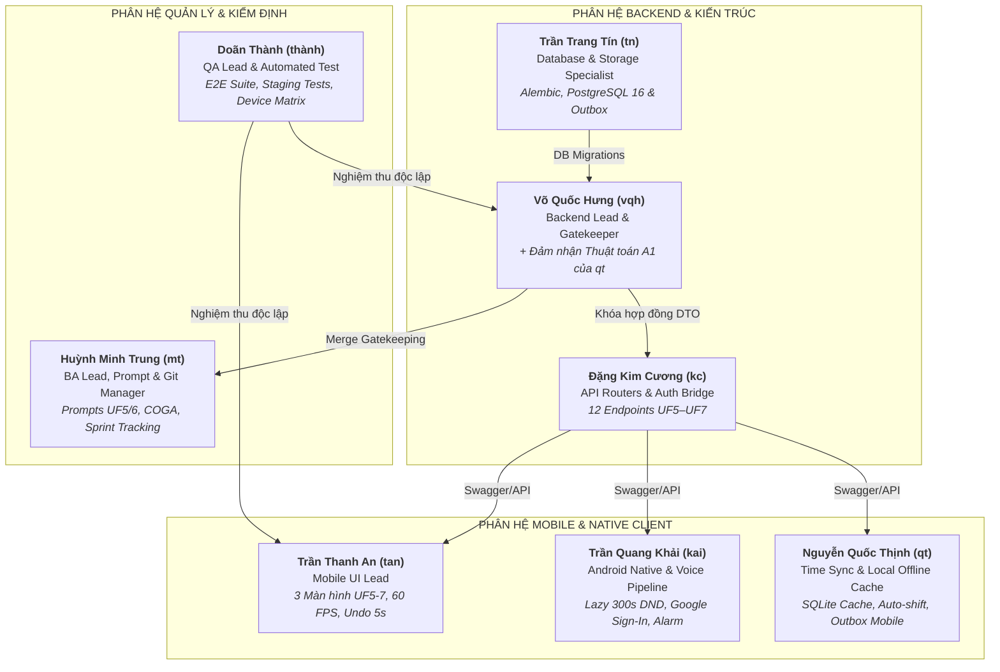
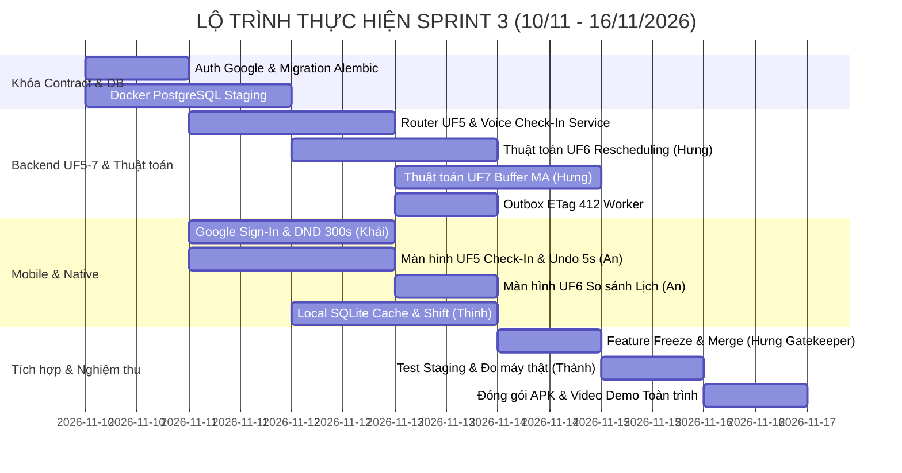

# KẾ HOẠCH SPRINT TUẦN 3 — HOÀN THIỆN THÍCH ỨNG (UF5–UF7), TÍCH HỢP LỊCH 2 CHIỀU & NGHIỆM THU E2E TOÀN TRÌNH

> **Dự án:** ProPlan VA (Trợ lý ảo AI hỗ trợ lập kế hoạch & nhắc lịch chủ động cho người trưởng thành ADHD-I)  
> **Thời gian:** 10/11/2026 – 16/11/2026 (Giờ Việt Nam — UTC+7)  
> **Phiên bản:** v3.0 (Cập nhật sau khi dọn sạch nợ kỹ thuật Sprint 2 & phân tách độc lập 8 roles)  
> **Người điều phối tích hợp (Gatekeeper):** Võ Quốc Hưng (`vqh`) — Backend Lead & Architecture Orchestrator  
> **Nguồn đối chiếu chuẩn:** [Project.md](../Project.md), [AGENTS.md](../AGENTS.md), [WEEK3_SPRINT_HANDOFF.md](backend/WEEK3_SPRINT_HANDOFF.md) và [schema Backend](backend/schema.md)

---

## 1. TỔNG KẾT NỀN TẢNG SPRINT 2 (ĐÃ HOÀN TẤT & SẠCH NỢ KỸ THUẬT)

Trước khi bước vào Sprint 3, toàn bộ nợ kỹ thuật lớn từ Sprint 2 đã được rà soát và giải quyết dứt điểm:

1. **[HOÀN THÀNH 100%] Dọn dẹp triệt để RAM Cache `_FAKE_DRAFTS_BY_OWNER` (Task 1):**
   - Đã xóa bỏ hoàn toàn 6 biến Dictionary RAM trong [`backend/app/services/draft_service.py`](backend/app/services/draft_service.py) (Commit `89e7c5a`).
   - 100% dữ liệu nháp và idempotency được lưu bền vững vào CSDL SQLite / PostgreSQL (`planning_drafts` và `command_receipts`).
   - Toàn bộ 106 tests trọng yếu và 319 tests toàn Backend đều **PASS 100%**.
2. **[HOÀN THÀNH 100%] Chuẩn hóa Timeout AI Hedged Execution & Non-blocking Cleanup (Task 5):**
   - Đã ghép nối nhánh `origin/update/AI-model-fallback` (Commit `db236a8`).
   - Khung B (UF2) ưu tiên Primary tới **7.5s**, ngắt cứng tại **9.0s** (tỉ lệ ăn AI thật đạt **77.8%**).
   - Bổ sung cơ chế non-blocking cancellation (`add_done_callback`), triệt tiêu hoàn toàn độ trễ socket khi timeout.
   - Mobile Flutter đã nâng `receiveTimeout` lên **20s** cho tác vụ tạo ứng viên chia bước.
3. **[HOÀN THÀNH 100%] Tối ưu N+1 Query trong `plan_service.py`:**
   - Hàm `list_tasks` đã được batch-load cố định $O(1)$ (`[8, 8, 8]` queries), 9/9 tests batch loading đều PASS.
4. **[HOÀN THÀNH 100%] Tích hợp Google Calendar Cơ sở (A22.1 & A22.2):**
   - Quốc Thịnh (`qt`) đã hoàn thành kết nối OAuth, đọc lịch bận và lưu trữ Fernet Envelope.

---

## 2. PHÂN TÁCH NHIỆM VỤ ĐỘC LẬP CHO 8 THÀNH VIÊN (CLEAR SEPARATION OF ROLES)

Nguyên tắc cốt lõi của Sprint 3: **Mỗi nhiệm vụ có ranh giới rõ ràng, có Input xác định, Output độc lập và tiêu chí nghiệm thu (DoD) đo đếm được. Triệt tiêu hoàn toàn việc dẫm chân lên nhau.**

---

### 2.1. Võ Quốc Hưng (`vqh`) — Backend Lead, Architecture Orchestrator & Integration Gatekeeper
- **Trách nhiệm chính:**
  1. **Đảm nhận Bài toán Thuật toán A1 của Thịnh (`qt`)**: 
     - Lập trình thuật toán dời lịch thích ứng UF6 (`rescheduling.py`): Tính toán tịnh tiến các phiên đã trôi qua (`shift_elapsed_sessions`), bảo vệ nghiêm ngặt các Task khác không bị xáo trộn (`allowed_task_ids`), tính toán số phút thiếu hụt $\Delta T_{\text{deficit}}$ so với Deadline:
       $$\Delta T_{\text{deficit}} = \max\left(0, \sum (Duration \times k_{\text{buffer}} + Break) - T_{\text{free}}\right)$$
     - Thuật toán trừ khoảng bận Google Calendar (Mốc C03): $T_{\text{free}} = T_{\text{user}} - T_{\text{busy}}$ kèm bộ lọc bảo vệ sự kiện của ứng dụng (Own-Event Protection).
     - Thuật toán **A20 Median Step** cho UF7: Lấy trung vị tỷ lệ $\frac{\text{actual}}{\text{planned}}$ của $N=15$ bước gần nhất, kẹp $[1.0, 2.0]$, làm tròn 0.05.
  2. **Người gác cổng Tích hợp (Integration Gatekeeper):**
     - Review toàn bộ Pull Requests từ Backend (`kc`, `tn`) trước khi merge vào nhánh `backend`/`dev`.
     - Kiểm soát tính tương thích của DTOs, hợp đồng API, và kiểm tra tính nhất quán của dữ liệu.
     - Khắc phục các xung đột mã nguồn (merge conflicts) khi ghép nối các phân hệ.
- **Input:** Đặc tả UF6/UF7 từ `Project.md`, mô hình dữ liệu từ `tn`, prompt từ `mt`.
- **Output bàn giao:** 
  - Module `rescheduling.py` và `adaptation_worker.py` hoàn chỉnh, có unit test đạt độ bao phủ $\ge 90\%$.
  - Toàn bộ PRs của Backend được review, test kỹ và merge sạch sẽ.

---

### 2.2. Nguyễn Quốc Thịnh (`qt`) — Time Synchronization & Local Offline Cache Specialist
- **Trách nhiệm chính:**
  1. **Cache Cục bộ trên Mobile (Local Offline Storage):**
     - Xây dựng cơ chế cache `RescheduleProposal` và `OfficialSchedule` cục bộ bằng SQLite/SharedPreferences trên Mobile.
     - Triển khai thuật toán **Auto-shift giờ đề xuất cục bộ** khi người dùng mở lại app trong trạng thái Offline (mất mạng): Tự động tịnh tiến các ô lịch đã trôi qua mà không làm crash ứng dụng.
  2. **Đồng bộ Thời gian Thực (Time Synchronization):**
     - Đối soát đồng bộ thời gian thực giữa native clock Android, Flutter Dart và Server UTC.
     - Bảo đảm định dạng thời gian ISO-8601 kèm timezone offset `+07:00` (Asia/Ho_Chi_Minh).
  3. **Hàng đợi Outbox trên Mobile:**
     - Quản lý hàng đợi Outbox trên Mobile để gửi lại các phản hồi Check-in và Thought metadata khi có mạng trở lại.
- **Input:** API Contract từ `kc`, mô hình `RescheduleProposal` từ Backend.
- **Output bàn giao:** 
  - Module SQLite cache và outbox queue trên Flutter.
  - Test case chứng minh app mở offline vẫn tịnh tiến lịch trôi qua chính xác, không lệch múi giờ.

---

### 2.3. Huỳnh Minh Trung (`mt`) — BA Lead, Prompt Engineer & Git Manager / Scrum Master
- **Trách nhiệm chính:**
  1. **Prompt Engineering:**
     - Thiết kế và chuẩn hóa System Prompts cho Gemini Flash tại UF5 (Voice Check-in 2 chiều) và UF6 (Lời giải thích dời lịch ấm áp, đồng cảm, cấm phán xét theo nguyên tắc *Guilt-free Adaptive Rescheduling*).
  2. **Giám sát Trải nghiệm W3C COGA:**
     - Kiểm tra thiết kế các màn hình mới: Đảm bảo mật độ tương tác tối đa 3–5 phần tử, không dùng hộp thoại Confirm mà dùng SnackBar Hoàn tác trong 5 giây, màu sắc dịu mắt.
  3. **Điều phối Git & Scrum:**
     - Theo dõi tiến độ Sprint hàng ngày, điều phối merge vào nhánh `dev`, lập biên bản nghiệm thu đồ án.
- **Input:** Cơ sở khoa học ADHD từ `Project.md`, phản hồi từ các buổi test.
- **Output bàn giao:**
  - File prompts chuẩn hóa cho UF5 và UF6 trong `ai_service.py`.
  - Biên bản đánh giá tuân thủ W3C COGA và kịch bản nghiệm thu cuối kỳ.

---

### 2.4. Đặng Kim Cương (`kc`) — Backend Router & Auth Bridge
- **Trách nhiệm chính:**
  1. **12 API Endpoints Mới (FastAPI):**
     - **UF5 (5 endpoints):** `/sessions/{id}/checkin-prompt`, `/checkin`, `/skip`, `/undo-skip`, `/timeout-check`.
     - **UF6 (4 endpoints):** `/proposals/reschedule`, `/current`, `/{id}/approve`, `/{id}/reject`.
     - **UF7 (3 endpoints):** `/settings/preferences`, `/adaptation-suggestions`, `/{id}/apply`.
  2. **Auth Bridge (Mốc C01):**
     - Triển khai endpoint `POST /api/v1/auth/google`: Tiếp nhận Google ID Token từ Mobile, giải mã và thẩm định chữ ký qua `google-auth`.
     - Cấp phát JWT Access Token và Refresh Token thật, thay thế hoàn toàn stub `resolve_dev_current_user` mà vẫn giữ Dev Token Bypass an toàn cho test suite.
- **Input:** Schema DTOs từ `schema.md`, thuật toán từ `vqh`.
- **Output bàn giao:** 
  - 12 endpoints đăng ký đầy đủ trên FastAPI với Swagger/OpenAPI tự động sinh chuẩn xác.
  - Bộ integration tests cho router pass 100%.

---

### 2.5. Trần Trang Tín (`tn`) — Database & Migration Specialist
- **Trách nhiệm chính:**
  1. **Alembic Migrations:**
     - Viết migration `20261108_01`: Tạo bảng `adaptation_suggestions`, bổ sung composite index cho `planning_drafts`, `session_runs` và `reminders`.
  2. **Calendar Outbox Worker (Mốc C04):**
     - Xây dựng `CalendarSyncWorker` chạy ngầm xử lý hàng đợi Outbox đồng bộ lên Google Calendar, xử lý Header `If-Match` chống xung đột ETag 412.
  3. **Môi trường PostgreSQL 16 Staging:**
     - Dựng và duy trì container Docker PostgreSQL 16 Staging (Port 5433).
     - Đảm bảo toàn bộ 319+ test cases chạy mượt mà trên cả SQLite lẫn PostgreSQL.
- **Input:** ERD từ `Project.md`, yêu cầu index từ QA và Lead.
- **Output bàn giao:**
  - Migration script Alembic sạch, rollback được (`downgrade`).
  - Container Docker PostgreSQL 16 Staging chạy ổn định kèm hướng dẫn kết nối.
  - Module `calendar_sync_worker.py` xử lý tốt ETag 412.

---

### 2.6. Trần Thanh An (`tan`) — Mobile Flutter UI Lead
- **Trách nhiệm chính:**
  1. **Màn hình Voice Check-in UF5:**
     - Giao diện trực quan phát âm thanh câu hỏi check-in.
     - Hiển thị 3 chip lựa chọn rõ ràng khi Bỏ qua: `[Hoãn phiên này làm sau]`, `[Bỏ qua phiên này]`, `[Bỏ toàn bộ bước này]`.
     - Thanh `SnackBar` Hoàn tác (Undo) trong 5 giây theo chuẩn W3C COGA (tuyệt đối không dùng Confirm Dialog).
  2. **Màn hình So sánh Lịch UF6:**
     - Thẻ trực quan so sánh Lịch Cũ vs. Lịch Mới đề xuất, hiển thị số phút thiếu giờ $\Delta T_{\text{deficit}}$ và lời động viên Guilt-free.
  3. **Màn hình Cài đặt UF7:**
     - Giao diện tùy chỉnh thời lượng phiên (15–60p), thời gian nghỉ (5–15p), hệ số đệm thủ công, chọn giọng đọc TTS.
  4. **Đóng gói Sản phẩm:**
     - Build bản APK Release cuối cùng, tối ưu đạt 60 FPS, vượt qua `dart analyze` không có lỗi.
- **Input:** Thiết kế UI từ `Project.md`, API DTOs từ `kc`.
- **Output bàn giao:**
  - 3 màn hình Flutter hoàn chỉnh, mượt mà.
  - File APK Release hoàn chỉnh kèm hướng dẫn cài đặt.

---

### 2.7. Trần Quang Khải (`kai`) — Android Native, Doze Mode & Voice Pipeline
- **Trách nhiệm chính:**
  1. **Native DND & Wakelock Controller:**
     - Xây dựng BroadcastReceiver / AlarmManager native trên Android để tự động tắt DND và giải phóng Wakelock sau 300 giây (5 phút) lazy timeout khi người dùng không phản hồi check-in, kể cả khi máy đang trong **Doze Mode**.
  2. **Google Sign-In Native:**
     - Tích hợp thư viện `google_sign_in` trên Flutter, xử lý luồng đăng nhập 1 chạm lấy `id_token` gửi về Backend Auth Bridge của `kc`.
  3. **Voice Audio Player:**
     - Xây dựng pipeline phát audio base64 câu hỏi Check-in từ backend (`edge-tts`), tự động fallback về `flutter_tts` trên máy khi mất mạng.
  4. **Bảo đảm Chuông Báo Thức:**
     - Đo đạc và bảo đảm chuông báo thức hết giờ phiên chính xác sai số $\le 1\text{s}$ trên các dòng máy Android phổ biến (Samsung OneUI, Xiaomi MIUI, Google Pixel).
- **Input:** Native handoff docs, Android Manifest permissions.
- **Output bàn giao:**
  - Mã nguồn native Java/Kotlin trong `mobile/android`.
  - Báo cáo đo đạc chuông báo thức và tự tắt DND trên thiết bị thật.

---

### 2.8. Doãn Thành (`thành`) — QA Lead & Automated Test Engineer
- **Trách nhiệm chính:**
  1. **Test Automation E2E:**
     - Viết bộ kịch bản test tự động E2E cho chuỗi thích ứng toàn trình: Hết giờ $\rightarrow$ Check-in 5 nhánh $\rightarrow$ Dời lịch UF6 $\rightarrow$ Cập nhật Buffer UF7.
     - Kiểm thử chuyên sâu kịch bản bấm Undo trong 5 giây của 3 chip Skip.
  2. **Kiểm thử PostgreSQL 16 Staging:**
     - Chạy kịch bản 34 bước Console E2E trên cơ sở dữ liệu PostgreSQL Staging thật.
  3. **Đo đạc Ma trận Thiết bị Thật:**
     - Thực hiện kiểm chứng thực tế trên các dòng máy Android: Đo Doze Mode, độ trễ chuông báo, kiểm tra không gọi STT trong phiên UF4.
  4. **Nghiệm thu Đồ án:**
     - Quay video minh chứng toàn trình từ UF1 đến UF7 trên máy thật và hoàn tất hồ sơ nghiệm thu kỹ thuật.
- **Input:** Mã nguồn hoàn thiện từ Backend và Mobile APK.
- **Output bàn giao:**
  - Bộ test tự động E2E mới bổ sung vào repository.
  - Biên bản nghiệm thu kiểm thử có log chi tiết, ma trận thiết bị và video demo toàn trình.

---

## 3. LỘ TRÌNH THỰC HIỆN 7 NGÀY (DAY-BY-DAY ROADMAP)

### Chi tiết Từng Ngày:

- **Ngày 1 (Thứ Ba - 10/11) — Khóa Hợp Đồng & Thiết Lập Staging:**
  - **Hưng + Cương:** Thống nhất Schema DTOs 12 endpoints UF5–UF7; Cương bắt đầu dựng Router UF5.
  - **Tín:** Dựng Docker PostgreSQL 16 Staging (Port 5433); chạy migration Alembic mới.
  - **Khải:** Bắt đầu dựng Google Sign-In trên Flutter và Native DND receiver.
  - **An:** Chuẩn bị layout các màn hình mới trên Flutter.

- **Ngày 2 (Thứ Tư - 11/11) — Voice Check-In UF5 & Auth Bridge:**
  - **Cương:** Hoàn tất 5 endpoints UF5 và endpoint `POST /auth/google`.
  - **Khải:** Nối Google Sign-In vào Auth Bridge; hoàn thiện Native DND receiver tự tắt sau 300s.
  - **An:** Dựng xong màn hình Voice Check-in với 3 chip Bỏ qua và SnackBar Undo 5s.
  - **Trung:** Hoàn thiện bộ Prompt đồng cảm UF6 và câu hỏi check-in UF5.

- **Ngày 3 (Thứ Năm - 12/11) — Thuật Toán UF6 & Local Cache:**
  - **Hưng:** Hoàn tất thuật toán UF6 dời lịch thích ứng (`shift_elapsed_sessions`) và tính $\Delta T_{\text{deficit}}$.
  - **Thịnh:** Hoàn thành SQLite local cache trên Mobile và thuật toán local auto-shift khi mở app offline.
  - **Cương:** Nối thuật toán của Hưng vào Router UF6 (`/proposals/reschedule`).
  - **An:** Dựng màn hình so sánh Lịch Cũ vs. Lịch Mới.

- **Ngày 4 (Thứ Sáu - 13/11) — Thuật Toán UF7 & Outbox Calendar:**
  - **Hưng:** Hoàn tất thuật toán **A20 Median Step** và worker quét định kỳ `adaptation_worker.py`.
  - **Tín:** Hoàn thành `CalendarSyncWorker` chạy ngầm xử lý ETag 412.
  - **An:** Dựng xong màn hình Cài đặt UF7.
  - **Cương:** Hoàn thành 3 endpoints Cài đặt UF7.

- **Ngày 5 (Thứ Bảy - 14/11) — Khóa Mã Nguồn & Ghép Nối Hệ Thống (Feature Freeze):**
  - **Hưng (Gatekeeper):** Tiến hành review toàn bộ PRs từ Backend; kiểm tra tính nhất quán; merge vào nhánh chính; chạy bộ test 319+ tests trên PostgreSQL Staging.
  - **An + Khải + Thịnh:** Hoàn tất ghép nối API Backend vào toàn bộ giao diện Mobile.
  - **Thành:** Nhận bản build đầu tiên, bắt đầu chạy bộ test tự động E2E.

- **Ngày 6 (Chủ Nhật - 15/11) — Đo Đạc Thiết Bị Thật & Tinh Chỉnh:**
  - **Thành + Khải:** Đo đạc thực tế trên ma trận máy thật (Doze mode, chuông báo thức $\le 1\text{s}$, DND tắt sau 300s, kiểm tra không gọi STT trong phiên UF4).
  - **Hưng + Tín:** Giám sát log server và hiệu năng truy vấn DB PostgreSQL.
  - **An:** Tinh chỉnh các lỗi giao diện nhỏ, bảo đảm mượt mà 60 FPS.

- **Ngày 7 (Thứ Hai - 16/11) — Đóng Gói APK & Nghiệm Thu Cuối Kỳ:**
  - **An:** Đóng gói file APK Release hoàn chỉnh kèm mã SHA kiểm tra.
  - **Thành + Trung:** Quay video minh chứng toàn trình từ UF1 đến UF7 trên máy thật; hoàn tất biên bản nghiệm thu đồ án để nộp giảng viên.

---

## 4. TIÊU CHUẨN NGHIỆM THU HOÀN THÀNH (DEFINITION OF DONE — DoD)

- [ ] **Mã nguồn Backend:**
  - 100% tuân thủ cú pháp SQLAlchemy 2.0 và Pydantic v2.
  - 12 endpoints mới đăng ký đầy đủ trên FastAPI và Swagger Docs.
  - Không còn bất kỳ biến RAM cache in-memory nào trong mã nguồn.
- [ ] **Mã nguồn Mobile:**
  - Vượt qua kiểm tra `dart analyze` không có warning/error.
  - Duy trì tốc độ khung hình 60 FPS, không giật lag.
  - Màn hình Focus tuân thủ tuyệt đối chuẩn 1-Step UI (chỉ hiện bước/phiên hiện tại).
  - Mọi thao tác Bỏ qua đều có SnackBar Hoàn tác trong 5 giây (W3C COGA).
- [ ] **Bảo vệ Nghiệp vụ Cốt lõi (Strict Guardrails):**
  - Đồng hồ đếm ngược hết giờ KHÔNG tự động complete session.
  - Đóng app KHÔNG phải là đồng ý dời lịch (lưu `pending_approval`, tịnh tiến giờ thực tế khi mở lại app).
  - Thuật toán dời lịch không tự ý thay đổi các Task khác ngoài `allowed_task_ids`.
  - DND tự động tắt sau 300s timeout nếu không phản hồi check-in.
- [ ] **Độ bao phủ Kiểm thử:**
  - Toàn bộ test suite backend $\ge 319$ tests pass trên cả SQLite và PostgreSQL 16 Staging.
  - Kịch bản Console E2E pass 100%.
- [ ] **Bảo mật & Tích hợp:**
  - Google Sign-In cấp phát JWT thật; token được mã hóa an toàn.
  - Đồng bộ Google Calendar 2 chiều xử lý tốt xung đột ETag 412.
- [ ] **Đóng gói Sản phẩm:**
  - File APK chạy ổn định trên máy thật Android 12–14.
  - Video demo minh chứng đầy đủ 7 luồng UF1–UF7 trên thiết bị thật.
